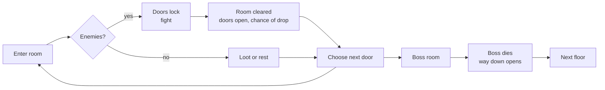
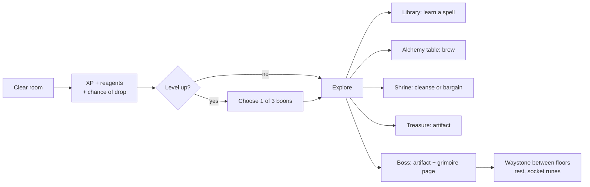

# Ossuary — Game Design Document

Sep 24, 2026 · @Azyrion

## Vision and pillars

Ossuary is a top-down roguelike with RPG elements, set in the high/dark fantasy world of Eda. It borrows the room-by-room structure of The Binding of Isaac, but its identity is magic: every run is a spellbook the player assembles from spells, runes, magical artifacts and potions they brew themselves. It runs in desktop browsers (a mobile version may come later); its rooms, creatures and effects are built in code, with Tripo3D for special models (the mage, bosses where wanted). It is a hobby project; the current goal is to prove the core loop is fun before adding content.

**Pitch:** An apprentice mage descends beneath a ruined chapel of Eda, room by room, floor by floor. They learn spells from torn grimoire pages, bind cursed artifacts to their will, brew potions from what the dead leave behind, and grow stronger with every floor. Every run builds a different mage; what the mage learns is never fully lost.

**Pillars**

- **Magic is the build.** Spells, runes, artifacts and potions interact with each other and with the room. The fun is discovering combinations, not collecting stat-ups.
- **Readable twin-stick combat.** Fixed rooms, four-direction casting, clear telegraphs. Every hit the player takes should feel fair.
- **Growth you can feel.** RPG levels and choices inside a run; knowledge (recipes, spells, bestiary), the freed dead and a few powers that carry over between runs.
- **Alchemy as a second game.** Unknown potions to identify, reagents to harvest, recipes to discover. Every potion can be drunk or thrown.
- **Eda, not Isaac.** The room structure is borrowed; the world, magic schools, creatures and tone come from Eda. Medieval high fantasy turned dark: crypts, chapels, relics, the unquiet dead.
- **A pixel-art diorama.** Each room is a candle-lit cutaway diorama drawn in pixel-art 3D: models and torchlight drawn small and blown up in whole pixels, with outlines.
- **Tripo in, game out.** Any model exported to the checklist drops into the game without hand-fixing.

**What separates Ossuary from an Isaac clone**

| Isaac | Ossuary |
| --- | --- |
| One attack (tears) changed by items | A free cantrip plus two active spells with mana, cooldowns and runes |
| Pills with random effects | Potions to identify, brew from reagents, and drink or throw |
| Items are mostly passive stat and tear changes | Artifacts include foci that reshape the cantrip, cursed artifacts and set bonuses |
| No character growth inside a run beyond items | XP, levels, attributes and boon choices |
| Rooms are obstacles | Rooms react to magic: oil burns, water conducts, braziers empower |
| Bombs: placed, then wait | Blast glyphs: chalked runes the cantrip sets off from afar, chaining and burning in the bolts' colour |
| Unlocks are new items | The Vigil: the dead the mage frees become its people, and it opens to the magic the mage knows |

**Rule of thumb:** when a system is borrowed from Isaac, it gets a magic take. It answers to the cantrip, glyphs, spells, schools or the room, or to the dead of Eda (souls, shades, the Ferryman), never only to walking over it and waiting. Unscheduled ideas in that spirit, such as more pickup families, are collected in `docs/ideas.md`.

**Scope:** hobby project for desktop browsers, played with keyboard or gamepad. A mobile version may come later and is not designed for until then. No monetisation plans.

## Core loop

A run is a descent through floors; each floor is a grid of rooms ending in a boss. Death ends the run and everything restarts from floor 1.



One room at a time fills the screen. Entering a room with enemies locks its doors until every enemy is dead; clearing it opens the doors and may drop a reward. The boss room's defeat opens a trapdoor to the next floor.

**Prototype 0.3 has:** one hand-built floor of six rooms, one boss, a win screen after the boss. **Target (M1):** three generated floors with rising difficulty, and every run differs in map, room count and room types; a run takes 20 to 40 minutes.

### Game loop changes for the magic RPG

The room loop stays; what the player gets from each room, and what they do between rooms, changes.



| Loop element | Isaac-style prototype | Magic RPG version |
| --- | --- | --- |
| Room reward | Chance of a heart | XP always; reagents from enemies; chance of heart, mana vial or coin |
| Growth in a run | Items only | Items plus levels: each level offers 3 boons, pick 1 |
| Special rooms per floor | Treasure, boss | Treasure, ordeal, boss, merchant, secret, library, alchemy table or shrine (alternating); sometimes a bone altar or locked vault |
| Between floors | Trapdoor, straight on | Waystone room: full mana, socket runes into spells, sell or brew |
| Death | Everything lost | Run items lost; Arcane Dust, the freed, spell knowledge, discovered recipes and bestiary entries kept; the run's echo waits at the Vigil |
| Run start | Same hero, same stats | At the Vigil: a discipline, vows and gifts inscribed in the Great Circle, then the Ferryman's crossing |

**Pacing target:** level 2 after the first two rooms, about 3 levels per floor, first active spell no later than the first library or boss. Floor 1 should give a clear build direction (a school) by its boss.

## Player

The player moves in eight directions and casts in four, independently, with three hearts of health counted in halves.

| Action | Keyboard | Gamepad |
| --- | --- | --- |
| Move | W A S D | Left stick |
| Cast | Arrow keys (last pressed wins) | Right stick or face buttons |
| Blast glyph (M2) | Space | Left trigger |
| Pause | Esc or P | Start |
| Mute | M |  |

The touch twin-stick from prototype 0.3 stays in the code but is frozen: it isn't extended or tested, and new actions get no touch controls until a mobile port.

Planned inputs for the magic layer: spell 1 and 2 on Q and E (LB and RB) and potion on F (Y; hold to throw). See Magic system.

**Starting stats (prototype 0.3)**

| Stat | Value |
| --- | --- |
| Move speed | 4.3 tiles/s |
| Damage per bolt | 3.5 |
| Fire delay | 0.36 s |
| Bolt speed | 8.8 tiles/s |
| Range | 6.8 tiles |
| Health | 3 hearts (6 halves) |
| Invulnerability after a hit | 1.0 s |

Hearts can't be picked up at full health. The hero faces the cast direction while casting, otherwise the move direction.

**Animation mapping.** Legs play idle, walk or run by speed; the upper body can overlay a cast, a hit reaction or a gesture (drinking, eating); death plays on the whole body. Extras are used when a model has them.

| Game state | Clip | Body part | Notes |
| --- | --- | --- | --- |
| Standing | standing\_relax | Whole body | Loops |
| Moving | run | Whole body | Plays at up to 3× speed to match move speed |
| Moving slowly | walk | Whole body | Below 30% of full speed (a gamepad stick barely tilted) the walk takes over from the run |
| Casting | cast\_a\_spell | Upper body | Only the forward thrust is replayed per bolt |
| Taking damage | hit\_to\_body\_01 | Upper body | Played at 1.6× |
| Healed by a heart | Drink Potion | Upper body | Only the draught, around the moment the flask is raised; ready for the potions of M5 |
| Standing still a while | Eat | Upper body | A fidget after 9 to 16 s standing still; moving or casting puts it away |
| Death | fall or defeat\_03 | Whole body | One of the two at random; the end screen waits for it; a model without a death clip topples over instead |

## Combat and enemies

Combat is Isaac-style: bolts travel in straight lines, drop to the floor at the end of their range, and are blocked by rocks and walls. Enemies deal contact damage and some shoot slow, readable projectiles.

- Bolts inherit 30% of the player's movement and alternate between two spawn points, like Isaac's two eyes.
- Hits flash the enemy white and knock it back; deaths leave a stain on the floor.
- Every attack is telegraphed: a glow, a shake or a pause before it lands.
- Contact and shots cost half a heart; touching a boss costs a full heart.

**Enemies in prototype 0.3** (placeholder shapes; M4 replaces them with the enemies built in code below)

| Enemy | HP | Behaviour | Isaac equivalent |
| --- | --- | --- | --- |
| Rotling | 10 | Walks straight at the player with a wobble | Gaper |
| Wisp | 7 | Flies over rocks, drifts, fires an aimed orb every 2 to 3 s | Fly with shot |
| Crypt hound | 12 | Wanders; charges when lined up with the player; stunned on impact | Charger |
| Hollow Warden (boss) | 120 | Walks, 12-shot radial burst, three aimed 3-shot volleys; summons two Rotlings below 50% | Floor 1 boss |
| Drowned Abbess (boss, M1) | 120 | Drifts; wails fans of aimed shots; sinks into the floor and follows the mage as a ripple that can't be hurt, then a widening ring marks where she surfaces with a ring of shots; summons Wisps below 50% | Pin |
| Pyre Knight (boss, M1) | 135 | Stalks; leaps at where the mage stands (the landing spot glows) and lands with a shockwave ring; charges in a line until a wall stuns him; sprays cones of embers; summons Crypt hounds below 50% | Monstro |

When a boss falls, the foes it called fall with it, so no fight drags on while its rewards rise.

**Enemies built in code** (decided with the owner 2026-09-29; M4 makes them foes). The owner liked the code-built
models in the pixel look and chose code over Tripo for the enemies. Ten were drawn up as options
(`src/actors/modelOptions.ts`, shown by the dev menu). On the owner's second look each took its school's light
(runes, crystals, rune rings, motes, spirit fire); on the third (2026-09-30) they became critters and small fantasy
creatures rather than the dead: round, big-eyed and smaller than the mage. All ten are divided over the three floors:

| Floor | Enemy (placeholder name) | School | The look, and how it could fight |
| --- | --- | --- | --- |
| 1 | Sporeling | Umbral | A mushroom that walks, hopping on stubby feet; its violet-spotted cap puffs spores that blind |
| 1 | Vesper Moth | Hallow | A fuzzy moth drawn to candles, gold eyespots on its wings; flutters in loops and dusts the mage with light |
| 1 | Rune Beetle | Storm | A scarab with runes lit on its shell; charges in a line, and its wing-cases part to throw a spark |
| 1 | Urn Mimic | Ember | A kiln-fired urn on stubby feet with a fire in its belly; waits among the urns, peeks, then spits embers |
| 2 | Mire Toad | Frost | A fat toad with frost crystals on its back; leaps, and breathes a cone of cold |
| 2 | Cistern Lurker | Storm | A round-headed eel rising from a rune-edged pool, a glowing lure on each whisker; spits sparks, then dives |
| 2 | Lantern Jelly | Hallow | A jellyfish floating like a lantern, a little flame in its bell; drifts close and pulses light |
| 3 | Cinder Salamander | Ember | A salamander with a crest of flame; scurries, and leaves a trail of burning ground |
| 3 | Hex Imp | Umbral | A big-eared imp on bat wings holding up a violet flame; blinks about the room and throws it |
| 3 | Rime Drakeling (elite) | Frost | A small dragon with ice crystals for horns and spines; breathes rime and takes to its wings |

Behaviour, health, sounds and the affinities (Enemy affinities, below) are M4's to design; a foe's school is a
starting point for them.

**The Bestiary (M4.5, decided 2026-09-30).** The owner liked the critters and wants a whole host more: small critters,
fantasy creatures and elementals, and new kinds of enemy behaviour. They come after M4, which builds the enemy
framework on the ten. Each is drawn up in code as a look first (the dev menu's gallery), chosen by the owner, then
made a foe. The rules of the ten hold: round, readable shapes; big eyes on the critters; a school's light; smaller than
the mage (elites and bosses aside); a floor each. The ideas to choose from are in `docs/ideas.md` (Bestiary).

**Spell effects in the same style (decided 2026-09-30).** The owner liked the Cinder Lance in the new style, so every
spell's effect is redone in it, and `docs/effects.md` is the guide for every effect to come.

**Enemy asset needs per creature:** a run or move clip, an attack clip, a hit reaction and a death. The hero's layered animation system is reused for enemies.

**Planned archetypes:** a slow tank that blocks shots, an enemy that splits on death, a burrower that surfaces under the player, a turret bound to a wall.

## Magic system

The mage has three layers of magic: a free cantrip that is always firing, two active spell slots paid with mana, and potions. Five schools of magic apply status effects that combine with each other and with the room.

**Layers**

| Layer | Input | Cost | Changed by |
| --- | --- | --- | --- |
| Cantrip (today's bolt) | Arrow keys, 4 directions | Free | The equipped focus artifact, boons, passive artifacts |
| Spell 1 and 2 | Q and E / LB and RB | Mana + cooldown | Runes socketed into the spell, school mastery |
| Potion | F / Y, hold to throw | One potion from the belt | Alchemy boons, some artifacts |

**Mana:** a blue bar under the hearts, 100 at start. It refills 4 per second out of combat and 1 per second in combat; killing an enemy with the cantrip gives 3. Mana vials drop from rooms like hearts, and like hearts stay on the floor while mana is full; the first time in a run the mage walks into one it can't take (a vial at full mana, a heart at full health) a message says why. While the mage knows no spell nothing spends mana, so loot gives an obol in place of a mana vial until the first spell is learned.

**Spells aim like the cantrip:** a spell fires in the current cast direction, or the move direction when not casting. Some spells are placed at the mage's feet or target the nearest enemy.

**Schools and status effects**

| School | Status effect | Strong against | Feel |
| --- | --- | --- | --- |
| Ember | Burn: damage over time, spreads to burning ground | Rot and undead flesh | Aggressive, area |
| Frost | Chill slows; 3 stacks freeze; frozen enemies shatter for bonus damage | Fast enemies | Control |
| Storm | Shock: chains to nearby enemies, brief stun | Groups, anything wet | Burst |
| Hallow | Sanctified: takes more damage, can't regenerate | Wraiths, the Warden's kind | Precise, defensive |
| Umbral | Hex: drains life or mana back to the mage | Living things | Risky, sustain |

**Element reactions** (two effects on the same enemy or tile)

| Combination | Reaction |
| --- | --- |
| Ember + Frost | Steam cloud: enemies inside can't aim |
| Frost + Storm | Shatter: frozen enemy explodes into ice shards |
| Ember + Storm | Overload: small explosion, knockback |
| Hallow + Umbral | Eclipse: the enemy is removed from the fight for 3 s, then takes all stored damage |
| Umbral + Ember | Blackfire: burn that never goes out until the enemy dies |

**Rooms react to magic.** Oil puddles ignite, water conducts shock across the whole puddle, braziers lit by Ember empower Ember spells in that room, cobwebs burn away to open shortcuts, gravestones can be shattered by Frost. This is the main systemic difference from Isaac and gives room templates a second purpose.

**As built in M3** (numbers in `data/spells.json`, `data/magic.json` and `CFG`; see `docs/M3-plan.md`):

- Ember, Frost and Storm, two spells each (the six in the Spells table without Phoenix Step, Winter's Breath and
  Thundercall). The run starts with no spell; the first comes from floor 1's library or its boss.
- Burn: 2.5 damage a second. Chill: each stack 22% slower, thawing after 3 s; the third freezes for 2 s (frozen foes
  take ×1.5 and can't act), then 1.5 s before it can freeze again. Shock: a 0.35 s stun, and the next hit on the foe
  leaps half its damage to a neighbour. Bosses slow (two stacks at most) but never freeze, and are stunned at most
  once every 3 s.
- Shatter and Overload are the two reactions; Steam waits. Reaction names rise in the air so players learn them.
- Rooms that react: oil burns for 5 s (walking foes on it burn, the mage in it is hurt) and is then spent; water is
  shallow (wading at 60% speed), carries a shock to everything standing in it, the mage too, and freezes over from
  Frost into ice crossed at full speed; fire melts it. The drowned floor grows real puddles in its fights.
- A cantrip kill gives 3 mana; kills by spells don't (burn keeps whoever lit it). Spells are refused in the
  merchant's warded shop.

**Runes** modify one spell each and are socketed at waystones. Each spell has 1 socket (2 with a boon).

| Rune | Effect |
| --- | --- |
| Split | Projectile spells fire 3 weaker copies in a fan |
| Echo | The spell repeats 0.5 s later at 50% power |
| Seeking | Projectiles curve towards enemies |
| Wide | Area spells +50% radius, −20% damage |
| Swift | −30% cooldown, +20% mana cost |
| Blood | Costs half a heart instead of mana when mana runs out |

**Enemy affinities (RPG layer):** every enemy has one weakness (+50% damage) and one resistance (−50%), shown in the bestiary once discovered. Placeholder examples: Rotlings are weak to Ember; Wisps resist Umbral and are weak to Hallow; the Hollow Warden resists Frost.

## Spells

Fifteen spells, three per school, are enough for M1 to M5. Spells are learned from grimoire pages (library rooms, bosses, rare drops); a new spell replaces one of the two slots, and the replaced one can be rebought at the next library. All names are placeholders until the Eda lore arrives.

| School | Spell | Mana | Cooldown | Effect |
| --- | --- | --- | --- | --- |
| Ember | Cinder Lance | 20 | 2 s | Piercing fire beam, burns everything in a line |
| Ember | Pyre Seal | 35 | 8 s | Rune on the floor erupts after 1 s in a ring of flame, leaves burning ground |
| Ember | Phoenix Step | 25 | 6 s | Short dash through enemies, leaving a fire trail; 0.3 s invulnerable |
| Frost | Rime Shards | 15 | 1.5 s | Shotgun of 5 ice shards, each applies Chill |
| Frost | Glacial Wall | 30 | 10 s | Wall of ice across the cast direction; for 5 s it stops enemies and their shots (not the mage's bolts), then shatters on enemies near it |
| Frost | Winter's Breath | 40 | 12 s | Cone that freezes everything it touches for 2 s |
| Storm | Arc | 15 | 1 s | Lightning hits the nearest enemy and chains to 3 more |
| Storm | Thundercall | 40 | 10 s | Three strikes on random enemies; hits on water spread to the whole puddle |
| Storm | Static Mantle | 30 | 15 s | For 6 s, shocks any enemy that touches the mage and throws it back |
| Hallow | Lantern of Vigil | 30 | 14 s | Floating lantern follows the mage and fires at enemies for 8 s |
| Hallow | Consecrate | 35 | 12 s | Holy ground at the feet: the mage heals half a heart per 3 s inside, undead take damage |
| Hallow | Judgement | 50 | 16 s | Beam from above on the strongest enemy after 1 s delay, huge damage |
| Umbral | Hex Bolt | 15 | 2 s | Slow bolt, applies Hex; hexed enemies return mana on hit |
| Umbral | Grasp of the Grave | 30 | 10 s | Hands rise from the floor and root enemies in an area for 2 s |
| Umbral | Soul Harvest | 0 | 20 s | Consumes all Hex stacks in the room: damage per stack, +1 mana per stack |

**Spell data shape**

```json
{
  "id": "cinder_lance", "name": "Cinder Lance", "school": "ember", "shape": "beam",
  "mana": 20, "cooldown": 2, "damage": 8, "status": { "burn": 3 },
  "params": { "range": 7, "width": 0.3 },
  "tags": ["beam", "pierce"], "color": "#ff8a3a", "icon": "lance",
  "text": "A beam of fire pierces every foe in a line and sets them burning",
  "lore": "The pyre-keepers lit the chapel's lamps from across the nave..."
}
```

`shape` picks a behaviour in code; M3 built beam, placed, shotgun, wall, chain and self, and cone, dash and summon come with the spells that need them. `params` holds the numbers only the shape reads (each shape's list is checked). Everything else is data, so new spells are mostly new entries. Tags decide which runes and boons apply; sockets arrive with runes (M6).

**Casting animation:** the hero's `cast_a_spell` window is reused for every spell; strong spells can play a longer part of the same clip. A second Tripo clip (a two-handed channel) would help beams and cones later.

**Spell knowledge (M3.7, built 2026-09-29).** The mage comes to know spells in stages, and what the mage knows is kept between runs (in the browser until the Vigil, the hub between runs, takes it over; see RPG progression: Between runs).

| Stage | Reached when | What a spell's panel shows |
| --- | --- | --- |
| Seen | Its page is first approached | Name, school (in its colour), the one-line effect |
| Learned | A page of it is taken | Adds mana, cooldown, damage and statuses |
| Used | It has been cast about ten times (over all runs) | Adds its lore and the reactions it can set off (Frost and Storm: Shatter) |
| Upgraded | Runes or school mastery change it (M6) | Adds what changed it |

- **At a page:** coming within about two tiles of a grimoire page (library, boss, loose) shows a small panel above it at the spell's stage, so the library's choice of three is an informed one; walking into the page still takes it.
- **In the inventory:** the spells tab keeps the two carried slots on top, then one section per school, shown only once a spell of that school has been learned. A school's section lists every spell of it the mage has met (carried ones marked Q or E, given-up ones dimmed) and a sealed blank entry for each one not yet met, so there is more to find. Each entry's description is filled to its stage.
- **Dev menu:** know every spell, and forget everything.

## Artifacts

Artifacts replace Isaac's items. There are four kinds: one focus that reshapes the cantrip, any number of passive artifacts, cursed artifacts with a price, and sets that reward collecting pieces. The prototype's Ember Sigil becomes the first passive artifact.

| Kind | Slots | Role |
| --- | --- | --- |
| Focus (wand, staff, orb, tome) | 1; picking a new one drops the old | Changes how the cantrip fires: count, path, element |
| Passive | Unlimited, stack | Stats, triggers, new behaviours |
| Cursed | Unlimited | Strong effect plus a drawback; cleansed at a shrine, which removes the drawback and halves the effect |
| Set piece | Unlimited | 2 or 3 pieces of a set grant a bonus |

**Artifacts per floor: at least 3; a budget of 6, and now and then luck gives more.** Three sources are on every floor; optional ones can add up to three more, enough for the merchant, a vault and a bone altar on the same floor. The boss's choice of two counts as one, since only one can be taken. Some finds sit outside the budget, so a lucky floor can hold more (decided 2026-09-28): a gilded reliquary chest (see Containers), and from step 4 of M2 the secret room.

| Source | Artifacts | Per floor | Arrives |
| --- | --- | --- | --- |
| Treasure room | 1 on a pedestal | Always | 0.3 |
| Ordeal | 1 after the last wave | Always | M1 |
| Boss | Choice of 2, take 1 | Always | M1 |
| Bone altar | 1 for a heart container, often cursed | Sometimes | M1 |
| Room-clear drop | 1, rare (about 3%) | Sometimes | M1 |
| Merchant | 1 for coins | While the budget lasts | M2 |
| Secret room | 1, often cursed | Sometimes | M2 |
| Locked vault | 1 behind a key | Sometimes | M2 |

The generator places the three guaranteed sources first, then gives artifacts to optional sources while the floor has budget left, in an order shuffled with the floor's seed so no optional source is always the one left out; optional sources without one hold obols, keys, glyphs or hearts instead (the merchant sells only wares, the vault holds a hoard, the secret room coffers and a chest, and a bone altar without an artifact isn't placed). Room-clear drops only roll while budget is left. Each artifact lists the pools it can appear in (treasure, ordeal, boss, altar, merchant, secret, vault); cursed artifacts live mostly in the altar and secret pools.

**Foci**

| Focus | Cantrip becomes | Arrives |
| --- | --- | --- |
| Apprentice's Wand (start) | Single bolt, as now | 0.3 |
| Twin-Headed Staff | Two parallel bolts, −30% damage each | M1 |
| Drowned Orb | Bolts bounce off walls twice, +35% range | M1 |
| Shepherd's Crook | Bolts fly out and back like a boomerang, passing through foes and hitting each twice, −20% damage | M1 |
| Mourner's Censer | Three bolts fan out, −40% damage each and −40% range | M2 (added 2026-09-28) |
| Gravewarden's Spear | One slow, heavy, larger bolt: ×2.4 damage, passes through every foe, casts 1.9× slower | M2 (added 2026-09-28) |
| Serpent Rod | Bolts weave from side to side like a serpent, +10% damage | M2 (added 2026-09-28) |
| Emberwood Wand | Bolts apply Burn, −10% range | M3 |
| Tome of Whispers | Slow bolts that curve towards enemies, +40% damage | M3 |

**Passive artifacts (first list)**

| Artifact | Effect | Arrives |
| --- | --- | --- |
| Ember Sigil | Damage +1.5, bigger white-hot bolts (exists in 0.3) | M1 |
| Pilgrim's Boots | Move speed +0.6; the mage can walk over pits | M1 |
| Rosary of Haste | Cantrip fire delay −25% | M1 |
| Bone Lens | Cantrip pierces one enemy | M1 |
| Reliquary Shard | +1 heart container, fully healed | M1 |
| Saint's Knucklebone | Enemies burst into four bolts (north, east, south, west) when they die | M1 |
| Mourning Bell | When the mage is hit, a bell tolls and a ring of 8 bolts bursts outwards | M1 |
| Mason's Chisel | Bolts crack rocks; three hits break one | M1 |
| Raven's Eye | One cast in five is a strong one: bigger white-hot bolts that strike thrice as hard | M2 (added 2026-09-28) |
| Cracked Mirror | A bolt that strikes a foe splits into two halves that fly on either side of it | M2 (added 2026-09-28) |
| Hawk-Bone Fletching | Bolts fly 35% faster and 30% farther | M2 (added 2026-09-28) |
| Ram's Skull | Bolts knock foes back 2.6 times as far, damage +0.5 | M2 (added 2026-09-28) |
| Leech Jar | Every tenth foe put to rest gives back half a heart, as a red mote | M2 (added 2026-09-28) |
| Candle Moth | A pale moth flutters about the mage and stings the nearest foe with a lesser bolt every second or so | M2 (added 2026-09-28) |
| Weeping Skull | A skull circles the mage, swallowing enemy shots it meets and biting foes it passes | M2 (added 2026-09-28) |
| Unbroken Oath | A fight won without being hurt returns half a heart | M2 (added 2026-09-28) |
| Mana Lantern | Max mana +40 | M3 |
| Candle of the Vigil | Each room clear refills 25 mana | M3 |
| Frostbitten Ring | Every 5th cantrip bolt applies Chill | M3 |
| Stormglass Pendant | Shocked enemies take +25% cantrip damage | M3 |
| Thurible of Ash | Burning enemies spread Burn when they die | M3 |
| Witch's Knot | Spells cost 20% less at half health or below (below half alone was too rare with 3 hearts) | M3 |
| Alchemist's Satchel | Potion belt +1 slot, reagents drop 30% more often | M5 |

**Cursed artifacts**

| Artifact | Gift | Price | Arrives |
| --- | --- | --- | --- |
| Mask of the Drowned | Cantrip damage doubled | Vision limited to a circle around the mage | M1 |
| Chain of the Penitent | Invulnerability after a hit lasts 3 s | Move speed −25% | M1 |
| Leaden Heart | Two more heart containers | Bolts reach 40% less far | M2 (added 2026-09-28) |
| Bloodied Covenant | Damage +2.5 | Every fight the mage begins takes half a heart (never the last) | M2 (added 2026-09-28) |
| Crown of Thorns | Spell damage +50% | Max health −1 heart | M3 |
| Hungering Tome | Every kill refills 5 mana | Mana doesn't regenerate on its own | M3 |

**The M1 set** is the 10 artifacts and 3 foci marked M1 above. Rules that apply from M1 on:

- **Every artifact is noticeable.** Picking one up changes something the player sees (the bolts, the mage, the HUD or the room), never only a hidden number. The pickup banner names it and says what it does in a few words, and a lore card in the corner of the screen describes it, the way a soulslike describes an item but plainer: its icon, name and kind, what it does and a few lines of lore. Items and containers get the same card the first time they're taken in a run; spells and potions will too.
- **The cantrip combines automatically.** The focus sets the pattern (how many bolts, and their path); passives add modifiers (damage, size, fire rate, piercing, triggers). There are no hand-written pairings: Twin-Headed Staff with Bone Lens fires two piercing bolts, Shepherd's Crook with Bone Lens pierces on the way out and back.
- **Taking a focus leaves the old one on the pedestal,** so the player can swap back.
- **Each artifact appears at most once per run.** If a source's pool is empty, it falls back to any unseen artifact, then to a heart. M1 had 13 items against up to 15 offers per run; 13 more joined on 2026-09-28 so play-tests see different runs, then the 7 economy artifacts (33 in all, besides the starting wand), and more are brainstormed in `docs/ideas.md`. More artifacts are the cheapest way to add variety.
- **Companions** (the Candle Moth, the Weeping Skull) circle the mage and act on their own; they belong to their artifact and leave with it.

**Sets** (from M3, when their pieces exist)

| Set | Pieces | Bonus |
| --- | --- | --- |
| The Pyromancer's Regalia | Ember Sigil, Emberwood Wand, Thurible of Ash | Burning ground heals the mage instead of hurting it |
| The Vigil | Candle of the Vigil, Mana Lantern | Hallow spells cost no mana while at full health |
| The Drowned Choir | Drowned Orb, Mask of the Drowned | Water puddles appear in every room; the mage is immune to shock |

**Costumes and transformations** (decided with the owner 2026-09-30, after the Pilgrim's Cowl proved the idea)

Picking up an artifact shows on the mage, as Isaac's items do, but in a high fantasy and magic way.

- **Costumes.** Most artifacts wear a piece, built in code and hung from a bone of the rig, one per slot: head,
  face, shoulders, back, hands, belt and aura. The one taken last wins its slot. A cursed artifact shows its curse
  (the mask weeps, the chain drags on the floor) until a shrine cleanses it; then its piece changes to its cleansed
  look.
- **Transformations.** Three artifacts of one kind (a `kind` tag in `data/artifacts.json`) transform the mage for
  the rest of the run. The look takes several slots, an aura and a tint of the robes. A banner and a lore card name
  it, and the mage gains a gift in its spirit (as Isaac's transformations do, with a magic take). Sets (above) keep
  their bonus; a transformation counts any artifacts of its kind. Proposed, to be chosen with the owner:

| Transformation | Kind | The look | The gift |
| --- | --- | --- | --- |
| Pyromancer | Ember | A crown of flame, smouldering sleeves, burning footprints | The cantrip leaves embers where it strikes |
| Frostborn | Frost | An ice crown, rimed robes, frosted breath | Foes that touch the mage are chilled |
| Stormcaller | Storm | A crackling aura, eyes lit with lightning | Every fifth cast leaps to a second foe |
| Lightbearer | Hallow | A halo and wings of candle-light | The mage floats over pits and water |
| Shadowstep | Umbral | A cloak of shadow, violet eyes | A short blink in the moving direction |
| Runescribe | Runes and scrolls | Runes glowing across the robes, a floating grimoire | Bolts leave a rune that bursts a moment later |
| Pilgrim | Pilgrim's things (the Cowl, the Boots, the Rosary of Haste) | A pilgrim's robes, a lantern at the belt | The lantern's light shows each floor's map and makes cracked walls glow; the mage walks faster |
| Beastcaller | Familiars | A circlet of antlers, motes circling | One more familiar, and familiars strike harder |
| Alchemist (M5) | Potions | A bandolier of vials, a stained apron | Thrown potions split in two |

**Artifact data shape**

```json
{
  "id": "ember_sigil",
  "name": "Ember Sigil",
  "kind": "passive",
  "text": "Your bolts burn hotter",
  "pool": ["treasure", "boss"],
  "stats": { "damage": 1.5, "boltScale": 0.35 },
  "effects": [],
  "set": "pyromancer",
  "curse": null
}
```

A cursed artifact keeps its gift in `stats` and `effects` and its price in `curse`, with what it says of itself
once a shrine has cleansed it: the Mask of the Drowned is `"stats": { "damageMul": 2 }, "curse": { "effects":
["vision"], "cleansed": "Your bolts strike half again as hard" }`. Cleansing drops the `curse` and halves the gift:
half of an added stat, half the way to 1 of a multiplied one (×2 becomes ×1.5).

**Their looks are built in code** (the owner's decision 2026-09-30): the models over the pedestals, the costume pieces and the icons. Tripo is kept for special models (the mage, and bosses where wanted).

## Potions and alchemy

Potions are the second game inside a run: every potion has a drink effect on the mage and a throw effect on the room, found potions are unidentified, and the mage can brew their own from reagents.

**The potion belt:** 3 slots (4 with the Alchemist's Satchel). Tap the potion button to drink the selected potion, hold it to aim and throw in the cast direction. Thrown potions shatter in a 2-tile splash.

**Identification.** Bottle shapes and colours are shuffled every run, like Isaac's pills. Unknown potions show only their bottle. A potion is identified by drinking or throwing it, by an identify boon, or at an alchemy table. Once a recipe has been brewed, that potion is always identified in future runs.

| Potion | Drink | Throw |
| --- | --- | --- |
| Healing Draught | Heal 1 heart | Heals the mage if they stand in the splash |
| Mana Tonic | Refill 50 mana | Enemies in the splash lose their next attack |
| Liquid Ember | Cantrip applies Burn for 20 s | Pool of fire for 5 s |
| Frostbrew | Immune to Chill; move speed +20% for 20 s | Freezes everything in the splash for 2 s |
| Bottled Storm | Next 3 spells are free | Lightning storm on the splash for 3 s |
| Philter of Echoes | Next spell casts twice | Enemies in the splash repeat their last hit on each other |
| Giant's Brew | Bigger, +50% damage, −20% speed for a room | Enemies in the splash grow slower and bigger |
| Shadowstep Tincture | Invisible for 4 s; enemies lose track | Darkness cloud; enemies inside can't aim |
| Bitter Remedy | Suppresses one curse's drawback until the next floor | Cleanses status effects in the splash |
| Volatile Mixture | A random potion effect | Explosion |
| Hex Brew (bad) | Controls reversed for 5 s | Enemies in the splash are Hexed |
| Grave Draught (bad) | Lose half a heart, gain 15 XP | Summons a friendly skeleton for the room |

Bad potions are still useful when thrown, so there is always a reason to pick up an unknown bottle.

**Reagents** drop from enemies and room objects and stack in an ingredient pouch (no slot limit).

| Reagent | Source (placeholder) | Leans towards |
| --- | --- | --- |
| Grave Moss | Rotlings, damp rooms | Healing |
| Wisp Essence | Wisps | Mana, echoes |
| Bone Dust | Crypt hounds, gravestones | Strength, grave magic |
| Ember Salt | Braziers, burning enemies | Fire |
| Rimewater | Frozen puddles | Frost |
| Warden's Ash | Bosses | Rare potions |

**Brewing:** at an alchemy table, combine two reagents. Known recipes show their result; unknown combinations are experiments that can fail into Volatile Mixture. Discovered recipes are written into the grimoire and kept forever. Example recipes: Grave Moss + Grave Moss = Healing Draught; Wisp Essence + Grave Moss = Mana Tonic; Ember Salt + Bone Dust = Liquid Ember; Rimewater + Wisp Essence = Frostbrew; Warden's Ash + any = a rare potion.

**Their looks** are built in code: reagents and potion bottles are small props; bottles can share one mesh with shuffled colours.

## RPG progression

Growth happens on two timescales: levels, attributes and boons inside a run (lost on death), and knowledge, unlocks and a few powers at the Vigil between runs (kept). Power mostly stays inside the run; the few powers kept are offset by deeper floors and the vows.

**Inside a run**

- **XP** from kills (bosses give a lot), first-time room clears and potion discoveries. Level cap 12 per run.
- **Each level up:** +1 attribute point to spend, and the player picks 1 of 3 boons (the game pauses, like a card choice).

| Attribute | Per point | Starts at |
| --- | --- | --- |
| Vigor | +half a heart container every 2 points | 0 |
| Arcana | Spell damage +6% | 0 |
| Focus | Max mana +10, mana regeneration +5% | 0 |
| Swiftness | Move speed +3%, cantrip fire delay −3% | 0 |

**Boons (examples)**

| Boon | Effect |
| --- | --- |
| Kindling | Ember: Burn lasts 50% longer |
| Deep Winter | Frost: freeze needs 2 Chill stacks instead of 3 |
| Conductor | Storm: chains jump to +2 enemies |
| Warden's Oath | Hallow: +1 heart container, Hallow spells heal a little |
| Bloodprice | Umbral: Hex drains +50%; spells can be paid with health |
| Second Socket | One spell gets a second rune socket |
| Keen Nose | All potions are identified on sight this run |
| Scavenger | Reagent drops +50% |
| Attuned | Choose any attribute: +3 points |

Boons are weighted towards the schools the player already uses, so a build forms by floor 2.

**Between runs: the Vigil** (decided with the owner 2026-09-29; built in M7)

The Vigil is a candle-lit crypt above the dungeon, where the dead the mage frees come to rest. The mage wakes there
after every run and goes down from there. It grows by who the mage has freed and by the magic the mage knows, not by
coin, and it is no shop: nothing is sold there. It replaces the Sanctum placeholder; its name and every name below are
placeholders until the Eda lore arrives. The concepts it was chosen from are in `docs/ideas.md` (A hub between runs).

**Magic take:** the Vigil answers to magic as the dungeon does. Its rooms open to the spells the mage knows; its
candles, bells, water and skull niches work like the dungeon's own mechanisms; its people are the dungeon's dead.

*The heart: free or bind.* In runs the mage finds bound shades, about one a floor: in secret rooms, behind ordeals, in a
boss's keeping, now and then in a library or vault. Each shade is someone who died in the dungeon (a sexton, a
chorister, a pilgrim, a bell-ringer, a novice, an embalmer, a scribe). Breaking its binding takes magic, and then the
mage chooses:

- **Free it:** it rises to the Vigil and becomes one of its people. It talks, remembers and gives (below).
- **Bind it:** it serves as a familiar in the next run only. Then it slips back into its chains somewhere in the
  dungeon, to be met again.

Freeing grows the Vigil; binding is power for one run. That choice is the Vigil's heart.

*Townspeople and dialogue.* The freed are the game's first NPCs, with a small dialogue system:

- A few lines for each moment (the first meeting, after a death, after a boss, a quest open or done) and a choice or
  two. What a townsperson says depends on what the mage has found.
- They tell what they know: bestiary lore, where secret rooms hide, what a boss fears.
- Each gives one thing when freed, and more as its bond deepens: a spell added to the library's pool, a discipline, a
  recipe (M5), a way through the Vigil, or one of the few powers (below).
- Some give small quests into the dungeon ("bring back my ring from the drowned floor") and open something when helped.
- Dialogue is data (lines, conditions, choices), like rooms and spells.

*The Vigil unfolds.* At first it is one dark crypt. Its other parts open to the magic the mage knows, like a small
Metroidvania:

- a frozen stair melts once an Ember spell is known;
- a flooded cellar is crossed with Frost;
- a sealed door answers only to Storm (Hallow and Umbral later).

Every part opened holds a resting place for more of the freed, a workshop, or a way down.

*The Great Circle: the choice before a run.* In the Vigil's nave the mage inscribes sigils into a ritual circle with
Arcane Dust. The circle has three rings:

- **The ring of vows:** a harder run for a better reward (more foes, faster shots, a curse from the start, a boss's
  second phase). The vows keep the challenge ahead of the powers.
- **The ring of gifts:** the discipline (starting spell and focus), and a spell or potion to start with.
- **The ring of omens:** which themes and schools the floors lean towards.

Sigils side by side combine, so placing them is a small puzzle. Casting the finished circle calls the way down.

*The Ferryman's crossing: the way down.* The Ferryman takes the mage down across dark water, for a toll. What is paid
decides where he lands the mage: the first floor, or a deeper one once it has been reached. A deeper landing is a
shortcut that skips the upper floors' rewards.

*Echoes.* Every run that ends leaves an echo of the mage at the Vigil (the last few runs at most): a pale figure
holding what that run carried. The mage can do one thing with each echo:

- speak to it, to hear how it fell (a hint);
- take a faded copy of one of its artifacts into the next run (weaker, one use);
- lay it to rest, for Arcane Dust.

The Vigil fills with the mage's own history.

*What carries over.* **Arcane Dust** is earned from every run (depth reached, bosses, discoveries, shades freed,
vows kept, echoes laid to rest) and spent at the Vigil. Kept between runs:

- Arcane Dust, the freed and their bonds and quests, and the Vigil's opened parts;
- spell knowledge (M3.7; it moves here from the browser's own store), recipes, the bestiary and the disciplines;
- the echoes.

Everything carried in the run is lost at death.

*Permanent upgrades: options first, a few powers* (the owner's decision 2026-09-29; it replaces the earlier rule of
no permanent stat increases).

- **Options**, most of what the Vigil gives: spells and artifacts added to the pools, disciplines, recipes, bestiary
  entries, gifts and omens, parts of the Vigil. They widen what a run can be.
- **Powers**, few and costly: for example more mana, a second rune socket, one heart container, a glyph to start
  with. Each comes from a freed townsperson and is paid in Arcane Dust. There are about six in all, each a small step.
- **The offset:** the dungeon grows bigger, more explorable and harder the deeper it goes (M7's descent), and the
  vows add challenge on top. The vows can always make a run harder than the powers make it easier.

| Feature | Where in the Vigil | What it keeps or unlocks |
| --- | --- | --- |
| Grimoire | A lectern, kept by a freed scribe | Every spell, recipe and artifact ever found; recipes stay known; spell knowledge (M3.7) |
| Bestiary | The crypt's walls | Enemy weaknesses and resistances once discovered (the record kept in the Vigil; the M4.5 milestone of the same name adds the creatures themselves) |
| Disciplines | The Great Circle's ring of gifts | Starting loadouts: Pyromancer (Cinder Lance, Emberwood Wand), Frostwarden, Stormcaller, Vigil Keeper, Hexer; each unlocked by a freed shade |
| Library shelves | Given by the freed | New spells and artifacts in the pools of future runs |
| Alchemy garden | A garden of the dead, tended by a freed embalmer (M5) | Start runs with one reagent of choice |

*The first run and the return.* The first run starts in the dungeon, as now. When it ends, the mage wakes in the
Vigil: dark and empty but for its first candle. From then on the title screen leads to the Vigil, and every run,
won or lost, ends there.

*More of the Vigil's magic* (Claude's additions at the owner's request, 2026-09-29; the owner keeps or strikes each):

1. **The candle wall.** The Vigil starts dark, and every shade freed lights a candle on its wall: the Vigil's light
   shows how far it has come. Before a run, the mage can light one townsperson's candle to carry a small blessing
   from them for that run, like a chapel's candle stands in the dungeon.
2. **The wall of skulls.** The bestiary is a wall of skull niches, like the ossuary's. Each kind of foe put to rest
   leaves a skull; looking at one reads its weaknesses and resistances. A skull that still watches is a foe not yet
   understood.
3. **The scrying pool.** A pool of still water that answers to the spell cast into it, once per run and for Arcane
   Dust: Frost freezes an image of the next floor's map, Storm shows where its secret room hides, Ember shows its
   boss.
4. **The practice crypt.** Shades that fight back, for trying every known spell and its reactions before a run.
   Casts there count towards knowing a spell well (M3.7).
5. **The bell that calls the boat.** With the circle cast, the mage rings the Vigil's bell, and the Ferryman's boat
   comes out of the dark water: the way down as a small rite.
6. **Obols on the eyes.** An obol laid on a townsperson's eyes deepens their bond: a new memory, a second gift. This
   is the dungeon's own burial custom, and the reason obols matter beyond one run. Open question: where the Vigil's
   obols come from (for example the obols still carried when a run ends: all of them after a win, a tenth after a
   death).

## Floors and rooms

Rooms are built from cells of 13 × 7 tiles. A standard room is one cell, with a door in the middle of any wall that has a neighbour; larger rooms combine cells and have a door slot on every cell edge. Floors are generated from hand-built room templates.

**Room anatomy.** Walls are 1 tile thick; the north wall is tall and carries two torches, the south wall is low so the player stays visible. Doors have iron gates that rise when enemies are present. Rocks block walking and bolts; flying enemies ignore them.

**Architecture (M3.6).** Rooms are places, not boxes. A template can carve its outline: `x` inside the shape turns tiles into wall, for cut corners, a stepped apse, bays, a pinched waist between the cells of a hall, or a partition or pier standing free. A wall is tall only where it runs unbroken to the room's north edge (the north wall, the side walls, a spur coming down from the north); anywhere the floor lies north of it, it is low, so it never hides the mage, and low walls carved inside the room carry a cap of dark stone. The tall walls facing into the room are dressed by the floor's look: pilasters at intervals and niches between them, holding a skull, candle stubs, a small urn or a few bones. Doors move along their cell edge half the time (per floor, `doorShift`), two or four tiles along a north or south edge and two along an east or west one, where both rooms' templates leave the lane clear; shops, vaults, libraries, shrines and secret cells keep theirs in the middle.

**Objects and piles (M3.6).** Beside rocks, pillars, tombs and urns, templates place the dungeon's remains and furnishings, each answering to magic. Tall ones block walking and bolts; low ones block walking while bolts fly over them, unless a bolt breaks them; soft ones are walked into.

| Object | Blocks | What magic does |
| --- | --- | --- |
| Bone pile | Low | A bolt scatters it; now and then something is left (the poorer `remains` loot: mostly nothing, an obol, a glyph stone, a mana vial, rarely half a heart) |
| Skull heap | Low | Two bolts; `remains` loot |
| Grave sacks | Low | A bolt spills one to three small things (`bundle` loot); fire burns them |
| Oil cask | Tall | A bolt breaks it and its oil spills over the tiles round it, a pool that fire lights |
| Rubble | Low | Only a glyph's blast clears it |
| Grave roots | Tall | Fire burns them away in a few seconds |
| Thorn briar | Soft | Stings the mage (half a heart) and walking foes; fire or a blast clears it |
| Cobwebs | Soft | Slow the mage and walking foes; burn in a flash |
| Glowcaps | Low | Give soft light; a bolt bursts them into a cloud of spores that flashes when fire finds it, burning every foe in reach, and the mage too if they stand in it |
| Pews | Low | Side by side they make one bench; cover for movement, not for bolts |

Fire spreads between what burns, and lights oil; anything that burns or blasts (Burn, the lance, the seal, a glyph, burning oil) reaches them.

**Mechanisms (M3.6).** Some furnishings answer to magic with more than breaking: they turn a spell or a bolt into something the room does. They hear what everything else hears: fire, frost or shock landing near them (a spell, a status on a foe beside them, a glyph's blast), and the mage's bolts.

| Mechanism | Blocks | What magic does |
| --- | --- | --- |
| Brazier | Low | Fire lights it; a bolt flying through a lit brazier's flame catches fire and burns what it strikes |
| Candle stand | Low | Fire lights it; with every stand still standing lit, the room's reliquary opens, a dark room's dark lifts, and in a chapel nave the next six casts are blessed (harder, in gold). A blast knocks a stand over in burning wax; with every stand knocked over, the reliquary breaks open, but the dark and the blessing stay away |
| Bell | Tall | A bolt or a blast rings it: every foe in the room reels for a moment (bosses shrug it off); it must settle before it rings again |
| Rune stone | Tall | The first status that reaches it (a bolt carrying one, fire, frost or shock landing near) charges it with that school; charged, it pulses that status on the foes round it while the fight lasts |
| Lodestone | Tall | Shock reaching it leaps to every other lodestone near enough, hurting and shocking what stands between, the mage too |
| Hanging censer | None (hangs overhead) | A bolt through its chain brings it down on what is under it, and its oil spills burning |
| Reliquary | Tall | Sealed until the room's candle stands are all lit (or all knocked over); then it opens and gives a chest's hoard |
| Dead tree | Tall | Burns, like grave roots, but longer; a burning bolt (from a brazier) sets it alight, as it does roots |

**Themed rooms (M3.6).** Twelve kinds of place. About two fights in five (per floor, `themeChance`) take place in a themed room: a kind of place in the dungeon, dressed its own way (torch light, floor stains, what the niches hold, scatter on the floor, how its rocks and tombs look) and with one twist to learn. The mage learns its name on first entering. Each floor draws on some of them (weights in `data/floors.json`).

| Theme | Floors | What is in it | Its twist |
| --- | --- | --- | --- |
| Chapel nave | 1, 2 | Rows of pews, an altar, candle stands, candles in the niches and on the floor | Light every candle stand and the next six casts are blessed |
| Ossuary | 1, 3 | Bone piles, skull heaps, niches full of skulls | If the fight drags on, piles rise as rotlings, one every few seconds; the skulls' eyes glow in the colour of the last spell cast |
| Scriptorium | 1 | Desks, scroll heaps, loose pages | A scroll heap sometimes hides a torn grimoire page |
| Pilgrims' rest | 1, 2 | Bedrolls, grave sacks, a cold fire | Its foes sleep until hurt, or until the mage comes close |
| Flooded cistern | 2 | Water between stepping stones and pillars | Frost makes paths; Shock runs through it all |
| Fungal grotto | 2 | Stalagmites, glowcaps, moss, cobwebs | Glowcap spores that flash in fire |
| Collapsed crypt | 2, 3 | Rubble, roots, a shaft of daylight | A glyph's blast brings stones down round it a moment later, shadows first, hurting what they land on and leaving rubble |
| Embalmers' hall | 3 | Slabs with shrouded dead, oil casks, oil | One spark and the room burns |
| Bell chamber | 1, 3 | A bronze bell (two in the long hall), bell ropes hanging from the dark, hand bells in the niches, pillars | Ring the bell and every foe reels |
| Frozen mausoleum | 2 | Tombs, rune stones that hold frost, frozen water, rime on the floor, pale stone | Its dead wait in ice until struck or thawed by fire; its stones chill foes near them; the rime lets the mage slide |
| Reliquary gallery | 1, 2 | Candle stands round a sealed reliquary, bays in its walls | Light every candle stand and the reliquary opens |
| Cloister garth | 2, 3 | A dead tree, briars, roots and braziers, and daylight through the open roof | Braziers set bolts alight; the tree and the briars burn |

| Room type | Purpose | Door style | Arrives |
| --- | --- | --- | --- |
| Start | No enemies, controls chalked on the floor | Plain | 0.3 |
| Normal | Enemy encounter from a template | Plain | 0.3 |
| Treasure | One artifact on a pedestal | Gold | 0.3 |
| Boss | Boss fight, then trapdoor | Red, glowing eye | 0.3 |
| Ordeal | Waves of enemies, then an artifact | Iron, skull above the lintel | M1 |
| Bone altar | Artifact for a heart container | Arch of bones | M1 |
| Merchant | Buy with coins | Lantern above the door | M2 |
| Secret | Hidden, opened by a glyph's blast | None, a cracked wall | M2 |
| Locked vault | Opened with a key | Padlocked iron | M2 |

**Room shapes (M1).** The cell size stays 13 × 7; shapes combine cells on the floor grid, Isaac-style.

| Shape | Cells | Inside (tiles) | Doors |
| --- | --- | --- | --- |
| Standard | 1 × 1 | 13 × 7 | Up to 4 |
| Narrow corridor, east–west | 1 × 1 | 13 × 3 | East and west only |
| Narrow corridor, north–south | 1 × 1 | 5 × 7 | North and south only |
| Long hall | 2 × 1 | 28 × 7 | Up to 6 |
| Tall hall | 1 × 2 | 13 × 16 | Up to 6 |
| Great hall | 2 × 2 | 28 × 16 | Up to 8 |
| L-shaped hall | 3 cells of a 2 × 2, four rotations | 28 × 16 minus a corner | Up to 8 |

Between two cells of the same room, the two wall tiles become floor, which is why two cells make 28 tiles, not 26. Doors sit in the middle of every outer cell edge, including the two edges facing an L's missing corner.

- **Camera:** fixed and fitted in one-cell rooms, as now. In larger rooms it pulls back a little (the view is 20% wider and deeper, `camHallView` in `config.ts`) so halls don't feel too vast, follows the mage and stops at the walls; the zoom blends during the pan between rooms. The minimap shows the whole shape.
- **Which rooms can be large:** normal rooms and the boss room, which sometimes widens into a great hall. Ordeals stay one cell until they get large templates; start, treasure, bone altar, merchant, secret and vault rooms stay one cell.
- **Mix:** most rooms stay standard; larger shapes and corridors make up a quarter to a third of a floor, a little more on deeper floors (weights per floor in `data/floors.json`).

**Room variants (M1).** Normal rooms can roll a variant that makes them clearly easier or harder than the floor's baseline, so a floor has peaks and breathers. Chances per floor are in `data/floors.json` (floor 1: about 18% hard, floor 3: about 40%); champion, quiet and ambush tuning is in `config.ts`.

| Variant | Difficulty | What changes |
| --- | --- | --- |
| Quiet | Easier | One or two weak enemies or none; often a heart |
| Normal | Floor baseline | A template at the floor's difficulty |
| Champion | Harder | One enemy is a champion: bigger, tinted, double health, a little faster; drops a heart |
| Ambush | Harder | The room looks empty and its doors stay open; enemies rise from the floor (never on top of the mage) and the doors lock when the mage reaches the middle, or walks four tiles away from every door in a large room |
| Dark | Harder | The torches are out and the fill light is low; the mage's lantern burns a little brighter and lights the way |
| Ordeal | Much harder | Two or three waves, then an artifact (a special room, see above) |

**A run is three floors (M1).** Each floor is generated fresh, so no two runs share a map:

- **Map:** start in the centre of a 9 × 8 grid and grow outwards by random walk until the floor has its room count, rolled per floor: 8 to 12 rooms on floor 1, 10 to 14 on floor 2, 12 to 16 on floor 3. From M2 each floor gets one more (9 to 13, 11 to 15, 13 to 17), since the merchant, and the shrine on floor 2, each take a dead end that would otherwise hold a fight. From M3 the library takes one more on every floor (10 to 14, 13 to 17, 14 to 18: floor 2 gets two, so its vault and altar still find dead ends beside the shrine).
- **Special rooms** go into dead ends (rooms with one neighbour): the farthest from the start is the boss room, then treasure, ordeal and (from M2) the merchant; optional rooms (bone altar, and from M2 the locked vault) need a spare dead end. Each floor rolls the optional rooms it wants first (chances per floor in `data/floors.json`); if the walk leaves too few dead ends for the required and wanted rooms, it tries again, and after a while makes do with fewer. The boss room never touches the start room.
- **Secret room (M2):** one per floor, in an empty cell with hidden doorways into two or more rooms (the cell that could open into the most rooms wins). It never opens into the boss room (no way round the fight), a locked vault (no way round its ward) or the merchant (whose warded shop won't let a glyph be chalked). It comes on top of the floor's room count, and the other rooms keep their distances from the start as if it weren't there.
- **Shapes:** while growing the map, the walk sometimes places a larger shape when the cells it needs are free.
- **Difficulty:** floor 1 is easy, and each later floor raises the baseline a little (harder templates, about 15% more enemy health per floor). Within a floor, rooms vary randomly around the baseline rather than rising steadily, and variants push single rooms clearly above or below it; deeper floors roll more hard variants. The rooms next to the start on floor 1 are never hard variants. All numbers are found by play-testing.
- **Between floors:** the boss opens a trapdoor; stepping in starts the next floor (waystones join in M6). Beating the floor 3 boss wins the run. Each floor draws its boss from a pool in `data/floors.json`, never one the run has already met, and scales it (health, speed, shot speed, summons, volleys). Until M4's bosses arrive (built in code, like its enemies), the bosses are placeholder shapes: the Hollow Warden on floor 1, the Drowned Abbess and the Pyre Knight on floors 2 and 3 in either order.
- **Seeds:** every run has a seed, shown in the pause menu, so a run can be replayed and bugs reproduced.
- **End of a run:** won or lost, the end screen sums up the run: the deepest floor, the time, foes put to rest, obols found, every artifact carried (cursed ones ringed in red, cleansed ones in pale gold) and the seed, with a button to replay the same seed.
- **Floor looks:** each floor already looks a little different, as placeholders until the biome pass (M8): floor 1 has warm stone and iron torches, floor 2 cool damp stone with moss, puddles and cage lanterns, floor 3 scorched brick with soot, ash and braziers. Colours and torch styles live in `data/floors.json`.

**Room templates are data:** a character grid in the size of the room's shape (rock, pit, pillar, stone tomb, enemy spawn, empty; urns and rune-sealed urns from M2) plus a difficulty value and the room types it suits, stored as JSON so new rooms need no code. Pillars and tombs block walking and bolts like rocks but never break; tomb tiles side by side make one longer tomb. Larger halls are furnished with them so they don't feel empty. Ordeal templates list two or three waves. M1 needs at least two templates per shape and 50 or more in total.

## Pickups and room types

Pickups feed the three resources of a run (health, mana, gold) plus reagents for alchemy. New room types give the magic systems a place on the map. More pickup families, each a magic take on something Isaac has (scrolls for cards, talismans for trinkets, soul motes, coloured chalk, shades and others), are brainstormed in `docs/ideas.md` for later milestones.

| Pickup | Effect | Arrives |
| --- | --- | --- |
| Heart (half, full) | Heals; ignored at full health | 0.3 |
| Obol (coin; single, or a purse of 5) | Spent at the merchant, shrine and library | M2 |
| Bone key | Opens locked vaults and reliquary chests | M2 |
| Glyph stone | One more blast glyph to chalk: its blast breaks rocks, urns and cracked walls and opens secret rooms | M2 |
| Mana vial | +25 mana | M3 |
| Grimoire page | Learn a spell (replaces a slot) | M3 |
| Reagent | Goes into the ingredient pouch | M5 |
| Unknown potion | Goes into the potion belt | M5 |
| Rune | Socket into a spell at a waystone | M6 |

| Room type | What happens | Per floor | Arrives |
| --- | --- | --- | --- |
| Ordeal | Doors lock; two or three waves, harder than the floor's normal rooms; an artifact rises on a pedestal after the last wave | 1 | M1 |
| Bone altar | An artifact from the altar pool (strong or cursed) for one heart container; can't be taken with only one container left | 0 or 1 | M1 |
| Merchant | Artifact, hearts, keys and glyphs for obols; stock grows with later milestones | 1 | M2 |
| Secret room | Behind a cracked wall; obols, glyphs and keys, or an artifact from the secret pool | 1 | M2 |
| Locked vault | Behind a padlocked door; an artifact while the budget lasts, otherwise a hoard | 0 or 1 | M2 |
| Shrine | Cleanse a curse for coins; bargain a heart container for a boon from M6 | 1 on floor 2 | M2 |
| Library | Choose 1 of 3 grimoire pages; rebuy a replaced spell for coins | 1 | M3 |
| Elemental trial | Room full of oil, water or braziers; clear it with the right school for a bonus reward | Optional, 0 or 1 | M3 |
| Alchemy table | Brew from reagents, identify one potion for free | 1 on floors 1 and 3 | M5 |
| Waystone | Between floors: full mana, socket runes, reorder the belt | After each boss | M6 |

## Coins, keys and blast glyphs

Arrives in M2 (Plunder). Three small resources turn exploring into choices: which chest to open, whether to blast a suspicious wall, whether to spend at the merchant now or save. In Eda they are grave obols (coins), bone keys and blast glyphs: where Isaac has bombs, the mage has a spell to chalk on the floor, and the cantrip is its trigger. They are counted in the HUD under the artifacts, capped at 99 each. A run starts with one glyph, no keys and no obols. All numbers are placeholders for play-testing and live in `data/loot.json` and `config.ts`.

| Resource | Found in | Spent on |
| --- | --- | --- |
| Obols (coins) | Room clears, urns, coffers, now and then an enemy | Merchant, shrine cleansing, rebuying spells at the library (M3) |
| Bone keys | Room clears, coffers, the merchant | Locked vaults and reliquary chests |
| Blast glyphs | Room clears (glyph stones), coffers, the merchant | Rocks, urns, cracked walls and enemies; gravestones from M5 |

**Economy target:** about 12 to 18 obols per floor, so a merchant artifact means saving or skipping hearts. From M2, a room clear drops one pickup about half the time: a heart, obols, a bone key or a glyph stone, now and then a coffer or a reliquary chest. Obols are drawn to the living: from close by they drift to the mage.

**Blast glyphs**

- Chalked at the mage's feet (Space, or LT on a gamepad). The rune turns and flickers faster as its 1.5 s fuse burns down, ticking as it goes, and a faint ring shows how far the blast will reach.
- It flares when the fuse runs out, or at once when one of the mage's own bolts crosses it (a bolt leaving the mage doesn't set off the glyph at their feet). So the focus shapes how glyphs are used: bouncing bolts set them off round corners, the crook's bolt on its way back, twin bolts two at a time.
- The blast (1.5 tiles) deals 10 damage to every foe in reach (bosses too), knocks them back, breaks rocks (not pillars or tombs), urns and cracked walls, snuffs out enemy shots and sets off other glyphs in reach, so glyphs chain. A mage caught in it loses a full heart.
- It burns in the colour of the mage's bolts, so artifacts that change the bolts show in the glyphs too. Idea for M3: a glyph takes the school of the mage's focus, so an Ember glyph leaves burning ground and a Frost glyph chills.

**The merchant** (1 per floor, in a dead end). A hooded trader (placeholder): a bound shade who deals in the obols of the dead, with 3 or 4 items per visit; the first is an artifact while the floor's budget allows. His wares float in ward circles that paying breaks: walking into one buys it, or he refuses (too few obols, a heart at full health). His shop is warded: bolts fizzle there and a glyph's chalk won't take, so there is no fighting or robbing him.

| Item | Price | Arrives |
| --- | --- | --- |
| Artifact (merchant pool) | 15 | M2 |
| Heart | 3 | M2 |
| Key or glyph | 5 | M2 |
| Mana vial | 3 | M3 |
| Unknown potion / reagent | 4 / 2 | M5 |
| Rune | 10 | M6 |

**Secret room** (1 per floor). Entered through a cracked wall that a glyph's blast breaks open, on both sides at once. The hints are a hairline crack and dust drifting from it, and the cantrip divines them: a bolt striking a cracked wall rings hollow, with a chime and a puff of dust, and the crack keeps a faint pale-blue glow. Inside is a forgotten mage's cell in pale blue light: a faded circle of runes on the floor, loose pages, a stone bed. Half the time (per floor, in `data/floors.json`) it holds an artifact from the secret pool, where cursed artifacts are common, outside the floor's budget; otherwise a hoard of obols, keys and glyph stones with two coffers and a reliquary chest (`data/loot.json`). It isn't shown on the minimap until found.

**Locked vault** (0 or 1 per floor, in a dead end). Its door is sealed by a ward that one bone key unbinds; bolts glance off it. Two glyph blasts can force the ward too (the first cracks it), but forcing it wakes the vault's warden: a champion rises inside to guard the prize, which can't be taken until it falls. Behind the door, inside is an artifact while the floor's budget allows, otherwise a hoard of obols and glyphs around a reliquary chest.

**Containers.** A broken urn lets out a puff of grave dust, and the soul inside rises as whatever it held. A reliquary chest is sealed by a ward: a bone key unbinds it cleanly, and a glyph's blast breaks it too but burns half of what's inside, so the player chooses between a key and a glyph. Now and then (10% of chests, in `data/loot.json`) a reliquary is gilded: gold bands and a golden ward that no blast breaks. A bone key unbinds it, and a relic rises out of it: an artifact from the vault's pool that doesn't count against the floor's budget. It is the one container that holds an artifact, and it is rare: about one floor in fifteen.

| Container | Opened by | Holds | Found |
| --- | --- | --- | --- |
| Urn | Bolts or blasts | Usually nothing; sometimes an obol, half a heart or a glyph stone | Room templates |
| Rune-sealed urn | Only a glyph's blast (bolts glance off) | Always something better: obols, a purse, a bone key or a heart (never a glyph stone, since it costs one) | Room templates |
| Coffer | Walking into it | 1 to 3 obols, keys, glyphs or hearts | Room clears, secret rooms |
| Reliquary chest | A bone key, or a blast that burns half of it | Better loot: purses, several keys or glyphs, a full heart | Room clears, secret rooms, vaults |
| Gilded reliquary (rare chest) | Only a bone key | A relic: an artifact outside the floor's budget | Wherever a reliquary chest turns up |

**Shrine cleansing** (the shrine on floor 2, in a dead end of its own; which floors have one is in `data/floors.json`). For 10 obols (`data/loot.json`), the shrine cleanses one cursed artifact: the drawback goes and the gift is halved (see Artifacts). The room is lit warm white, with a circle of pale runes in the middle of the floor. The mage chooses which curse: each cursed artifact held gets an offering stone, the artifact floating above it; with too few obols, walking into a stone is refused. The curse fights back: walking into its stone draws it out as a wisp that flits about the room, lingering in the circle now and then, and spits at the mage. Bolts pass through it outside the circle and strike it inside (a glyph's blast there strikes twice); four strikes within 10 s put it down, while the motes of light around the circle go out one by one and the curse's strength shows on the boss bar. Then the artifact is cleansed (its red ring in the HUD and on the end screen turns pale), the obols are paid and the stone crumbles. If time runs out, or the mage leaves the room, the wisp flees back into its stone, and the mage can try again. The heart-for-boon bargain joins in M6.

**Artifacts that bend the economy** (joined the pools in step 6 of M2; placeholder names). Each shows in the magic, not only in the numbers.

| Artifact | Effect | How it shows | Pools |
| --- | --- | --- | --- |
| Sexton's Keyring | +3 keys; the locked vault opens for free once per floor | The keyring turns in the ward, in a flurry of bone dust | treasure, drop, merchant |
| Miser's Purse | +0.5 cantrip damage for every 10 obols held | The bolts turn gold, a fifth of the way for every 10 obols, and gold glints off each cast | treasure, merchant, vault |
| Glyphwright's Chalk | +5 glyphs; blasts are 50% wider | The glyph's reach ring is drawn wider | treasure, drop, secret |
| Ferryman's Obol | Every fight won also drops an obol | It falls between the mage and the middle of the room, with a pale glint and a chime | merchant, secret |
| Warding Band | Your glyphs don't hurt you, and their fuse burns 1 s | A ward rings the mage's feet as they chalk, and again as it turns their own blast aside | merchant, vault |
| Grave Lantern | Cracked walls glow when you enter a room, and secret rooms show on the minimap before they're found | The walls ring hollow from anywhere in the room; the cell shows as a faint eye on the map | treasure, merchant, secret |
| Pedlar's Scale | Merchant prices −30% (rounded, at least 1) | The price tags show the lower price, in pale green | vault, secret |

**Ideas for later** (not scheduled; more in `docs/ideas.md`): an alms box in chapel rooms where donated coins buy small blessings; sarcophagi that hold loot, or a Rotling; a bone-caster who throws the dice of the dead for coins.

## Art, camera and audio

The look is a candle-lit cutaway diorama in pixel-art 3D: dark stone rooms, warm torchlight and chibi characters, drawn small and blown up in whole pixels, with outlines.

- **Camera:** orthographic, tilted 45° from horizontal, fixed per room; it pans between rooms in 0.42 s. Only the current room is drawn.
- **Scale:** 1 tile = 1 unit. The hero is 1.3 units tall; enemies 0.4 to 1.2 (the critters built in code mostly under 0.9); bosses about 2.
- **Light:** a dim fill, a cold moonlight from above, two flickering torch lights per room, and a warm lantern following the hero. Characters get a faint self-light from their colour texture so they stay readable.
- **Palette:** worn stone browns, torch amber for the hero's magic, verdigris greens for the undead, violet for wisp magic, rust red for the boss.
- **Characters:** the mage is a Tripo3D model (chibi proportions, textured, rigged; see the Tripo asset checklist); Tripo stays for special models like it (bosses, where wanted). Enemies and familiars are built in code (Combat and enemies).
- **Environment:** built in code in the pixel look (the owner's decision 2026-09-30: no Tripo props): objects, mechanisms, walls and floors, the floors and walls with pixel-art textures drawn in code at the game's own pixel size. The room kit is redone in the style of the spell effects (`docs/M3.5-plan.md`, step 3): the fire objects, every floor's floors and walls in three kinds each, the mechanisms, objects and piles, doors, gates, niches and pilasters, and the artifacts with their icons rendered from them; the owner's review is next.
- **How assets are made:** everything is built in code in the pixel look, in the style of the spell effects (`docs/effects.md`); `docs/assets.md` holds the pipeline, house style and budgets for the special models that still come from Tripo (the mage, bosses where wanted). Milestone M3.5 (`docs/M3.5-plan.md`) is the look: the pixel look, and the room kit redone in code.
- **UI:** hearts top left, mana bar, spell slots with cooldowns, potion belt, artifacts and obol, key and glyph counters below them, minimap top right, boss bar bottom centre, lore cards bottom right. Typefaces Cinzel (titles), Alegreya (lore and banners) and Alegreya Sans (UI).
- **Audio:** simple synthesised effects for now; the full plan is in Audio design, and where sounds come from (sources, licences, specs, pipeline) is in `docs/assets.md` (Sound).

**The pixel look (decided 2026-09-30, M3.5 step 2).** The owner was drawn to a cartoony or pixel-art style and chose pixel-art 3D over cartoon 3D at full resolution, after comparing them in the game. The models and the game's lights are drawn at 1080 lines at most and blown up in whole pixels, with outlines from depth; light in bands stays off. It started at 270 (4 × 4 at 1080p, the mage about 32 pixels), then 360; in the play-tests of 2026-09-30 neither let the mage and small things read in a full-screen window on a high-resolution monitor, and 540 was the first that did (a 960 × 540 grid, the mage about 64 pixels tall). After playing the room kit's proof the owner set 1080 as the default (2026-09-30): 720 rows on a 1440p screen, 1080 on a 4K one. The rows are at most: each game pixel is a whole number of screen pixels, rounded up, so a smaller window keeps the look at fewer rows rather than turning sharp. The dev menu offers the rows that fall on whole pixels on the owner's screens (a full-screen browser):

| Choice | 1080p | 1440p (2K) | 2160p (4K) |
| --- | --- | --- | --- |
| 1080 (the default) | 1080 (sharp, no pixel look) | 720 | 1080 |
| 720 | 540 | 720 | 720 |
| 540 | 540 | 480 | 540 |
| 360 | 360 | 360 | 360 |
| 270 | 270 | 240 | 270 |

At 180 small objects stop reading, so it is no longer offered. Tiles, icons and effects are drawn as pixel art; concept art for Tripo stays clean cartoon. The game starts in it; the dev menu and `?pixel=` still switch it (`src/render/pixelLook.ts`). It replaces the painted-miniature direction, and the house style in `docs/assets.md` follows it.

**Identity note.** The current hero is close to the Isaac art style. Fine for a hobby prototype; if the game is ever published, characters and art need their own look.

## Audio design

Audio is designed for headphones first: every sound has a position in the room, every floor has its own soundscape, every magic school has its own sound palette, and the music reacts to what is happening. The world should sound alive even when nothing moves.

**Four layers**

| Layer | What it is | Reacts to |
| --- | --- | --- |
| Music | Layered stems per floor: explore, combat, boss | Enemies alive in the room, boss phase, low health |
| Ambience | A looping bed per floor biome plus random one-shots placed around the room | Floor, room type (library, shrine, alchemy) |
| Sound effects | Spells, cantrip, potions, enemies, footsteps, doors, pickups | Every gameplay event, positioned in space |
| Interface | Menus, level up, boon choice, artifact pickup fanfare | Player actions outside the room |

**Headphone-first spatial sound**

- Every sound in the room is placed in 3D with binaural (HRTF) panning, so an enemy on the left is heard on the left and a wisp charging behind the mage is heard behind.
- The listener sits just above the hero's head, not at the camera, so panning follows the mage.
- Each floor has its own reverb (small stone crypt, flooded tunnels, wide burning hall); special rooms get their own (the library is dry and close, the shrine rings).
- Doors are acoustic windows: the ambience of the next room is heard faintly through an open door and muffled when doors lock.
- Speakers get a simpler stereo mix; a setting chooses between headphones and speakers.

**Adaptive music**

- Each floor has one piece split into 3 to 4 stems (drone, percussion, melody, choir) that fade in and out: calm drone when exploring, percussion joins when doors lock, full stems in a boss fight.
- Short stingers: room cleared, level up, artifact found, curse taken, secret found, death.
- Under one heart, the music thins out and a heartbeat joins.
- Boss themes are separate pieces with a phase change at 50% health.

**Floor biomes and their soundscapes** (proposal; the biomes themselves are a new idea and need Eda lore). The current scope is three floors, so floors 4 and 5 are kept as ideas for later.

| Floor | Biome (placeholder) | Ambience bed | Random one-shots | Music mood |
| --- | --- | --- | --- | --- |
| 1 | The Ossuary | Dripping water, distant wind, low stone hum | Bones settling, far-off chant, rat scurry | Sparse, low strings and drone |
| 2 | Drowned Catacombs | Running water, deep echoes | Bubbles, sloshing, a bell under water | Slow, watery, detuned choir |
| 3 | Burning Scriptorium | Fire crackle, wind through shelves | Pages turning, beams groaning, embers popping | Driving percussion, brass |
| 4 | Frozen Reliquary | Howling cold wind, creaking ice | Ice cracking, chimes, distant avalanche | Glassy, bells, high voices |
| 5 | The Umbral Depths | Heartbeat-like pulse, whispers | Reversed voices, breathing walls | Dissonant, heavy choir |

**Sound palettes per magic school.** Each school has its own sonic identity, so players recognise spells, status effects and reactions by ear.

| School | Palette | Cast | Travel | Impact | Status loop |
| --- | --- | --- | --- | --- | --- |
| Ember | Crackle, whoosh, roar | Rising whoosh | Fire hiss loop | Burst of flame | Soft crackle on burning enemies |
| Frost | Crystal, chime, crunch | Glassy inhale | High shimmer | Ice shatter | Creaking; freeze is a sharp crack |
| Storm | Zap, buzz, thunder | Electric charge-up | Buzzing arc | Thunder snap | Intermittent sparks |
| Hallow | Bells, choir, warm tones | Single bell | Choir pad | Bright chord | Low hum |
| Umbral | Whispers, reversed sounds, sub-bass | Reversed breath | Whispering trail | Deep thud | Faint whisper on hexed enemies |

Reactions (steam, shatter, overload, eclipse, blackfire) each get their own signature sound, louder than a normal hit, so a combo feels like a reward.

**Other effect families**

- **Cantrip:** a light cast sound per focus (wand, staff, orb, tome) with 4 variants and ±5% random pitch so rapid fire never repeats.
- **Potions:** cork pop, drinking gulp, glass shatter on throw, then a fizz or effect sound per potion type; unknown potions share one neutral sound until identified.
- **Alchemy:** bubbling cauldron loop at the alchemy table, success chime, failed-brew hiss.
- **Enemies:** per type an idle sound, movement, an attack telegraph, hit and death. The telegraph is the most important: every attack has a sound cue slightly before it lands.
- **Hero:** footsteps per floor surface (stone, water, ash, ice), hurt voice, death, level-up flourish.
- **World:** doors grinding shut and open, gates, braziers igniting, oil catching fire, water splashing, secret wall crumbling.

**Mixing rules**

- Priority: telegraphs and player damage are never masked; music ducks under boss intros, stingers and level-ups.
- Voice limit: at most 3 copies of the same sound at once, oldest cut first; total voice cap around 32.
- Every frequent sound has 3 to 5 variants plus slight random pitch.
- Volume sliders for master, music, ambience, effects and interface.
- Accessibility: important sounds (telegraphs, off-screen spawns, low health) also have a visual cue.

**As built in M3:** the synthesised placeholders run through two buses, effects and interface, under a master, each
with a slider in the pause menu (remembered in the browser; music and ambience sliders come with M8). Effects that
happen somewhere in the room are panned left or right of the mage and a little quieter further away (plain stereo;
HRTF, reverb and the headphones or speakers setting stay for M8).

**Technical notes:** Web Audio API through three.js positional audio for effects; ambience and music streamed rather than loaded up front; short effects packed into a few files to cut download size; audio unlocked on the first tap or key press, as browsers require. Files ship as Ogg Vorbis, each synthesised sound staying as the fallback; sources, licences, budgets and the pipeline are in `docs/assets.md` (Sound).

## Asset list

A full five-floor game needs roughly 85 3D models, about 300 sound files, 5 music pieces with stems, and about 80 icons. Counts are estimates for the scope in this document; each milestone only needs its own slice.

**Current scope: three floors.** The counts below assume five. With three, the rows that scale with floors (floor music, ambience beds and one-shots, bosses, biome props, footstep surfaces) shrink to about three fifths.

**Audio**

| Category | Contents | Files (approx.) |
| --- | --- | --- |
| Music | 5 floor pieces × 3 to 4 stems, 3 boss themes, title, the Vigil, death | 25 to 30 |
| Stingers | Room clear, level up, artifact, curse, secret, death, victory | 10 |
| Ambience beds | 1 loop per floor biome + library, shrine, alchemy, the Vigil | 9 |
| Ambience one-shots | 3 to 4 per biome | 20 |
| Spells | 15 spells × cast, travel, impact | 45 |
| Status and reactions | 5 status loops + apply sounds, 5 reactions | 15 |
| Cantrip | 4 foci × 4 variants + impact | 20 |
| Potions and alchemy | Cork, gulp, shatter, 12 effect sounds, cauldron, brew success and fail | 18 |
| Enemies | About 12 enemy types × idle, move, telegraph, hit, death | 60 |
| Bosses | 5 bosses × roar, 2 to 3 attacks, phase change, death | 30 |
| Hero | Footsteps × 4 surfaces × 3 variants, hurt, death, level-up voice | 16 |
| World | Doors, gates, braziers, oil, water, secret walls, pickups | 20 |
| Economy | Coins (3 variants), key, lock, glyph chalk, fuse and blast, urn break, chest open, purchase | 12 |
| Interface | Menu, confirm, back, boon cards, grimoire pages | 10 |

**3D models (Tripo)**

| Category | Count | Rig and clips |
| --- | --- | --- |
| Hero (per discipline if separate characters) | 1 to 5 | Idle, run, cast, hit, death; later a two-handed channel |
| Enemies | About 12 | Idle, move, attack, hit, death |
| Bosses | 5 | As enemies + 1 to 2 extra attacks |
| Artifacts on pedestals | About 25 | Static |
| Potion bottles | 3 to 4 shapes, colours shuffled in code | Static |
| Reagents | 6 | Static |
| Pickups and containers (obol, purse, bone key, glyph stone, urn, coffer, reliquary chest) | 7 | Static |
| Merchant | 1 | Idle, a small gesture |
| Props per biome (urns, coffins, statues, bookshelves, braziers) | About 5 per biome | Static |
| The Vigil's pieces (crypt dressing, the Great Circle, candle wall, the Ferryman's boat) | About 8 | Static |
| Townspeople (the freed shades) | 6 to 8 | Idle, a talking gesture |

**Visual effects** (code and particles, no Tripo): cantrip bolts per focus, 15 spell effects, 5 status visuals, 5 reaction bursts, potion splashes, level-up glow, portal and waystone.

**2D and interface:** icons for about 15 spells, 25 artifacts, 12 potions (plus unknown bottles), 6 reagents, 6 runes and 12 boons; floor and wall textures per biome (procedural now, painted later); fonts already chosen.

**Sourcing options (to decide)**

| Asset | Options |
| --- | --- |
| 3D | Tripo3D (Master plan), from concepts made in MidJourney, Tripo's own image models or others (`docs/assets.md`) |
| Floor and wall textures | MidJourney seamless tiles (`--tile`) in the house style, over the procedural details |
| Sound effects | Royalty-free libraries, AI sound effect generators, own recordings (foley is easy: glass, water, paper, fire) |
| Music | AI music generators, royalty-free libraries, a commissioned composer later |
| Icons | Rendered from the artifacts' models built in code (M3.5, 2026-09-30); a painted icon (MidJourney) for a special model |

Licences differ per source and per subscription plan: for a hobby project most are fine, but if Ossuary is ever published, every asset's licence has to allow commercial use in a game. Keep a simple credits file in the repo from the start (asset, source, licence).

## Tech stack and architecture

The prototype is a single HTML file; the target is a Vite + TypeScript project on current three.js, developed in Claude Code and deployed to GitHub Pages or itch.io.

|  | Prototype 0.3 (now) | Target |
| --- | --- | --- |
| Code | One 2.7 MB HTML file, about 1,500 lines | Vite + TypeScript, one module per system |
| Engine | three.js r147 (UMD, due to artifact limits) | Current three.js (ES modules, WebGPU with WebGL fallback) |
| Assets | Hero GLB embedded as base64 | GLB files in `public/assets`, loaded at runtime |
| Asset prep | Done by hand in chat | Script: resize textures to 1024 px, check clips, report problems |
| Content | Rooms and relic hard-coded | JSON data: rooms, enemies, spells, runes, artifacts, potions, recipes, boons |
| Hosting | Claude artifact | GitHub Pages or itch.io, testable in any desktop browser |
| History | None | Git |

**Target module layout**

```
src/
  main.ts          boot, game loop, states
  render/          renderer, camera, lights, textures
  world/           floor generation, rooms, doors, collision, room hazards
  actors/          hero, enemies, animation controller
  combat/          cantrip, enemy shots, damage, status effects, reactions
  magic/           spells, runes, mana, schools
  items/           artifacts, sets, curses, pickups, glyphs, merchant stock
  alchemy/         potions, identification, reagents, brewing
  progression/     XP, levels, attributes, boons, sanctum save
  input/           keyboard, gamepad (touch frozen until a mobile port)
  ui/              HUD, minimap, menus, boon picker, grimoire
  audio/           spatial effects, ambience, adaptive music, mixer
data/              rooms, enemies, spells, runes, artifacts, potions, recipes, boons (JSON)
public/assets/     hero_default.glb, enemies/, bosses/, props/, artifacts/ (GLB), textures/, icons/, audio/
tools/             prepare-asset script
```

**Proven techniques to carry over:** layered hero animation (legs vs upper body), automatic clip recognition by name, the cast release window found from hand motion, hip-offset re-centring, miniature-base removal for static models, drag-and-drop model swapping for quick Tripo tests.

## Roadmap and milestones

Milestones 1 to 3 decide whether the game is fun: the loop and its variety, exploration worth the risk, and magic as the build. Everything after them deepens it. Milestones have no dates, since this is a hobby project.

| Milestone | Goal | Done when |
| --- | --- | --- |
| M0 Move to Claude Code | Same game, proper project | Prototype 0.3 runs from the repo, deployed, playable on phone |
| M1 Core loop | Runs feel different | Three generated floors with varied maps, room counts and room shapes; a different boss on each floor; 50+ room templates; room variants from quiet to ordeal, and bone altars; 3 to 5 artifacts per floor from 10 artifacts and 3 foci as data |
| M2 Plunder | Exploration pays | Obols, bone keys and blast glyphs; merchant, secret room, locked vault and shrine cleansing; urns and chests |
| M3 Magic | Magic is the build | Mana, 2 spell slots, 6 spells across 3 schools, status effects, 2 reactions, library room |
| M3.5 The look | One set | The asset pipeline's tooling (built); the pixel look (decided; 1080 lines by default); the room kit (objects, mechanisms, floors and walls) redone in code in the style of the spell effects, at 60 fps; Tripo kept for special models such as the mage (the owner's decision 2026-09-30, `docs/M3.5-plan.md`) |
| M3.6 Rooms of Eda | Places, not arenas | Carved outlines, dressed walls and doors off the middle; twelve themed rooms with their own objects and twists; new objects and piles, and mechanisms that answer to magic (`docs/M3.6-plan.md`) |
| M3.7 Spell knowledge | Know your spells | Panels over grimoire pages and in the inventory that fill in as spells are seen, learned, used and later upgraded; the spells tab by school; knowledge kept between runs (Spells: Spell knowledge) |
| M4 Enemies in code | Own creatures | The ten enemies built in code (Enemies built in code: four on floor 1, three on each of the others) as foes with behaviour, health, sounds and elemental affinities, and a boss built the same way (the owner chose code over Tripo, 2026-09-29) |
| M4.5 Bestiary | A living dungeon | More critters, fantasy creatures and elementals built in code, and new kinds of enemy behaviour, spread over the floors; each drawn up as a look, chosen by the owner, then made a foe (Combat and enemies: The Bestiary; ideas in `docs/ideas.md`, decided 2026-09-30) |
| M4.6 Costumes and transformations | You can see your build | Most artifacts wear a costume piece built in code; transformations when three artifacts of a kind are held (Artifacts: Costumes and transformations; decided 2026-09-30, its place in the order the owner's to move) |
| M5 Alchemy | The second game | Potion belt, drink or throw, identification, 4 reagents, alchemy table |
| M6 RPG growth | Growth you can feel | XP, levels, attributes, 12 boons, runes and waystones |
| M7 Descent and the Vigil | A full run with a reason to return | Final boss; the Vigil (RPG progression: Between runs): freed shades as townspeople with dialogue, its unfolding, the Great Circle, the Ferryman's crossing, echoes, grimoire, bestiary and disciplines |
| M8 Eda | It is Eda | Lore names, floor biomes, adaptive music, ambience beds and final mix |

**Why Plunder comes before Magic:** it builds straight on M1's floor generator and room templates, and Magic's library already sells spells back for coins.

**Sound in every milestone:** each milestone ships placeholder sounds for what it adds (M2 obols and glyphs, M3 the school palettes, M4 enemy telegraphs, M5 potion sounds). Spatial audio and the mixer belong in M3, since spells need them; M8 replaces placeholders and adds music and ambience.

**M0 tasks**

- [x] Install Node.js, Git and Claude Code
- [x] Create the repo and a Vite + TypeScript project
- [x] Port the prototype into modules, upgrade three.js
- [x] Move the hero GLB to `public/assets` and add the asset preparation script
- [x] Deploy to GitHub Pages and test on phone

## Open questions and placeholders

All names in the prototype are placeholders until the Eda lore is added to this project.

| Placeholder | Stands for | Replace with |
| --- | --- | --- |
| Ossuary (working title) | Game title and floor 1 | Title and first location from Eda |
| The old chapel of Eda | Setting of floor 1 | A real place in Eda |
| Hero (no name) | Player character | Name and short backstory |
| Rotling, Wisp, Crypt hound | Enemy types | Eda creatures |
| The Hollow Warden | Floor 1 boss | Eda boss creature |
| The Drowned Abbess, the Pyre Knight | Floor 2 and 3 bosses | Eda boss creatures |
| Ember Sigil | First artifact | Eda artifact |
| Ordeal, Bone altar | M1 room types | Eda names for these rooms |
| Coins | Currency | An Eda currency (idea: obols, the coins laid on the eyes of the dead) |
| The merchant | Trader NPC | Who trades with the dead in Eda |

- [ ] Who is the hero, and why do they descend?
- [ ] Which region of Eda is the dungeon in, and what are floors 2 and 3?
- [ ] Does Eda have its own schools or traditions of magic that should replace Ember, Frost, Storm, Hallow and Umbral?
- [ ] Should artifacts come from Eda's factions or gods (for example one pool per faction)?
- [ ] Who teaches alchemy in Eda, and is it respected or forbidden?
- [ ] Should the disciplines be separate playable characters with their own Tripo models, or one mage with different loadouts?
- [ ] For a later mobile port: is four-direction casting right on phones, and do the spell, potion and glyph buttons fit on screen?
