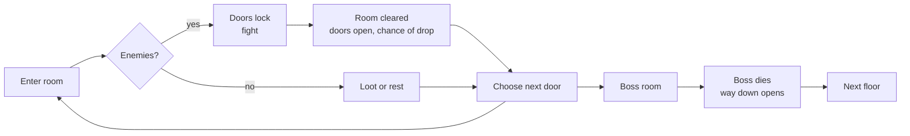
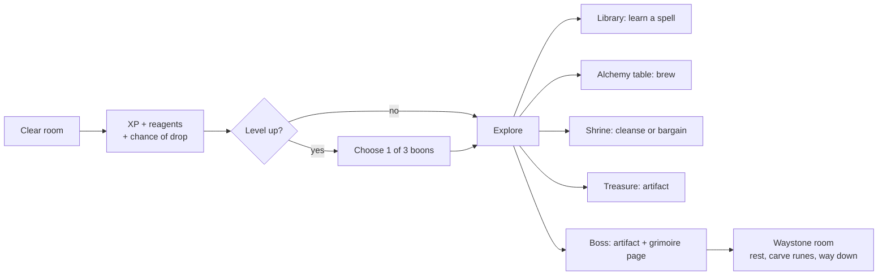

# Ossuary — Game Design Document

Sep 24, 2026 · @Azyrion

## Vision and pillars

Ossuary is a top-down roguelike with RPG elements, set in the high/dark fantasy world of Eda. It borrows the room-by-room structure of The Binding of Isaac, but its identity is magic: every run is a spellbook the player assembles from spells, runes, magical artifacts and potions they brew themselves. It runs in desktop browsers (a mobile version may come later); its rooms, creatures and effects are built in code, with Tripo3D for special models (the mage, bosses where wanted). It is a hobby project; the current goal is to prove the core loop is fun before adding content.

**Pitch:** An apprentice mage, Azyrion, breaks into the vault beneath the Gate of Uzulim, room by room, floor by floor, where the gate's Wardens sealed away what they took from the wilderness. They learn spells from torn grimoire pages, bind cursed artifacts to their will, brew potions from what the dead leave behind, and grow with every floor from an apprentice into a chaos mage of fire and runes. Every run builds a different mage; what the mage learns is never fully lost.

**Setting** (from the owner's Eda lore, `docs/lore/`; `docs/ideas.md` has the reading of the notes and images). The
Pass of Buluiain runs through the valleys of the Huruhui, guarded at each end by a gate: Belregi, carved and bright,
towards the valleys, and Uzulim, dark volcanic stone, towards the wild lands beyond. The Uzulim Wardens keep the dark
gate, and beneath it a vault of what they took from the wilderness over the centuries, "a source of great strength and
a potential danger". The runs go down into that vault. The chapel above the first floor is the Wardens' own; the
crypts are theirs, and their dead lie there with the sextons and pilgrims who served them; the artifacts on the
pedestals are what they sealed away; the Hollow Warden is a Warden who never came back up. Below the vault lies what
Kaelith, the Shadow Sentinel, gave their life to seal: the horde from the wilderness, whose creatures are the
dungeon's foes. **The world above** (the Huruhui's green valleys and cliff towns, the Longwood and its World Trees,
the Plains of Belerial) is lush and hopeful where the vault is dark: it is what the gate keeps safe. The game shows it
at the edges only: through the Vigil, a cave mouth over the valleys, and at a run's end, in daylight. The dark stays
below; the light is what the mage climbs back to.

**Pillars**

- **Magic is the build.** Spells, runes, artifacts and potions interact with each other and with the room. The fun is
  discovering combinations, not collecting stat-ups.
- **Readable twin-stick combat.** Fixed rooms, four-direction casting, clear telegraphs. Every hit the player takes
  should feel fair.
- **Nothing silent** (the owner's rule). Every mechanic tells the player that it is happening, even if only in a word
  or a cryptic line: what holds the mage shows beside the mana bar, a reaction's or a weakness's name rises over the
  foe, a counter found says so. A new mechanic is not done until it shows.
- **Growth you can feel.** RPG levels and choices inside a run; knowledge (recipes, spells, bestiary), the freed dead
  and a few powers that carry over between runs.
- **Alchemy as a second game.** Unknown potions to identify, reagents to harvest, recipes to discover. Every potion
  can be drunk or thrown.
- **Eda, not Isaac.** The room structure is borrowed; the world, magic schools, creatures and tone come from Eda.
  Medieval high fantasy turned dark: crypts, chapels, relics, the unquiet dead.
- **A pixel-art diorama.** Each room is a candle-lit cutaway diorama drawn in pixel-art 3D: everything (the room, the
  mage, foes, artifacts and spells) drawn at one pixel size, the room kit's texel, and blown up, with outlines.
- **Tripo in, game out.** Any model exported to the checklist drops into the game without hand-fixing.

**What separates Ossuary from an Isaac clone**

| Isaac | Ossuary |
| --- | --- |
| One attack (tears) changed by items | A free cantrip plus two active spells with mana, cooldowns and runes |
| Pills with random effects | Potions to identify, brew from reagents, and drink or throw |
| Items are mostly passive stat and tear changes | Artifacts include foci that reshape the cantrip, cursed artifacts and set bonuses |
| No character growth inside a run beyond items | XP, levels, attributes and boon choices |
| Rooms are obstacles | Rooms react to magic: oil burns, water conducts, braziers empower |
| Bombs: placed, then wait | Blast glyphs: chalked runes the cantrip sets off from afar, chaining and burning in the bolts' colour |
| Unlocks are new items | The Vigil: the dead the mage frees become its people, and it opens to the magic the mage knows |

**Rule of thumb:** when a system is borrowed from Isaac, it gets a magic take. It answers to the cantrip, glyphs, spells, schools or the room, or to the dead of Eda (souls, shades, the Ferryman), never only to walking over it and waiting. Unscheduled ideas in that spirit, such as more pickup families, are collected in `docs/ideas.md`.

**Scope:** hobby project for desktop browsers, played with keyboard or gamepad. A mobile version may come later and is not designed for until then. No monetisation plans.

## Core loop

A run is a descent through floors; each floor is a grid of rooms ending in a boss. Death ends the run and everything restarts from floor 1.



One room at a time fills the screen. Entering a room with enemies locks its doors until every enemy is dead; clearing it opens the doors and may drop a reward. The boss room's defeat opens a trapdoor to the next floor.

**Target:** floors of rising difficulty, and every run differs in map, room count and room types; a run takes 20 to 40
minutes.

### Game loop changes for the magic RPG

The room loop stays; what the player gets from each room, and what they do between rooms, changes.



| Loop element | Isaac-style prototype | Magic RPG version |
| --- | --- | --- |
| Room reward | Chance of a heart | XP always; reagents from enemies; chance of heart, mana vial or coin |
| Growth in a run | Items only | Items plus levels: each level offers 3 boons, pick 1 |
| Special rooms per floor | Treasure, boss | Treasure, ordeal, boss, merchant, secret, library on every floor; Dr. Jelly's laboratory on floors 1 and 3, a shrine on floors 2 and 4, the waystone room on floors 1 to 5; sometimes a bone altar or locked vault |
| Between floors | Trapdoor, straight on | Waystone room, holding the way down: a rest (full mana, every cooldown ended), a pair of runes, carving and lifting runes, reordering the belt |
| Death | Everything lost | Run items lost; Arcane Dust, the freed, spell knowledge, discovered recipes and bestiary entries kept; the run's echo waits at the Vigil |
| Run start | Same hero, same stats | At the Vigil: a discipline, vows and gifts inscribed in the Great Circle, then the Ferryman's crossing |

**Pacing target:** level 2 by the second fight room, floors ending at levels 4, 7, 9, 11 and the cap of 12 (three
levels on floors 1 and 2, two on floors 3 and 4, one on floor 5), first active spell no later than the first library
or boss. Floor 1 should give a clear build direction (a school) by its boss.

## Player

The player moves in eight directions and casts in four, independently, with three hearts of health counted in halves.

| Action | Keyboard | Gamepad |
| --- | --- | --- |
| Move | W A S D | Left stick |
| Cast | Arrow keys (last pressed wins) | Right stick or face buttons |
| Blast glyph | Space | Left trigger |
| Begin a run (title, end screen) | Enter | A or Start |
| Pause | Esc or P | Start |
| Mute | M |  |

Every connected gamepad is read together (a browser may list an idle device first), and a pad says by name when the browser first reports it, which it does only once one of its buttons is pressed on the page. A takes on the level-up screen and acts at the alchemy table.

The touch twin-stick from prototype 0.3 stays in the code but is frozen: it isn't extended or tested, and new actions get no touch controls until a mobile port.

Inputs for the magic layer: spell 1 and 2 on Q and E (LB and RB); a potion on R (the d-pad's up; tap to drink, hold to
throw) and F to choose one (the d-pad's left and right). See Magic system.

**Starting stats**

| Stat | Value |
| --- | --- |
| Move speed | 4.3 tiles/s |
| Damage per bolt | 3.5 |
| Fire delay | 0.36 s |
| Bolt speed | 8.8 tiles/s |
| Range | 6.8 tiles |
| Health | 3 hearts (6 halves) |
| Invulnerability after a hit | 1.0 s |

Hearts can't be picked up at full health. The hero faces the cast direction while casting, otherwise the move direction.

**What is done to the mage shows** (Nothing silent, above). A row of chips beside the mana bar names each thing
holding the mage now, in its school's colour: *Hexed* with the mana the last blow took (the bar flashes violet and the
loss rises over the mage), *Chilled*, *Heavy as stone*, *Sight dimmed*, *Webbed* or *Ink-slowed*, *Snagged*,
*Sliding*, *Drawn in* (the Angler's lure, a Lodestone Golem, a Griffin's wings), *Sapped* (an obelisk's field), *In
jelly*, and what a drunk potion does while it lasts. The first time each comes in a run, a line says what it is ("A
hexed blow drew mana out of you."), one line at a time. The dev menu's Mage tab lists them and sets each.

**Animation mapping.** Legs play idle, walk or run by speed; the upper body can overlay a cast, a hit reaction or a gesture (drinking, eating); death plays on the whole body. Extras are used when a model has them.

| Game state | Clip | Body part | Notes |
| --- | --- | --- | --- |
| Standing | standing\_relax | Whole body | Loops |
| Moving | run | Whole body | Plays at up to 3× speed to match move speed |
| Moving slowly | walk | Whole body | Below 30% of full speed (a gamepad stick barely tilted) the walk takes over from the run |
| Casting | cast\_a\_spell | Upper body | Only the forward thrust is replayed per bolt |
| Taking damage | hit\_to\_body\_01 | Upper body | Played at 1.6× |
| Healed by a heart | Drink Potion | Upper body | Only the draught, around the moment the flask is raised |
| Standing still a while | Eat | Upper body | A fidget after 9 to 16 s standing still; moving or casting puts it away |
| Death | fall or defeat\_03 | Whole body | One of the two at random; the end screen waits for it; a model without a death clip topples over instead |

## Combat and enemies

Combat is Isaac-style: bolts travel in straight lines, drop to the floor at the end of their range, and are blocked by
rocks and walls. Enemies deal contact damage and some shoot slow, readable projectiles.

- Bolts inherit 30% of the player's movement and alternate between two spawn points, like Isaac's two eyes.
- Hits flash the enemy white and knock it back; deaths leave a stain on the floor.
- Every attack is telegraphed: a glow, a shake or a pause before it lands.
- Contact and shots cost half a heart; touching a boss costs a full heart.

(Code: docs/architecture.md, Foes and Bosses.)

### Bosses

Every boss is built in code and fights in its own way; each has one weakness and one resistance (below, Enemy
affinities). Each floor draws its boss from a pool, never one the run has met (Floors and rooms). When a boss falls,
the foes it called fall with it, so no fight drags on while its rewards rise. A boss calls its floor's foes below half
health. A boss that is hidden (the Abbess under the floor, the Knight in mid-leap) can't be hit and doesn't hurt on
contact.

| Boss | HP | Behaviour | Isaac equivalent |
| --- | --- | --- | --- |
| Hollow Warden | 120 | Walks, winds up and bursts a 12-shot ring, fires three aimed 3-shot volleys; calls the floor's walkers below 50% | Floor 1 boss |
| Drowned Abbess | 120 | A great pale cave olm (Frost) whose glowing gills hang like a veil. Drifts; opens its jaw and wails fans of aimed shots; sinks into the floor and follows the mage as a ripple that can't be hurt, then a widening ring marks where it surfaces with a ring of shots; calls the floor's flyers below 50%. Weak to Storm, resists Frost | Pin |
| Pyre Knight | 135 | A hollow suit of blackened plate full of fire (Ember), a burning greatsword. Stalks; leaps at where the mage stands (the landing spot glows) and lands blade first with a shockwave ring; levels its sword and charges in a line until a wall stuns it; raises it and sweeps cones of embers; calls the floor's heavies below 50%. Weak to Frost, resists Ember | Monstro |

- **The Hollow Warden** (floor 1; a Warden who never came back up) wears the **Owlbear** (Hallow): a bear's hunched
  body under a scowling owl's face, slit eyes of gold, a hooked beak, ear tufts like horns and a crown of candles. Its
  shots take Hallow's light.
- **The Hallowed Hart** (floor 4; Hallow): a gaunt white stag with antlers of light and candles in them. It charges
  along a lane lit on the floor and stuns itself on the wall, turns firing spokes of light, rears and stamps a ring of
  motes, and calls its fawns below half health. Fears Umbral, shrugs off Hallow.
- **The Deep Angler** (floor 5; Umbral): a great black anglerfish afloat in the mist, its lure its only light. The
  lure draws the mage in towards its jaws until it bites, unless struck hard enough meanwhile; it spits volleys of
  shadow that hex and breathes rings of dark motes, and calls the floor's flyers below half health. Fears Hallow,
  shrugs off Umbral.
- **The War-Tiger** (a white-maned tiger armoured in plates of bronze and stone, snarling under its mane; floors 3 and
  4): a statue in its hall until the mage comes within three tiles or strikes it (so a glyph can be chalked beside it
  first). It prowls, circles the mage at claw reach and swipes a fan of claws, crouches with the spot it will land on
  marked and pounces there (a wall stuns it; frost flies from its plates as it lands), and roars rings. Four plates
  (two bronze pauldrons, a stone slab on its back, a bronze brow) let only 40% of a blow through at first. A glyph's
  blast, a Shatter (bosses never freeze, so a shock on plates rimed by two chills) or enough blows turned knocks a
  plate off, and each plate lost leaves it faster and more open. Weak to Storm (it fears the Wardens' bells),
  resisting Frost (its plates rime).
- **The Pillar Dragon** (a long dragon with antlers, a spiked mane, a beard and a brow of spines, orange down its left
  flank and blue-grey down its right; floor 5): it coils round the top of the room's pillars and moves from one to the
  next. A room with fewer than three pillars raises four as the dragon comes down from above, and a belfry (four
  pillars, two bells) joins the boss rooms. Coiled, it leans out, only its head in reach of bolts, and breathes twice,
  fire and frost by turns (its maw glows with what is coming, then a stream sweeps across where the mage stood), then
  flies to another pillar, most often the one nearest the mage; below half health it throws a ring of fire and frost
  as it lands. Knocking it off a pillar (a blast at the pillar's foot, a bell) brings it down for four seconds, open
  and taking half again of each blow. Weak to Umbral, resisting Ember.
- **The Twin Guardians** (the colossal bearded, lion-pawed guardians crouched in the gate's towers; floors 3 and 4;
  Hallow): two statues that wake together, their heads following the mage until it comes near or strikes one. One
  strikes (it slams the floor and fixes the mage with a gaze of gold) while the other holds its post behind its stone
  shield and a drinking ward (bolts glance off, spells are drunk); the shield passes across every six seconds. A
  shielder that put itself between the mage and its twin blocked every line on the striker, so it holds its post. When
  one falls, the other rages. They share one bar and one reward. Weak to Frost, resisting Hallow. The Uzulim statues
  whose eyes follow whoever approaches are their kind.
- **The jelly serpent** and **Kaelith** are bosses of their own places (Potions and alchemy; RPG progression).

### Foes

Foes are built in code (the owner chose code over Tripo for them). They are creatures that could only live in Eda:
beasts of the old bestiaries or animals magic has changed past anything natural, readable at a glance as what they
are, fierce, at their real size and never undead. Their school is in their bodies (runes cut into horn, frost in a
stone's cracks, lightning in a hollow bell), their eyes are small slits under a brow and nothing smiles. They are
judged at play distance in the pixel look, and a foe's look keeps the parts its fight moves. Each takes its school's
light, has a sound in its school's palette, and an attack with a tell. The ids in `data/foes.json` keep the foes'
first names.

Templates mark roles rather than kinds (a walker that comes at the mage, a flyer or shooter that keeps its distance, a
charger or heavy); each floor fills the roles from its own foes, weighted, with one elite a room at most. Each foe
takes +50% from its weakness and −50% from its resistance, and the first time the mage finds one the word rises over
the foe; what the mage has found is kept between runs for the bestiary. A foe killed gives insight (RPG progression).

**The first eighteen:**

| Floor | Foe | School | The fight |
| --- | --- | --- | --- |
| 1 | Spore Fiend | Umbral | Hops on stubby feet and puffs a cloud of stinging spores that dims the mage's sight (fire makes it flash) |
| 1 | Seraph Moth | Hallow | Loops round the mage or round a lit brazier or candle stand, scattering light motes |
| 1 | Runehorn | Storm | Charges when lined up, and throws a spark when it stuns itself on a wall |
| 1 | Urn Mimic | Ember | A kiln-fired urn with a fanged lid and ember slits; waits beside the room's urns as one of them, peeks, then spits embers that light oil |
| 2 | Hoarfrost Toad | Frost | Leaps, and breathes cold that chills the mage and freezes water |
| 2 | Kelpie | Storm | Lives under water (bringing a pool where the room has none), rises to spit sparks, is hurt through a shocked pool and trapped by a frozen one |
| 2 | Reliquary Medusa | Hallow | Drifts over rocks and pulses light |
| 3 | Salamander | Ember | Zigzags and leaves burning ground |
| 3 | Hex Imp | Umbral | Blinks about and throws a hex that drains mana |
| 3 | Rime Drake (elite) | Frost | Stalks, breathes rime, and flies across the room to land in a ring of frost |
| 4 | Candle Kobold | Ember | Darts from cover to cover; its candle falls burning when it dies |
| 4 | Bell Fiend | Storm | Its chime marks the ground under the mage, and a spark strikes the mark |
| 4 | Gargoyle | Frost | Stone that turns most of a blow while it perches; wakes, pounces twice with a ring of frost, turns to stone again |
| 4 | Pale Unicorn | Hallow | Keeps away from the mage and heals the foes near it (a boss only a little) |
| 5 | Mandrake | Umbral | Burrows, creeps after the mage as a mound and bursts up under it; fire keeps it up |
| 5 | Sky Ray | Storm | Makes long passes, leaving a line of sparks on the floor that arm and sting |
| 5 | Void Maw | Umbral | Swallows the cantrip's bolts and spills them back as a ring; spells hurt it |
| 5 | Dragon Turtle (elite) | Frost | Hides, spins off the walls, then lies dizzy |

The **Wardlings**, one for each school, belong to no floor: a drinking ward lets one out (Floors and rooms). Each is a
ward core, a faceted crystal heart with one slit eye in a cage of turning runes. The training dummy never falls and
shows its hits and statuses; the Rotling is kept only as a plain foe for testing, in no floor's fights.

**The bestiary: thirty-five more**, seven a floor, each bringing a kind of fight with a magic take that changes it.
Fantasy animals and creatures, not cute critters.

- **Floor 1, the crypt.** The Gloom Weaver drops from out of reach and spits webs that slow (fire burns them); the
  Quill Kraken smears ink that slows and splits in two at half (chilled, it cracks instead); the Grimoire Mimic lies
  shut as a book, then flies, riffles cutting pages and bites; the Lampwyrms are several beetles with one mind; the
  Caladrius perches and sings the foes round it faster (a hex silences it); the Mantis Knight parries bolts from the
  front (chilled, it can't); the Helm Hermit hides as rubble and a glyph's blast flips it.
- **Floor 2, the drowned.** The Rime Crawler leaves rime the mage slides on and hides in an ice shell fire cracks; the
  Glass Wyrm swims unseen and lunges with a chilling bite (a shocked or frozen pool shows it); the Brine Serpent rises
  from its pool to spit brine (ice traps it); the Puddle Elemental pours water as it walks, and frozen, a shock
  shatters it; the Thunderhead rains sparks over the mage; the Spark Wyvern dashes laying sparks (chilled, it hangs);
  the Puffcap bursts in stinging spores (fire pops it early).
- **Floor 3, the burning crypt.** The Cinder Hornets' nest of cooled lava, set in a wall, lets out hornets whose sting
  burns the ground, and only fire truly harms it; the Cinder Djinn lights braziers and hurls fire (frost snuffs it);
  the Magma Ooze leaves burning ground, splits, and frozen hard a blow shatters it; the Phoenix (elite) dives in a
  burning line and rises once from its ashes unless frost or a blast puts them out; the Basilisk's stare makes the
  mage heavy as stone (anything tall blocks it, holy light blinds it); the Salt Golem stands between the mage and the
  other foes (fire slows it); the Rubble Golem drops stones from the roof, and a blast breaks it into stones that roll
  back together unless put down.
- **Floor 4, the Gilded Reliquary.** The Griffin (elite) soars out of reach and swoops down a marked line (a hex
  grounds it); the Radiant Eye fires a ray where the mage stood (shut, it takes half; a hex shuts it); the Harpy
  screeches glyphs away and bolts aside, and dives; the Lodestone Golem draws the mage and bends bolts towards itself
  (frozen, it can't); the Hearth Golem (elite) turns blows while its fire burns, until frost puts it out; the Shadow
  Fox blinks from shadow to shadow (lights deny it ground, holy light holds it); the Frost Scarab throws a growing
  snowball (fire melts it).
- **Floor 5, the Ferryman's Shore.** The Glacier Golem (elite) turns blows from the front, stomps ice spikes, and
  frozen stiff a shock shatters it; the Hydra (elite) loses heads that grow back as two unless fire sears the stump;
  the Gloom Raven (three eyes, smoke-trailing wings) darkens the mage's sight and flees light; the Rime Wargs hunt as
  a pack, howl themselves faster and scatter from fire; the Tarasque rolls (bolts glance off) until a wall dazes it,
  open to twice the harm; the Frost Jackalope keeps its distance stamping rime (burning ground stops its leaps); the
  Manticore looses hexing spikes and pounces (holy light stills its tail).

**Elementals** (the Puddle Elemental, Thunderhead, Cinder Djinn, Magma Ooze and the Lodestone, Hearth and Glacier
Golems): their own school heals them, blows and statuses alike ("Drinks it"), and their weakness hurts them twice
over.

**Rules for every foe**

- **Slowing works by its factor.** Chill, wading and cobwebs scale a foe's step, never its velocity, so one chill
  stack slows every foe to 78% whatever its movement; a song's haste scales it the same way.
- **One pack a room**, counted as one elite (a hornets' nest counts as a pack): a second wolf pack or swarm in a
  room's roll goes to another foe; a pack's size comes from the room's seed, so a replayed seed fights the same packs;
  quiet rooms keep no pack.
- **No foe waits for ever.** The Helm Hermit, the Urn Mimic and the Grimoire Mimic wake once nothing else in the room
  is awake (crabs aside); the Shadow Fox, finding no shadow near the mage for a while, rises in the light; the Brine
  Serpent, kept from the water nearest the mage, makes for the water nearest itself (and kept from that too, rises
  where it is). Each could have held a room's doors shut.
- **Songs don't reach bosses**: a Caladrius called up as a boss's helper hastens the helpers, not the boss.
- A hornets' nest or a harpy's perch keeps off the north wall's niches; a nest sits where the room is open in front of
  it and away from another, so no foe sits where a straight bolt can't reach it.
- **Every build brings the water foes up.** The Kelpie, the Brine Serpent and the Glass Wyrm hide in water, and Frost
  (freezing it) is not the only way to bring them up. A glyph's blast in their water, or near them, throws them up;
  fire on their water boils it to steam, which scalds them and brings them up; a shock through it brings them up, as
  it always hurt them. Brought up, the Kelpie and the Serpent lie stranded for 3 s, the Wyrm stunned, and each is open
  to every blow. The sluice gate (Floors and rooms) is one more way to win the water.

### Living foes: foes you read and outwit

The bestiary gave every foe a counter (a school or a mechanism that changes its fight). The counters are something the
mage learns, and foes are part of the room, not only in it.

- **Champion mantles.** A champion is bigger, tinted, double health and a little faster; it also wears the mantle of
  one school, drawn from its floor's weights. Its aura and body glow in the school's light, a ring of runes turns
  under it, its mantle's name rises as it comes, and the first time in a run a line says what the mantle does and what
  unbinds it. The opposite school strips the mantle ("Unbound!"): the champion is stunned 1.6 s and takes a quarter
  more for 3 s. One rule, five mantles, every foe.

  | Mantle | What it does | Stripped by |
  | --- | --- | --- |
  | Kindled | Leaves burning ground as it goes and can't burn | Frost |
  | Rimebound | Its touch and shots chill; it can't be chilled | Ember |
  | Stormcharged | Struck, it throws a spark under the mage now and then | Frost (as chill stills the storm creatures) |
  | Hallowed | Mends the foes within 3 tiles (a boss a little), not while it is sanctified | Umbral |
  | Hexbound | Its shots drink mana; as it falls its curse closes on the ground round it, draining the mage's mana if they stay inside (not if it was unbound before it fell) | Hallow |

- **Foes in each other's ground.** What the bestiary leaves on the floor works on foes as on the mage: webs and ink
  slow walkers, rime makes them slide, burning ground burns them, sparks shock them, a Puffcap's spores sting them.
  Every patch, fire, spark and cloud knows the kind of foe that left it and spares that kind; a foe is also at home in
  ground of its own school (a Frost foe on rime, an Ember one in fire, a Storm one on sparks, an Umbral one in webs,
  ink and spores). Fliers and bosses pass over it. Beasts blunder into it; golems and elementals look two points ahead
  and go round. A puff in the ground's colour shows a foe stepping in, and the first time in a run a line says foes
  fall foul of each other's ground. The mage can lure a pack of wolves across a Magma Ooze's trail.
- **Counters found.** Thirty-eight foes have one or two (the Mantis Knight is numbed by cold and flanked from behind;
  the water foes are iced in or driven up). Each foe's counters are sealed lines in its bestiary entry. The first time
  the mage brings one about (a hex grounds a griffin, frost snuffs a djinn, a blast flips a hermit crab), a word rises
  ("Grounded!", "Snuffed!", "Flipped!"; each time, with a chime and a line the first time ever) and the line opens,
  kept between runs beside its weakness and resistance. The inventory's Foes tab shows each foe met by floor, then the
  bosses, its weakness and resistance once found (an elemental's "Drinks"), and its counters found or sealed; the
  Vigil's bestiary grows from it.
- **Rooms with a pair.** Some foes are better together: a Salt Golem shielding a Basilisk, a Caladrius singing to the
  wolves, a Pale Unicorn behind a Gargoyle, a Cinder Djinn lighting braziers that drive the Gloom Ravens off (a pair
  that works against itself). Two or three pairs a floor are named in the floor's data; a fight rolls one about one
  time in ten on floor 1 up to a little more than one in five on floor 5. The pair takes the first two places of the
  first wave, the second beside the first, and its line says what they do together the first time in a run.

**Enemy asset needs per creature** (for a model made in Tripo): a run or move clip, an attack clip, a hit reaction and
a death. The hero's layered animation system is reused for enemies.

## Magic system

The mage has three layers of magic: a free cantrip that is always firing, two active spell slots paid with mana, and
potions. Six schools of magic apply status effects that combine with each other and with the room.

(Code: docs/architecture.md, Magic.)

**Layers**

| Layer | Input | Cost | Changed by |
| --- | --- | --- | --- |
| Cantrip (today's bolt) | Arrow keys, 4 directions | Free | The equipped focus artifact, boons, passive artifacts |
| Spell 1 and 2 | Q and E / LB and RB | Mana + cooldown | Runes socketed into the spell, school mastery |
| Potion | R tapped drinks, held throws; F chooses (d-pad: up; left, right) | One potion from the belt | Alchemy boons, some artifacts |

**Mana:** a blue bar under the hearts, 100 at start. It refills 4 per second out of combat and 1 per second in combat;
killing an enemy with the cantrip gives 3 (kills by spells don't; a burn keeps whoever lit it). Mana vials drop from
rooms like hearts, and like hearts stay on the floor while mana is full; the first time in a run the mage walks into
one it can't take (a vial at full mana, a heart at full health) a message says why. While the mage knows no spell
nothing spends mana, so loot gives an obol in place of a mana vial until the first spell is learned. Spells are
refused in the merchant's warded shop.

**Spells aim like the cantrip:** a spell fires in the current cast direction, or the move direction when not casting.
Some spells are placed at the mage's feet or target the nearest enemy.

**Schools and status effects**

| School | Status effect | Strong against | Feel |
| --- | --- | --- | --- |
| Ember | Burn: damage over time, spreads to burning ground | Rot and undead flesh | Aggressive, area |
| Frost | Chill slows; 3 stacks freeze; frozen enemies shatter for bonus damage | Fast enemies | Control |
| Storm | Shock: chains to nearby enemies, brief stun | Groups, anything wet | Burst |
| Hallow | Sanctified: takes more damage, can't regenerate | Wraiths, the Warden's kind | Precise, defensive |
| Umbral | Hex: a hexed foe's blows give mana back to the mage (life too, with Thirsting Hex) | Living things | Risky, sustain |

**How the statuses work** (numbers in `data/magic.json`):

- **Burn:** 2.5 damage a second.
- **Chill:** each stack 22% slower, thawing after 3 s; the third freezes for 2 s (frozen foes take ×1.5 and can't
  act), then 1.5 s before it can freeze again.
- **Shock:** a 0.35 s stun, and the next hit on the foe leaps half its damage to a neighbour.
- **Sanctified:** for a few seconds the foe takes a quarter more damage from everything and nothing heals it.
- **Hex:** stacks (up to five) that fade a while after the last; each blow the mage lands on a hexed foe spends one
  and gives back 3 mana, and a foe that falls with three or more leaves a black soul mote one time in two.
- **Root** (Umbral's hands): held where it stands, still striking; a boss only for a moment.
- **Overgrown** (Verdant, below).
- **Bosses** slow (two Chill stacks at most) but never freeze, and are stunned at most once every 3 s.
- **Slowing scales a foe's step**, so one Chill stack is 78% for every foe.

Foes' blows can hold and drain the mage too, and every such affliction shows (Player: What is done to the mage shows). A hexing blow's drain
runs from the mage back to the foe that threw it in violet motes, and a Hallow spell cast within 8 s gives it back
(gold over the mage; the first time in a run, a line).

**A sixth school: Verdant** (from the Huruhui's biomancy). Growth, roots, pollen and healing: the school the valleys
practise, in a spring green, its sound wood and breath, reeds and seed pods. Its status, *Overgrown*: vines that slow
a foe by 15% at once and 15% more each second they hold, up to 60% (a boss half as much), green vines on the foe; a
foe that falls overgrown flowers ("It flowers"), mending half a heart of the mage's, once a room. Its reactions are in
the table below. A Wardling of Verdant drinks it at a vault's ward, a rune stone takes its emblem, and the spell marks
rise with it. Pollen is no holy ground and living wood no ice: neither takes part in the weaves (a hex on the cloud
sets off no Eclipse, and a Cinder Lance burns the wall down rather than turning it to steam), and an obelisk's ward is
never Verdant, since growth reaches no mechanism. Its spells are under Spells.

**Element reactions** (two effects on the same enemy or tile). Every pair of the six schools reacts, on a foe and, for
some, on the floor. The first time ever a reaction goes off, its name rises larger than it does after, with its own
signature sound.

| Combination | Reaction | What it does |
| --- | --- | --- |
| Ember + Frost | Steam | A chilled or frozen foe set burning, or a burning foe chilled, puts both out and steams: a scald (6) and a cloud 1.7 tiles across for 4.5 s (a Blackfire's burn doesn't go out, so it doesn't steam). Foes inside can't aim (their shots go up to 1.1 radians wide), and eyes can't see the mage through it: the Basilisk's stare, the Radiant Eye's ray and a watching statue's charge all lose it. Water under it is scalded and what hides there comes up |
| Frost + Storm | Shatter | A frozen enemy explodes into ice shards |
| Ember + Storm | Overload | A small explosion, knockback |
| Hallow + Umbral | Eclipse | The foe is out of the fight for 2 s under a black sun, nothing reaching it, then struck for 18 (a boss is only struck) |
| Umbral + Ember | Blackfire | A violet burn that never goes out while the foe lives |
| Ember + Hallow | Searing | A burning foe sanctified, or a sanctified one set burning: struck for 4 in holy fire, and for 4 s its guard is gone, so shut shells, lids, clay and a lit Hearth Golem take full blows (one rule for every guarded foe); a War-Tiger loses a plate at once |
| Frost + Hallow | Prism | A frozen foe sanctified, or a sanctified one frozen: while the ice holds it glints every colour, and each cantrip bolt that strikes it breaks into three of the rainbow's colours, one on and one 24° to either side, each at 70% for 4.5 tiles |
| Storm + Hallow | Verdict | A sanctified foe shocked, or a shocked one sanctified: lightning falls on it and on every other sanctified foe in the room, each struck for 8 and stunned for half a second |
| Frost + Umbral | Black Ice | A chilled or frozen foe hexed, or a hexed one chilled: a glassy indigo patch, 2.3 tiles across, for 7 s; every walking foe on it slides, its grip a fifth of rime's, so it can hardly turn or stop (into the room's hazards and each other); the mage crosses it at full speed, and fire melts it |
| Storm + Umbral | Void Spark | A hexed foe shocked, or a shocked one hexed: the spark leaps to the three foes nearest within 3.4 tiles, striking each for 4 and laying a hex stack on it, and marks them for 5 s; a marked foe that falls gives 6 mana |
| Verdant + Ember | Wildfire | The burn runs along the vines to every overgrown foe in the room |
| Verdant + Frost | Frostbloom | Ice flowers open and shatter 0.6 s later, cutting and chilling the foes round it |
| Verdant + Storm | Pollen Spark | A cloud of pollen that shocks the foes in it for 3 s |
| Verdant + Hallow | Bloom | The foe flowers, and its lily mends half a heart as it falls, beyond the room's one flower |
| Verdant + Umbral | Blight | The vines rot to thorns that hex the foe and creep to the nearest other foe, overgrowing it |

**Reactions on tiles.** The same pairs work on the room's tiles. Fire on frozen water melts it to steam, frost on
burning oil snuffs it to steam, and fire on still water boils a little (a pool steams at most once every 2.5 s). A
shock through burning oil is an Overload at the pool's middle that blows the fire out. A hex landing on Consecrate's
holy ground (Grasp of the Grave's hands, a hexing bolt crossing it, a hex on a foe standing in it) darkens the ground
at once and takes everyone standing in it under a black sun.

**The codex.** A spell's panel lists the reactions it can set off, marking those not found yet. The spells tab's book
ends with the wheel of the six schools: an entry for each pair, lit once found (kept between runs), its chord drawn on
the wheel.

**Rooms react to magic.** This is the main systemic difference from Isaac and gives room templates a second purpose.
Oil puddles ignite, water conducts shock across the whole puddle, braziers lit by Ember empower Ember spells in that
room, cobwebs burn away to open shortcuts, gravestones can be shattered by Frost.

- Oil burns for 5 s (walking foes on it burn, the mage in it is hurt) and is then spent.
- Water is shallow (wading at 60% speed), carries a shock to everything standing in it, the mage too, and freezes over
  from Frost into ice crossed at full speed; fire melts it. The drowned floor grows real puddles in its fights.

**Weaves: what one spell leaves in the room, struck by another.** The lasting spells (the ice wall, the seal and its
ground, holy ground, the motes, the mantle, a toll's mark) each answer to the spells that strike them. Weaves cost
nothing beyond the two spells; the lasting spell is spent where the weave consumes it (the wall in a Steam Curtain or
a Conductor, the seal in an Overload Seal, the holy ground in Eclipse Ground), and kept where it isn't (Black Pyre,
Hallowed Hail, the motes, the mantle, Refraction's wall).

| Spells | Weave | What it does |
| --- | --- | --- |
| Glacial Wall + Cinder Lance | Steam Curtain | The lance melts the wall into a curtain of steam for the wall's time left, a cloud 2.3 tiles across on every block of it: shots through it go wide, and eyes can't see through it |
| Glacial Wall + Arc | Conductor | The chain runs along the wall: every foe within 0.8 of it is struck for 6 and shocked, and each block throws a chilling shard each way across the wall |
| Pyre Seal + Arc | Overload Seal | The seal bursts at once: an Overload the seal's size, throwing every foe out of it |
| Pyre Seal + Hex Bolt | Black Pyre | A Hex Bolt crossing the erupted seal's ground turns its flames violet for its time left: what burns in it burns with Blackfire |
| Consecrate + Grasp of the Grave | Eclipse Ground | The Grasp's hands closing on Consecrate's ground take it dark at once (it is spent) and every foe standing in it goes under a black sun whose blow strikes half again as hard |
| Consecrate + Rime Shards | Hallowed Hail | Each shard crossing holy ground comes out of it sanctifying what it strikes (2 s) |
| Wardlight + Cinder Lance | Lantern Fan | The lance passing through a mote (it must reach it) splits off a beam 4 tiles outward through each mote, at half the lance's damage |
| Static Mantle + water | Live Wade | While the mantle holds, wading in still water inside it shocks the pool once a second, the foes in it too (the mage spared) |
| Judgement + Glacial Wall | Refraction | The pillar of light striking within 1.2 of the wall lights every block of it, striking (10) and sanctifying foes at the wall |
| Ferryman's Toll + Arc | Toll Chain | The chain carries the toll's mark to each foe it leaps through |

**Chains: what a reaction leaves, met by a third school.** A cloud of steam takes the first of Storm, Hallow or Umbral
that lands in it (a status on a foe inside, a shock through water, holy light, darkness).

| Left by | Meets | Chain | What it does |
| --- | --- | --- | --- |
| A steam cloud | Storm | Thundercloud | The cloud is charged (yellow, crackling): it strikes (3) and shocks every foe inside once a second for its time left |
| A steam cloud | Hallow | Incense | The cloud (gold) sanctifies the foes inside, and mends half a heart of the mage once if it stands in it |
| A steam cloud | Umbral | Miasma | A black fog (violet): foes inside take a hex stack a second and lose the mage, as in steam |
| Black Ice | Ember | Black Melt | Fire on black ice lays ground burning with Blackfire (violet) in its place for 5 s, as oil burns |
| An Overload's blast | Frost | Hailburst | An Overload with a chilled or frozen foe, an ice wall or frozen water in its reach throws eight chilling shards |
| Shatter's shards | Ember | Molten Glass | A shard crossing fire (burning ground, burning oil, a seal's ground) falls there as burning ground for 4 s, burning walkers |
| An Eclipse's black sun | Storm | Corona | A shock landing within 3.5 of a black sun marks it; when the eclipse ends its blow leaps as lightning at half to every foe near |

**The room joins in** (through the hooks mechanisms already hear): darkness on a lit brazier, or a hexing bolt through
it, turns its fire black (a violet glow, the name Blackfire rising), and the bolts it lights carry a hex; a rune stone
charged with one school and struck or reached by another sets off their reaction at its foot (on the foes in its
reach, its name rising even with none) and takes the new school; a bell rung by a shock, or a shock landing beside it,
rings out a ring of sparks.

Every weave and chain has its name rise when it happens (a weave's in pale gold, a chain's in pale blue, larger the
first time ever, at most once every 2 s for those that go on), sounds both its schools, and is marked in the spell
book once found (Nothing silent): the spells tab closes with the weaves and chains, each found or sealed with its two
schools named, kept between runs. A spell's panel lists the weaves it takes part in.

**Runes** modify one spell each and are carved at waystones. Each spell has 1 socket (2 with Second Socket). There are
seven runes (`data/runes.json`); each fits the spells of the shapes it names, so a spell's shape chooses its runes,
and no rune is carved twice into one spell:

| Rune | Effect | Fits |
| --- | --- | --- |
| Thrice | The spell flies three times in a fan, each at 40% of its damage; only the middle one carries its statuses | bolt, shotgun |
| Reprise | Half a second later the spell comes again at half its damage and statuses | all but wall, self and orbit |
| Seeking | Its bolts curve towards foes; its hands reach further and rise under the foe nearest the aim | bolt, shotgun, grasp |
| Wide | Its ring, ground, wall or circle is half again as large, and strikes 20% less hard | placed, zone, smite, grasp, wall, orbit |
| Quicken | Ready again 30% sooner, for 20% more mana | every shape |
| Vein | Short of mana, it takes what mana there is and half a heart for the rest (never the last) | every shape |
| Lasting | What the spell leaves lasts half again as long, for 20% more mana | placed, wall, self, zone, orbit, grasp, mark |

A carved rune shows as a pip on the HUD's slot, in the spell's panel and as a speck at the hand. Carved runes are not
artifacts: they don't count toward the Runescribe's family (Runes and scrolls), whose three are artifacts held.

**Where runes come from.** A rune is a chip of the Wardens' stone with its glyph glowing; walked over, it goes into
the pouch (no limit), with a stone's chime and its card the first time each is taken in a run, and waits there for a
waystone to carve it. Two times in three it is one that fits a spell in the hand, otherwise any of the seven. On
floors 1 to 4 (none on floor 5 or in the Seal): half the merchant's shops lay one as an extra ware at
10 obols, half the secret rooms without an artifact keep one, a gilded reliquary chest always lets one out beside its
relic, and the Wandering Merchant carries one half the time (12 obols). All of it is rolled on the run's own stream,
so a seed's other drops and wares stay as they were: about one found and two or three offered a run, before the
waystones' pairs. A spell given up sends its runes back to the pouch. The inventory's Spells tab shows each slot's
socket and the pouch.

**The waystone.** It has a small room of its own beside the boss room on floors 1 to 5, opening only into it and
holding the way down. The door to it bears a grey menhir with a gold rune, and the boss's fall points to it ("The way
down lies past the waystone"). The room waits empty and dark until the mage first walks in after the boss falls. Then
the stone grinds up near its middle, a little toward the door: a menhir of grey stone with a hollow for each socket,
its runes kindling gold as the room lightens. The trapdoor opens beyond it, away from the door. Where no cell is free
beside the boss room (under one seed in a hundred) the stone rises at the side of the boss room as the boss falls, and
the trapdoor opens in its middle. Floor 5's leads down into the Seal. Walking up to it opens its screen; a spell cast
into it costs nothing and opens it on that spell. The first time, it rests the mage (full mana, every cooldown ended,
the mana streaming to the hand). It offers a pair of runes, two different ones leaning to the hand: one taken, the
other crumbles. Its Runes tab carves a rune from the pouch into a spell's socket, lifts one back out for nothing, and
opens Second Socket's socket in the spell chosen (both at rank II); its Belt tab reorders the potion belt, which the
inventory's Potions tab also does at any time.

**Enemy affinities (RPG layer):** every enemy has one weakness (+50% damage) and one resistance (−50%), shown in the
bestiary once discovered. Each foe has its pair (`data/foes.json`), and so does each boss (Combat and enemies:
Bosses). An elemental drinks its own school instead of resisting it (Combat and enemies: Elementals).

## Spells

Each school has three or four spells. Spells are learned from grimoire pages (library rooms, bosses, rare drops); a
new spell replaces one of the two slots, and the replaced one can be rebought at the next library. All names are
placeholders until the Eda lore arrives.

| School | Spell | Mana | Cooldown | Effect |
| --- | --- | --- | --- | --- |
| Ember | Cinder Lance | 20 | 2 s | Piercing fire beam, burns everything in a line |
| Ember | Pyre Seal | 35 | 8 s | Rune on the floor erupts after 1 s in a ring of flame, leaves burning ground |
| Ember | Phoenix Step | 25 | 6 s | Short dash through enemies, leaving a fire trail; 0.3 s invulnerable |
| Frost | Rime Shards | 15 | 1.5 s | Shotgun of 5 ice shards, each applies Chill |
| Frost | Glacial Wall | 30 | 10 s | Wall of ice across the cast direction; for 5 s it stops enemies and their shots (not the mage's bolts), then shatters on enemies near it |
| Frost | Winter's Breath | 40 | 12 s | Cone that freezes everything it touches for 2 s |
| Storm | Arc | 15 | 1 s | Lightning hits the nearest enemy and chains to 3 more |
| Storm | Thundercall | 40 | 10 s | Three strikes on random enemies; hits on water spread to the whole puddle |
| Storm | Static Mantle | 30 | 15 s | For 6 s, shocks any enemy that touches the mage and throws it back |
| Hallow | Consecrate | 35 | 12 s | Holy ground at the mage's feet for 6 s that sears and sanctifies what walks in it, heals the mage half a heart once, and kindles the candle stands on it |
| Hallow | Judgement | 45 | 14 s | A closing ring of gold marks the strongest foe in reach, then a pillar of light falls on it |
| Hallow | Wardlight | 30 | 14 s | Six motes circle the mage for 8 s, breaking the shots they meet and searing what they touch |
| Hallow | Lantern of Vigil | 30 | 14 s | Floating lantern follows the mage and fires at enemies for 8 s |
| Umbral | Hex Bolt | 14 | 1.8 s | Slow dark bolt, two stacks of Hex; hexed enemies return mana on hit |
| Umbral | Grasp of the Grave | 30 | 10 s | Hands rise from the floor where the mage aims and hold every foe there for 2 s, hexed |
| Umbral | Ferryman's Toll | 20 | 6 s | The nearest foe is marked with a coin of shadow; blows on it give back mana, and if it falls marked it pays an obol and its hex spreads |
| Umbral | Soul Harvest | 0 | 20 s | Consumes all Hex stacks in the room: damage per stack, +1 mana per stack |

Phoenix Step, Winter's Breath and Thundercall are designed and not built yet (their dash, cone and summon shapes come
with them). Lantern of Vigil and Soul Harvest are built but stay out of the libraries until their townsperson is
freed (the scribe, the novice): then they come into the pools.

**Verdant's three spells**, on shapes that were there: the *Thorn Snare* (thorns burst from the floor where the mage
aims and close, holding and overgrowing the foes there), the *Pollen Cloud* (golden pollen round the mage for 5 s that
overgrows the foes in it and mends half a heart once) and the *Living Wall* (trunks of living wood that stop foes and
their shots, not the mage's bolts, and overgrow the foes that touch them; fire burns it down).

Seals and walls go when the mage leaves the room. Every spell's effect is drawn in one house style (a spell's look,
its schools' light, budgets and how to add one: `docs/effects.md`).

**Spell data shape**

```json
{
  "id": "cinder_lance", "name": "Cinder Lance", "school": "ember", "shape": "beam",
  "mana": 20, "cooldown": 2, "damage": 8, "status": { "burn": 3 },
  "params": { "range": 7, "width": 0.3 },
  "tags": ["beam", "pierce"], "color": "#ff8a3a", "icon": "lance",
  "text": "A beam of fire pierces every foe in a line and sets them burning",
  "lore": "The pyre-keepers lit the chapel's lamps from across the nave..."
}
```

`shape` picks a behaviour in code (a beam, a placed seal, a shotgun, a wall, a chain, a self aura, holy ground, a
pillar of light, orbiting motes, a bolt, rising hands, a mark); a cone, a dash and a summon come with the spells that
need them. `params` holds the numbers only the shape reads (each shape's list is checked). Everything else is data, so
new spells are mostly new entries. Tags and the shape decide which runes and boons apply.

**Casting animation:** the hero's `cast_a_spell` window is reused for every spell; strong spells can play a longer
part of the same clip. A second Tripo clip (a two-handed channel) would help beams and cones later.

**Spell knowledge.** The mage comes to know spells in stages, and what the mage knows is kept between runs (in the
browser until the Vigil, the hub between runs, takes it over; see RPG progression: Between runs).

| Stage | Reached when | What a spell's panel shows |
| --- | --- | --- |
| Seen | Its page is first approached | Name, school (in its colour), the one-line effect |
| Learned | A page of it is taken | Adds mana, cooldown, damage and statuses |
| Used | It has been cast about ten times (over all runs) | Adds its lore and the reactions it can set off (Frost and Storm: Shatter) |
| Upgraded | Runes or school mastery change it | Adds what changed it |

- **At a page:** coming within about two tiles of a grimoire page (library, boss, loose) shows a small panel above it
  at the spell's stage, so the library's choice of three is an informed one; walking into the page still takes it.
- **In the inventory:** the spells tab keeps the two carried slots on top, then one section per school, shown only
  once a spell of that school has been learned. A school's section lists every spell of it the mage has met (carried
  ones marked Q or E, given-up ones dimmed) and a sealed blank entry for each one not yet met, so there is more to
  find. Each entry's description is filled to its stage. The book closes with the wheel of reactions and the list of
  weaves and chains (Magic system).
- **Dev menu:** know every spell, and forget everything.

**Spell marks.** The spells the mage carries and what they know show on the mage, small and in each school's light
(embers rise, rime falls, sparks crackle, motes drift up, shadow sinks). Purely visual so far; attunement or mastery
could give something later. Each says what it is the first time.

| Mark | Comes from | What shows |
| --- | --- | --- |
| Spell in hand | Each slot: Q at the casting hand, E at the off hand | A light with its school's motion. Ready: full. Cooling down: faint, filling back, a flash when ready. Short of mana: grey and flickering. It tells what the HUD's slot tells, where the eye is. |
| Master's ring | A slotted spell whose whole school is known well (every spell of it at the Used stage) | A thin rune ring turning round that wrist; a line the first time ("You know every Ember spell well") |
| Attunement | Both slots holding one school's spells | The school's light about the whole mage; a line the first time in a run ("Attuned to Ember") |
| Knowledge circle | Every spell known well, kept between runs | Standing still a moment: a rune circle at the feet, an arc per school, a rune for each spell known well and a faint tick for each still to know; a school known in full closes its arc in a bright line. It fades as the mage moves. |

Frame cost: all of them at once add about 12 draw calls (the circle is one mesh, its colours in its vertices).

## Artifacts

Artifacts replace Isaac's items. There are four kinds: one focus that reshapes the cantrip, any number of passive
artifacts, cursed artifacts with a price, and sets that reward collecting pieces. The Ember Sigil is the first passive
artifact.

(Code: docs/architecture.md, Artifacts.)

| Kind | Slots | Role |
| --- | --- | --- |
| Focus (wand, staff, orb, tome) | 1; picking a new one drops the old | Changes how the cantrip fires: count, path, element |
| Passive | Unlimited, stack | Stats, triggers, new behaviours |
| Cursed | Unlimited | Strong effect plus a drawback; cleansed at a shrine, which removes the drawback and halves the effect |
| Set piece | Unlimited | 2 or 3 pieces of a set grant a bonus |

**The deeper floors' twelve** (the Gilded Reliquary and the Ferryman's Shore; `data/artifacts.json`): two foci, the
Pendulum of Hours (bolts swing out to one side and curve back onto the aim, the side alternating by cast) and the
Lodestar Wand (bolts hang as small stars where their range ends); passives: the Twin Vigil Candles (standing still,
bolts strike half again as hard, two flames at the shoulders), the Ossuary Choir (the fifth foe put to rest in a room
makes the dead sing, striking every foe there), the Echo Stone (a bolt comes back off a wall once), the Blood Moon
Pendant (at half health, faster bolts, a quicker hand, crimson), the Salt Circle (standing still a moment, a ring that
walking foes can't cross), the Gilded Halo (the first bolt sanctifies each foe), the Ferryman's Lantern (hexes give
back half again the mana, soul motes come twice as often) and the Hart's Antler (every sixth cast a lance of light
that pierces and sanctifies); cursed: the Gravemonger's Contract (half the foes put to rest leave an obol; price:
fights leave no hearts and hearts cost twice as much) and the Last Rite (once a floor a killing blow is refused;
price: a heart container).

**Artifacts per floor: at least 3; a budget of 6, and now and then luck gives more.** Three sources are on every
floor; optional ones can add up to three more, enough for the merchant, a vault and a bone altar on the same floor.
The boss's choice of two counts as one, since only one can be taken. Some finds sit outside the budget, so a lucky
floor can hold more: a gilded reliquary chest (see Containers) and the secret room.

| Source | Artifacts | Per floor |
| --- | --- | --- |
| Treasure room | 1 on a pedestal | Always |
| Ordeal | 1 after the last wave | Always |
| Boss | Choice of 2, take 1 | Always |
| Bone altar | 1 for a heart container, often cursed | Sometimes |
| Room-clear drop | 1, rare (about 3%) | Sometimes |
| Merchant | 1 for coins | While the budget lasts |
| Secret room | 1, often cursed | Sometimes |
| Locked vault | 1 behind a key | Sometimes |

The generator places the three guaranteed sources first, then gives artifacts to optional sources while the floor has
budget left, in an order shuffled with the floor's seed so no optional source is always the one left out; optional
sources without one hold obols, keys, glyphs or hearts instead (the merchant sells only wares, the vault holds a
hoard, the secret room coffers and a chest, and a bone altar without an artifact isn't placed). Room-clear drops only
roll while budget is left. Each artifact lists the pools it can appear in (treasure, ordeal, boss, altar, merchant,
secret, vault); cursed artifacts live mostly in the altar and secret pools.

**Foci**

| Focus | Cantrip becomes |
| --- | --- |
| Apprentice's Wand (start) | Single bolt |
| Twin-Headed Staff | Two parallel bolts, −30% damage each |
| Drowned Orb | Bolts bounce off walls twice, +35% range |
| Shepherd's Crook | Bolts fly out and back like a boomerang, passing through foes and hitting each twice, −20% damage |
| Mourner's Censer | Three bolts fan out, −40% damage each and −40% range |
| Gravewarden's Spear | One slow, heavy, larger bolt: ×2.4 damage, passes through every foe, casts 1.9× slower |
| Serpent Rod | Bolts weave from side to side like a serpent, +10% damage |
| Emberwood Wand | Bolts apply Burn, −10% range |
| Tome of Whispers | Slow bolts that curve towards enemies, +40% damage |

**Passive artifacts (first list)**

| Artifact | Effect |
| --- | --- |
| Ember Sigil | Damage +1.5, bigger white-hot bolts |
| Pilgrim's Boots | Move speed +0.6; the mage can walk over pits |
| Rosary of Haste | Cantrip fire delay −25% |
| Bone Lens | Cantrip pierces one enemy |
| Reliquary Shard | +1 heart container, fully healed |
| Saint's Knucklebone | Enemies burst into four bolts (north, east, south, west) when they die |
| Mourning Bell | When the mage is hit, a bell tolls and a ring of 8 bolts bursts outwards |
| Mason's Chisel | Bolts crack rocks; three hits break one |
| Raven's Eye | One cast in five is a strong one: bigger white-hot bolts that strike thrice as hard |
| Cracked Mirror | A bolt that strikes a foe splits into two halves that fly on either side of it |
| Hawk-Bone Fletching | Bolts fly 35% faster and 30% farther |
| Ram's Skull | Bolts knock foes back 2.6 times as far, damage +0.5 |
| Leech Jar | Every tenth foe put to rest gives back half a heart, as a red mote |
| Candle Moth | A pale moth flutters about the mage and stings the nearest foe with a lesser bolt every second or so |
| Weeping Skull | A skull circles the mage, swallowing enemy shots it meets and biting foes it passes |
| Unbroken Oath | A fight won without being hurt returns half a heart |
| Mana Lantern | Max mana +40 |
| Candle of the Vigil | Each room clear refills 25 mana |
| Frostbitten Ring | Every 5th cantrip bolt applies Chill |
| Stormglass Pendant | Shocked enemies take +25% cantrip damage |
| Thurible of Ash | Burning enemies spread Burn when they die |
| Witch's Knot | Spells cost 20% less at half health or below (below half alone was too rare with 3 hearts) |
| Alchemist's Satchel | Potion belt +1 slot, reagents drop 30% more often |
| Taster's Spoon | Every potion carried is known |
| Cracked Retort | Thrown potions splash half again as wide, and their glass cuts the foes in the splash |

**Cursed artifacts**

| Artifact | Gift | Price |
| --- | --- | --- |
| Mask of the Drowned | Cantrip damage doubled | Vision limited to a circle around the mage |
| Chain of the Penitent | Invulnerability after a hit lasts 3 s | Move speed −25% |
| Leaden Heart | Two more heart containers | Bolts reach 40% less far |
| Bloodied Covenant | Damage +2.5 | Every fight the mage begins takes half a heart (never the last) |
| Crown of Thorns | Spell damage +50% | Max health −1 heart |
| Hungering Tome | Every kill refills 5 mana | Mana doesn't regenerate on its own |

The economy artifacts are under Coins, keys and blast glyphs, and Fen-Nex's rune is below; more artifacts are
brainstormed in `docs/ideas.md`.

**Rules**

- **Every artifact is noticeable.** Picking one up changes something the player sees (the bolts, the mage, the HUD or
  the room), never only a hidden number. The pickup banner names it and says what it does in a few words, and a lore
  card in the corner of the screen describes it, the way a soulslike describes an item but plainer: its icon, name and
  kind, what it does and a few lines of lore. Items and containers get the same card the first time they're taken in a
  run; so do spells and potions.
- **The cantrip combines automatically.** The focus sets the pattern (how many bolts, and their path); passives add
  modifiers (damage, size, fire rate, piercing, triggers). There are no hand-written pairings: Twin-Headed Staff with
  Bone Lens fires two piercing bolts, Shepherd's Crook with Bone Lens pierces on the way out and back.
- **Taking a focus leaves the old one on the pedestal,** so the player can swap back.
- **Each artifact appears at most once per run.** If a source's pool is empty, it falls back to any unseen artifact,
  then to a heart. More artifacts are the cheapest way to add variety.
- **Companions** (the Candle Moth, the Weeping Skull) circle the mage and act on their own; they belong to their
  artifact and leave with it.
- **Every artifact decides how it shows.** See Costumes and transformations, below.

**Sets**

| Set | Pieces | Bonus |
| --- | --- | --- |
| The Pyromancer's Regalia | Ember Sigil, Emberwood Wand, Thurible of Ash | Burning ground heals the mage instead of hurting it |
| The Vigil | Candle of the Vigil, Mana Lantern | Hallow spells cost no mana while at full health |
| The Drowned Choir | Drowned Orb, Mask of the Drowned | Water puddles appear in every room; the mage is immune to shock |

**Costumes and transformations**

Picking up an artifact shows on the mage, as Isaac's items do, but in a high fantasy and magic way.

- **Costumes.** An artifact it is logical to wear shows on the mage: clothes, jewellery and what hangs at a belt (a
  stone, a skull, a bell or a contract doesn't; every artifact showing cluttered the mage). Its piece is built in code
  and hung from a bone of the rig, one per slot: head, face, shoulders, back, hands, belt, feet and aura. The one
  taken last wins its slot, and every focus is held in the casting hand. A piece is built for the body (hood, crown of
  thorns, halo, mask, lens, stole, manacles, ring, band, beads, boots) or is the artifact's own model carried at a
  spot (the lanterns, the keyring, the purse and the satchel at the belt; the two pendants on the chest). Of the 61
  artifacts, 19 wear something; 26 wear nothing (`"none"`), among them everything that was carried on the back or a
  shoulder, the third eye, the feathers, the antlers and the witch's knot; the other 16 are the 11 foci, held in the
  casting hand, and five that show round the mage instead (a companion, flames at the shoulders, a ring at the feet).
  The antlers stay the Beastcaller's. A cursed artifact shows its curse until a shrine cleanses it (the mask weeps,
  the chain drags on the floor, a piece glows red); then its piece takes its cleansed look (the thorns flower, the
  mask is pushed up, the chains break, the stole turns white).
- **Every artifact to come decides how it shows.** A new artifact is designed with its look on the mage only where it
  is logical to wear it: a piece built for the body (a crown, a mask, cuffs, boots), its own model carried at a spot
  (a lantern or purse at the belt, a pendant on the chest), held (every focus); nothing when it already shows round
  the mage (a companion, flames at the shoulders, a ring at the feet), named in `SHOWS_OTHERWISE`; or nothing at all
  (`"costume": "none"`): a charm, a relic, a stone or a bargain with no shape stays in the inventory and the HUD. The
  validator refuses an artifact that hasn't decided.
- **Transformations.** Three artifacts of one kind (a `family` tag in `data/artifacts.json`, 4 to 6 artifacts each)
  transform the mage for the rest of the run. The latest formed wears its look over the artifacts' pieces in those
  slots, with an aura in its light and the robes tinted towards it. A banner, a lore card and a sound name it, and the
  mage gains a gift in its spirit (as Isaac's transformations do, with a magic take); every gift formed stays. Sets
  keep their bonus; a transformation counts any artifacts of its kind.

| Transformation | Kind | The look | The gift |
| --- | --- | --- | --- |
| Pyromancer | Ember | A crown of flame, smouldering sleeves, burning footprints | The cantrip leaves embers where it strikes |
| Frostborn | Frost | An ice crown, rimed robes, frosted breath | Foes that touch the mage are chilled |
| Stormcaller | Storm | Boketto's look (the owner's image): white hair, black spirals down the arms, a violet and teal glow across the face and shoulder, eyes lit blue when a Storm spell is cast | Every fifth cast leaps to a second foe |
| Lightbearer | Hallow | A halo and wings of candle-light | The mage floats over pits and water |
| Shadowstep | Umbral | A cloak of shadow, violet eyes | A short blink in the moving direction |
| Runescribe | Runes and scrolls | Runes glowing across the robes, a floating grimoire | Bolts leave a rune that bursts a moment later |
| Pilgrim | Pilgrim's things (the Cowl, the Boots, the Rosary of Haste) | A pilgrim's robes, a lantern at the belt | The lantern's light shows each floor's map and makes cracked walls glow; the mage walks faster |
| Beastcaller | Familiars | A circlet of antlers, motes circling | One more familiar, and familiars strike harder |
| Alchemist | Potions | A bandolier of vials, a stained apron | Thrown potions split in two |

The gifts as they work:

- The Pyromancer's embers, where a cantrip bolt strikes, burn foes and never the mage.
- The Stormcaller's leap comes on every fifth bolt that strikes. Its look does not whiten the model's hair.
- The Lightbearer floats over pits and water (no wading, no current).
- The Shadowstep blinks 2.4 tiles on Shift or the right trigger, every 1.6 s, briefly untouchable; a blink pressed too
  soon fizzles.
- The Runescribe's rune bursts 0.55 s after a strike for 60% of the bolt.
- The Pilgrim's map is shown as each floor begins, cracked walls glow, and the mage walks 12% faster.
- The Beastcaller has one more moth, and every familiar strikes half again as hard.
- The Alchemist's look is a bandolier of five vials of every colour across the chest, a stained apron at the waist and
  a green aura; every potion thrown splits in two as it leaves the hand, the bottles landing two tiles apart across
  the aim, each a whole splash.

**Azyrion's arc.** The mage is Azyrion. A run begins in the apprentice's look (a young man with tousled fair hair over
a dark undercut, green eyes, a grey-green hooded tunic, a traveller's pack) and grows towards the chaos mage's (long
dark hair, a dark coat worked all over in bronze, a flame in one hand, red rune orbs circling in thin gold rings,
white arcs of wind): the more of their power the mage holds (artifacts and levels), the more of the fire mage's pieces
replace the apprentice's, slot by slot, as costumes do. The Tripo model is made from the owner's two sheets
(`docs/assets.md`); the pieces that change are built in code. Four stages come at 3, 6, 9 and 12 artifacts held (every
one taken, the focus unless it is the first wand, and one for every three levels gained, so a level-12 run with
nothing held reaches the first): bronze-worked bracers; the dark coat's collar and shoulders; three red rune orbs in
gold rings circling at the chest; a flame in the off hand and white arcs of wind. Each fills its slot only where no
artifact or transformation does (the orbs and the flame have slots of their own). Each stage says so in a line the
first time it is reached in a run.

Frame cost: filling every slot at once adds about 21 draw calls in all (68 to 89); the arc's last stage about 20 more;
a transformation's look a few more over what it replaces.

**Fen-Nex** (the owner's "fox man", Azyrion's companion). The Rune of Fen-Nex binds a small rune fox that runs at the
mage's heel and bites; as the run goes on (floors cleared) it grows a stage a floor: the rune fox, then full-grown
with a burning bite, then its full shape, a long white beast between fox, cat and dragon, its fur blown back into
flame-tipped feathers, its legs plated dark blue with red spiral runes, which also breathes Ember. Three beast
artifacts make its pelt a transformation (the Beastcaller's look takes it).

**Artifact data shape**

```json
{
  "id": "ember_sigil",
  "name": "Ember Sigil",
  "kind": "passive",
  "text": "Your bolts burn hotter",
  "pool": ["treasure", "boss"],
  "stats": { "damage": 1.5, "boltScale": 0.35 },
  "effects": [],
  "set": "pyromancer",
  "curse": null
}
```

A cursed artifact keeps its gift in `stats` and `effects` and its price in `curse`, with what it says of itself once a
shrine has cleansed it: the Mask of the Drowned is `"stats": { "damageMul": 2 }, "curse": { "effects": ["vision"],
"cleansed": "Your bolts strike half again as hard" }`. Cleansing drops the `curse` and halves the gift: half of an
added stat, half the way to 1 of a multiplied one (×2 becomes ×1.5).

**Their looks are built in code** (the models over the pedestals, the costume pieces and the icons). Tripo is kept for
special models (the mage, and bosses where wanted).

## Potions and alchemy

Potions are the second game inside a run: every potion has a drink effect on the mage and a throw effect on the room,
found potions are unidentified, and the mage can brew their own from reagents.

(Code: docs/architecture.md, Alchemy.)

**The potion belt:** 3 slots (4 with the Alchemist's Satchel), under the spell slots, the chosen one lit, an unknown
one marked "?". Tap the potion button (R, or the d-pad's up) to drink the chosen potion; hold it past a quarter second
to show a ring where the bottle will land (in its colour once the potion is known) and throw it in the cast direction
on release. F (the d-pad's left and right) chooses another potion. Thrown potions shatter in a 2-tile splash. A full
belt leaves a potion where it lies and says so once a run. Potions drop from cleared rooms, coffers and chests, and
the merchant sells them. The belt is reordered at a waystone or in the inventory's Potions tab.

**Identification.** Bottle shapes and colours are shuffled every run, like Isaac's pills: six shapes built in code
(flask, vial, jar, teardrop, skull, bulb) and twelve of fourteen liquid colours, each potion in a run its own colour
and each shape on two potions, dealt on the run's seed. The belly of the bottle is the glowing draught itself, so its
colour reads at the pixel size. Unknown potions show only their bottle. A potion drunk or thrown is known for the rest
of the run (a line says so, and its card shows what it was); a potion is also identified by an identify boon, or at an
alchemy table (once a visit Dr. Jelly looks at an unknown potion in the belt for nothing). Once a recipe has been
brewed, that potion is always identified in future runs. The inventory's Potions tab lists the belt, the pouch and
every potion known, the rest sealed.

| Potion | Drink | Throw |
| --- | --- | --- |
| Healing Draught | Heal 1 heart | Holy light that heals the mage if they stand in the splash |
| Mana Tonic | Refill 50 mana | Enemies in the splash lose their next attack (a daze) |
| Liquid Ember | Cantrip applies Burn for 20 s | Pool of fire for 5 s |
| Frostbrew | Immune to Chill; move speed +20% for 20 s | Freezes everything in the splash for 2 s |
| Bottled Storm | Next 3 spells are free | Lightning storm on the splash for 3 s |
| Philter of Echoes | Next spell casts again 0.3 s later | Enemies in the splash repeat their last hit on each other |
| Giant's Brew | A quarter bigger, +50% damage, −20% speed until the next room | Enemies in the splash grow slower and bigger |
| Shadowstep Tincture | Foes' shots go wide and their touch misses for 4 s | Darkness cloud (steam's kind: enemies inside can't aim) |
| Bitter Remedy | Lifts the newest curse's price until the floor ends | Cleanses status effects in the splash |
| Volatile Mixture | Another potion's drink, at random | A glyph's blast |
| Hex Brew (bad) | Movement and casting reversed for 5 s | Enemies in the splash are Hexed |
| Grave Draught (bad) | Lose half a heart, gain 15 insight × the floor | Summons a skeleton that fights for the mage until the room is quiet |

Bad potions are still useful when thrown, so there is always a reason to pick up an unknown bottle. Each drink shows a
chip beside the mana bar while it lasts. Throws land through the spells' hooks, so they light oil, freeze water and
set off reactions like any spell. Bosses keep their rules: a freeze only chills one, and a daze stuns one only as
briefly as a shock does, with the same guard before the next. The aim ring shows where each bottle lands (two for the
Alchemist's split throw) and how wide it splashes (wider with the Cracked Retort).

**Reagents** go into an ingredient pouch (no limit; the inventory's Potions tab), each one's card shown the first time
in a run, and are harvested from enemies and room objects.

| Reagent | Source | Leans towards |
| --- | --- | --- |
| Grave Moss | Growing foes (Spore Fiends, Mandrakes), damp rooms | Healing |
| Wisp Essence | Hallow and Storm foes | Mana, echoes |
| Bone Dust | Crabs, golems and Umbral foes, gravestones | Strength, grave magic |
| Ember Salt | Braziers, burning enemies, Ember foes | Fire |
| Rimewater | Frost foes, frozen puddles | Frost |
| Warden's Ash | Bosses (always) | Rare potions |
| Bloom Petal | Verdant foes and foes that fall overgrown, flowering plants (six times in ten) | Healing, growth |

A fallen foe leaves its reagent about one time in eight (12%): its own kind's where it has one (growing things leave
Grave Moss; crabs and golems Bone Dust), else its school's (Ember Salt, Rimewater, Wisp Essence for Hallow and Storm,
Bone Dust for Umbral), and Ember Salt if it died burning. A broken bone pile, skull heap, grave root, glowcap, grave
sack or oil cask leaves its reagent three times in ten, and a brazier's first fire may leave Ember Salt. The merchant
sells potions (4 obols) and reagents (2, never Warden's Ash); the jelly globes may have a Bloom Petal too.

**Brewing:** at an alchemy table, combine two reagents. Known recipes show their result; unknown combinations are
experiments that can fail into Volatile Mixture. Discovered recipes are written into the grimoire and kept forever.
There are twenty-one recipes (`data/alchemy.json`). Examples: Grave Moss + Grave Moss = Healing Draught; Wisp Essence
+ Grave Moss = Mana Tonic; Ember Salt + Bone Dust = Liquid Ember; Rimewater + Wisp Essence = Frostbrew; Warden's Ash +
any = a rare potion. Bloom Petal with Grave Moss brews a Healing Draught, with Wisp Essence a Mana Tonic, with Ember
Salt Liquid Ember, and with Warden's Ash a Giant's Brew.

**Dr. Jelly's laboratory** (from the owner's Dr. Jelly's House). One more room on floors 1 and 3, on a free cell
beside a fight room (a dead end where it can be), lit green. The alchemy table stands in the middle facing the way in,
Dr. Jelly behind it, four glass globes of glowing jelly on iron stands, and on the north wall (in the middle, or
beside a door there) a great arched window onto a vat where a jelly serpent coils.

- *Dr. Jelly* is the alchemist who keeps it, a plague doctor: a grey greatcoat, a wide hat tipped back over a hood, a
  beaked mask with glass eyes glowing jelly-green, a flask of jelly with a coil of glass tube in one hand and his
  familiar, a small jelly in a jar, at his hip. What he gives (the potion he named or the mage brewed, a recipe, his
  thanks) he hands across the table, reaching out with it on his palm and tossing it over.
- *The table:* walking up to it opens it (the game waits): two reagents into the mortar, then the flask brews them; a
  pair brewed or bought before says what it makes, an unknown pair is an experiment (a recipe, or a Volatile Mixture).
  The potion goes into the belt (by the table if the belt is full) and is known from then on, in every run.
- *The recipes:* walking up to Dr. Jelly opens his recipes: each potion's for 6 obols (kept between runs). The
  inventory's Potions tab lists the recipes known.
- *The globes* burst to a bolt or a blast: a Reliquary Medusa drifts out four times in ten, else a reagent drops, and
  a jelly let out shuts the laboratory's doors until it is put to rest.
- *The jelly serpent* breaks out of its vat once a run at most: when three bolts crack its window (each crack shows in
  the glass, and Dr. Jelly pleads), or by itself a moment after the first brew in a run whose serpent is restless
  (about one run in three; a line says it stirs). The glass bursts, some thirty tiles of jelly flood the room, the
  doors lock and Dr. Jelly crouches low. Jelly is water that is green and slower to wade (a chip, "In jelly", says
  so); a shock runs through it and frost freezes it as through water. The serpent (a boss built in code: a blunt jelly
  head with great pale eyes and a crest of fins, its skull showing through, its body a chain of jelly rings following
  its head) swims under the jelly, where no bolt reaches it, a ripple and the humps of its rings showing; it rises
  where a ring of bubbles widens, then lunges at a mage near enough or rears and spits three globs that land as
  puddles of jelly (more to swim in), stays up a moment and dives again. Out of the jelly (a lunge onto the floor, or
  its jelly frozen over) it crawls back slowly, open. A shock through its jelly traps it at the surface, stunned and
  hurt ("Shocked through"), as its jelly freezing over does ("Frozen in"); below half health it comes up with a ring
  of jelly. Weak to Storm, resisting Frost. Fallen, it leaves Warden's Ash, a rare potion and Dr. Jelly's thanks, a
  recipe for nothing, and no trapdoor (it is no floor's boss); a laboratory on a floor after keeps an empty vat. As a
  floor's boss (the dev menu's boss fights) it pours its own jelly round it and falls to a trapdoor like the others.

**The Alchemist.** Three artifacts of the family, each showing on the mage, and the Leech Jar counted with them (a jar
of the trade): the Alchemist's Satchel (one more potion in the belt, reagents three tenths more often; carried at the
hip), the Taster's Spoon (every potion carried is known; a silver spoon on a cord at the chest) and the Cracked Retort
(thrown potions splash half again as wide, and the glass cuts the foes in the splash for 6; carried at the shoulder).
Three of the four transform the mage (Artifacts: Costumes and transformations).

**Their looks** are built in code: reagents and potion bottles are small props; the HUD's bottle is rendered from the
model in pixel art (24 px).

## RPG progression

Growth happens on two timescales: levels, attributes and boons inside a run (lost on death), and knowledge, unlocks
and a few powers at the Vigil between runs (kept). Power mostly stays inside the run; the few powers kept are offset
by deeper floors and the vows.

(Code: docs/architecture.md, Progression.)

**Inside a run**

- **Insight** (XP) comes from a foe's purse (its health ÷ 4, twice for a champion), each fight room's first clear (4 a
  floor, an ordeal twice), each boss (60, 130, 230, 360, 540) and each potion kind's first use. Level cap 12 per run.
  A level reached rises over the mage; its choice waits for the fight to end, then the level-up screen pauses the game
  (like a card choice).
- **Each level up:** +1 attribute point to spend, and the player picks 1 of 3 boons.
- **The curve:** level 2 by the second fight room in three runs of four, floors ending at levels 4, 7, 9 and 11, the
  cap of 12 on floor 5, never before. Every three levels gained count as one artifact toward Azyrion's arc. A deeper
  start begins at the floor's expected level, its choices waiting.

| Attribute | Per point | Starts at |
| --- | --- | --- |
| Vigor | +half a heart container every 2 points | 0 |
| Arcana | Spell damage +6% | 0 |
| Will | Max mana +10, mana regeneration +5% | 0 |
| Swiftness | Move speed +3%, cantrip fire delay −3% | 0 |

**Boons** (`data/boons.json`). Eighteen: two for each of the six schools, each taken up to twice (stronger the second
time, rank II), and six general. Every deal holds one general card, and leans to the schools in the hand, the schools
cast and the boons taken (a card that leans says so); with both slots of one school (attuned) two of the three are
that school's. A school boon taken with no spell of its school in hand pledges the next library to a page of it.

| Boon | School | Effect (rank I) |
| --- | --- | --- |
| Banked Coals | Ember | Burn lasts half again as long on foes, and so do burning oil and the mage's burning ground |
| Flamekeeper | Ember | In a fight, each flame within 2.5 tiles gives 1 mana a second, up to four |
| Deep Winter | Frost | Foes freeze at 2 Chill stacks instead of 3 (never a boss) |
| Cold Snap | Frost | A frozen foe that thaws breathes a Chill stack onto every foe within 1.5 tiles |
| Forking Arc | Storm | Arc leaps to two more foes, and a shock's leap reaches two foes instead of one |
| Spark Wake | Storm | A foe a shock stuns leaves a spark on the floor for 3 s that stings foes, never the mage |
| Votive Heart | Hallow | One more heart container; the first Hallow spell in a fight mends half a heart when hurt |
| Laid Bare | Hallow | A sanctified foe's guard is gone while it lasts: shells, lids, stone and plates take full blows |
| Thirsting Hex | Umbral | Every 6 hex stacks the mage's blows spend mend half a heart |
| Gathering Dark | Umbral | Hex holds 7 stacks instead of 5 and fades a third slower |
| Seedfall | Verdant | An overgrown foe that falls leaves a flowering plant where it fell |
| Perennial | Verdant | Overgrown holds half again as long, and a foe held at its full slow is rooted a moment |
| Tempered | general | Three more attribute points (taken again and again) |
| Second Socket | general | A spell chosen at the next waystone gets a second rune socket (twice) |
| Keen Nose | general | Potions are known on sight: on the floor, in the shop and in the Wandering Merchant's packs |
| Scavenger | general | A foe put to rest by its weakness always leaves its reagent |
| Brewer's Breath | general | A potion drunk also breathes its throw out round the mage's feet, sparing the mage |
| Afterglow | general | After a spell, the next three cantrip casts carry half its statuses |

**Between runs: the Vigil**

The Vigil is a candle-lit crypt above the dungeon, where the dead the mage frees come to rest. With the Eda lore it
opens at the back into a cave mouth over the Huruhui valleys: as the mage frees shades, the cave fills in as the
Huruhui's cave cities do (a terrace, a house, a garden bed and a fall of water for each), and the light of the valleys
reaches further in. Its first shades include Boketto the Storm Caller and the Cloud Forest Wizard, who teach their
schools (Storm, and Verdant); Huruhui foragers (flower crowns, bows and spears) bring reagents back between runs.
Kaelith, the Shadow Sentinel, is the voice under the vault: heard in the Vigil, met as the final boss (M7), the seal
they became the last thing between the horde and the pass. A run won ends in daylight, at the cave mouth. The mage
wakes there after every run and goes down from there. It grows by who the mage has freed and by the magic the mage
knows, not by coin, and it is no shop: nothing is sold there. Its name and every name below are placeholders until the
Eda lore arrives. The concepts it was chosen from are in `docs/ideas.md` (A hub between runs).

**Magic take:** the Vigil answers to magic as the dungeon does. Its rooms open to the spells the mage knows; its
candles, bells, water and skull niches work like the dungeon's own mechanisms; its people are the dungeon's dead.

*The heart: free or bind.* In runs the mage finds bound shades, about one a floor: in secret rooms, behind ordeals, in a
boss's keeping, now and then in a library or vault. Each shade is someone who died in the dungeon (a sexton, a
chorister, a pilgrim, a bell-ringer, a novice, an embalmer, a scribe). Breaking its binding takes magic, and then the
mage chooses:

- **Free it:** it rises to the Vigil and becomes one of its people. It talks, remembers and gives (below).
- **Bind it:** it serves as a familiar in the next run only. Then it slips back into its chains somewhere in the
  dungeon, to be met again.

Freeing grows the Vigil; binding is power for one run. That choice is the Vigil's heart.

*Townspeople and dialogue.* The freed are the game's first NPCs, with a small dialogue system:

- A few lines for each moment (the first meeting, after a death, after a boss, a quest open or done) and a choice or
  two. What a townsperson says depends on what the mage has found.
- They tell what they know: bestiary lore, where secret rooms hide, what a boss fears.
- Each gives one thing when freed, and more as its bond deepens: a spell added to the library's pool, a discipline, a
  recipe, a way through the Vigil, or one of the few powers (below).
- Some give small quests into the dungeon ("bring back my ring from the drowned floor") and open something when
  helped.
- Dialogue is data (lines, conditions, choices), like rooms and spells.

*The Vigil unfolds.* At first it is one dark crypt. Its other parts open to the magic the mage knows, like a small
Metroidvania:

- a frozen stair melts once an Ember spell is known;
- a flooded cellar is crossed with Frost;
- a sealed door answers only to Storm (Hallow and Umbral later).

Every part opened holds a resting place for more of the freed, a workshop, or a way down.

*The Great Circle: the choice before a run.* In the Vigil's nave the mage inscribes sigils into a ritual circle with
Arcane Dust. The circle has three rings:

- **The ring of vows:** a harder run for a better reward (more foes, faster shots, a curse from the start, a boss's
  second phase). The vows keep the challenge ahead of the powers.
- **The ring of gifts:** the discipline (starting spell and focus), and a spell or potion to start with.
- **The ring of omens:** which themes and schools the floors lean towards.

Sigils side by side combine, so placing them is a small puzzle. Casting the finished circle calls the way down.

*The Ferryman's crossing: the way down.* The Ferryman takes the mage down across dark water, for a toll. What is paid
decides where he lands the mage: the first floor, or a deeper one once it has been reached. A deeper landing is a
shortcut that skips the upper floors' rewards.

*Echoes.* Every run that ends leaves an echo of the mage at the Vigil (the last few runs at most): a pale figure
holding what that run carried. The mage can do one thing with each echo:

- speak to it, to hear how it fell (a hint);
- take a faded copy of one of its artifacts into the next run (weaker, one use);
- lay it to rest, for Arcane Dust.

The Vigil fills with the mage's own history.

*What carries over.* **Arcane Dust** is earned from every run (depth reached, bosses, discoveries, shades freed,
vows kept, echoes laid to rest) and spent at the Vigil. Kept between runs:

- Arcane Dust, the freed and their bonds and quests, and the Vigil's opened parts;
- spell knowledge (it moves here from the browser's own store), recipes, the bestiary and the disciplines;
- the echoes.

Everything carried in the run is lost at death.

*Permanent upgrades: options first, a few powers.*

- **Options**, most of what the Vigil gives: spells and artifacts added to the pools, disciplines, recipes, bestiary
  entries, gifts and omens, parts of the Vigil. They widen what a run can be.
- **Powers**, few and costly: for example more mana, a second rune socket, one heart container, a glyph to start with.
  Each comes from a freed townsperson and is paid in Arcane Dust. There are about six in all, each a small step.
- **The offset:** the dungeon grows bigger, more explorable and harder the deeper it goes (the descent), and the vows
  add challenge on top. The vows can always make a run harder than the powers make it easier.

| Feature | Where in the Vigil | What it keeps or unlocks |
| --- | --- | --- |
| Grimoire | A lectern, kept by a freed scribe | Every spell, recipe and artifact ever found; recipes stay known; spell knowledge |
| Bestiary | The crypt's walls | Enemy weaknesses and resistances once discovered (the record kept in the Vigil; the creatures themselves are in Combat and enemies) |
| Disciplines | The Great Circle's ring of gifts | Starting loadouts: Pyromancer (Cinder Lance, Emberwood Wand), Frostwarden, Stormcaller, Vigil Keeper, Hexer; each unlocked by a freed shade |
| Library shelves | Given by the freed | New spells and artifacts in the pools of future runs |
| Alchemy garden | A garden of the dead, tended by a freed embalmer | Start runs with one reagent of choice |

*The first run and the return.* The first run starts in the dungeon. When it ends, the mage wakes in the Vigil: dark
and empty but for its first candle. From then on the title screen leads to the Vigil, and every run, won or lost, ends
there.

*More of the Vigil's magic:*

1. **The candle wall.** The Vigil starts dark, and every shade freed lights a candle on its wall: the Vigil's light
   shows how far it has come. Before a run, the mage can light one townsperson's candle to carry a small blessing from
   them for that run, like a chapel's candle stands in the dungeon.
2. **The wall of skulls.** The bestiary is a wall of skull niches, like the ossuary's. Each kind of foe put to rest
   leaves a skull; looking at one reads its weaknesses and resistances. A skull that still watches is a foe not yet
   understood.
3. **The scrying pool.** A pool of still water that answers to the spell cast into it, once per run and for Arcane
   Dust: Frost freezes an image of the next floor's map, Storm shows where its secret room hides, Ember shows its
   boss.
4. **The practice crypt.** Shades that fight back, for trying every known spell and its reactions before a run. Casts
   there count towards knowing a spell well.
5. **The bell that calls the boat.** With the circle cast, the mage rings the Vigil's bell, and the Ferryman's boat
   comes out of the dark water: the way down as a small rite.
6. **Obols on the eyes.** An obol laid on a townsperson's eyes deepens their bond: a new memory, a second gift. This
   is the dungeon's own burial custom, and the reason obols matter beyond one run. Open question: where the Vigil's
   obols come from (for example the obols still carried when a run ends: all of them after a win, a tenth after a
   death).

## Floors and rooms

Rooms are built from cells of 13 × 7 tiles. A standard room is one cell, with a door in the middle of any wall that has a neighbour; larger rooms combine cells and have a door slot on every cell edge. Floors are generated from hand-built room templates.

**Room anatomy.** Walls are 1 tile thick; the north wall is tall and carries two torches, the south wall is low so the player stays visible. Doors have iron gates that rise when enemies are present. Rocks block walking and bolts; flying enemies ignore them.

**Architecture.** Rooms are places, not boxes. A template can carve its outline: `x` inside the shape turns tiles into
wall, for cut corners, a stepped apse, bays, a pinched waist between the cells of a hall, or a partition or pier
standing free. A wall is tall only where it runs unbroken to the room's north edge (the north wall, the side walls, a
spur coming down from the north); anywhere the floor lies north of it, it is low, so it never hides the mage, and low
walls carved inside the room carry a cap of dark stone. The tall walls facing into the room are dressed by the floor's
look: pilasters at intervals and niches between them, holding a skull, candle stubs, a small urn or a few bones. Doors
move along their cell edge half the time (per floor), two or four tiles along a north or south edge and two along an
east or west one, where both rooms' templates leave the lane clear; shops, vaults, libraries, shrines and secret cells
keep theirs in the middle.

**Objects and piles.** Beside rocks, pillars, tombs and urns, templates place the dungeon's remains and furnishings,
each answering to magic. Tall ones block walking and bolts; low ones block walking while bolts fly over them, unless a
bolt breaks them; soft ones are walked into.

| Object | Blocks | What magic does |
| --- | --- | --- |
| Bone pile | Low | A bolt scatters it; now and then something is left (the poorer loot: mostly nothing, an obol, a glyph stone, a mana vial, rarely half a heart) |
| Skull heap | Low | Two bolts; the same poorer loot |
| Grave sacks | Low | A bolt spills one to three small things; fire burns them |
| Oil cask | Tall | A bolt breaks it and its oil spills over the tiles round it, a pool that fire lights |
| Rubble | Low | Only a glyph's blast clears it |
| Grave roots | Tall | Fire burns them away in a few seconds |
| Thorn briar | Soft | Stings the mage (half a heart) and walking foes; fire or a blast clears it |
| Cobwebs | Soft | Slow the mage and walking foes; burn in a flash |
| Glowcaps | Low | Give soft light; a bolt bursts them into a cloud of spores that flashes when fire finds it, burning every foe in reach, and the mage too if they stand in it |
| Pews | Low | Side by side they make one bench; cover for movement, not for bolts |

Fire spreads between what burns, and lights oil; anything that burns or blasts (Burn, the lance, the seal, a glyph, burning oil) reaches them.

**Mechanisms.** Some furnishings answer to magic with more than breaking: they turn a spell or a bolt into something
the room does. They hear what everything else hears: fire, frost or shock landing near them (a spell, a status on a
foe beside them, a glyph's blast), and the mage's bolts.

| Mechanism | Blocks | What magic does |
| --- | --- | --- |
| Brazier | Low | Fire lights it; a bolt flying through a lit brazier's flame catches fire and burns what it strikes |
| Candle stand | Low | Fire lights it; with every stand still standing lit, the room's reliquary opens, a dark room's dark lifts, and in a chapel nave the next six casts are blessed (harder, in gold). A blast knocks a stand over in burning wax; with every stand knocked over, the reliquary breaks open, but the dark and the blessing stay away |
| Bell | Tall | A bolt or a blast rings it: every foe in the room reels for a moment (bosses shrug it off); it must settle before it rings again |
| Rune stone | Tall | The first status that reaches it (a bolt carrying one, fire, frost or shock landing near) charges it with that school; charged, it pulses that status on the foes round it while the fight lasts |
| Lodestone | Tall | Shock reaching it leaps to every other lodestone near enough, hurting and shocking what stands between, the mage too |
| Hanging censer | None (hangs overhead) | A bolt through its chain brings it down on what is under it, and its oil spills burning |
| Reliquary | Tall | Sealed until the room's candle stands are all lit (or all knocked over); then it opens and gives a chest's hoard |
| Dead tree | Tall | Burns, like grave roots, but longer; a burning bolt (from a brazier) sets it alight, as it does roots |

**From the Eda lore, and the water rooms.** More pieces that answer to magic:

| Piece | Blocks | What magic does |
| --- | --- | --- |
| Watching statue | Tall | A hooded Warden's statue whose gaze follows the mage. While the mage is in its sight (7.5 tiles) during a fight it charges, marks the mage's spot and strikes it with a ray. A hex blinds it for 7 seconds; a pillar between breaks its gaze |
| Sapping obelisk | Tall | Its field (2.8 tiles) saps the mage within it: the cantrip is halved and 5 mana a second drains. Each obelisk's ward answers to one school (never Verdant), as a rune stone does; break its ward with that school and its field goes out |
| Drinking ward | None (a door's, a foe's or a boss's shield) | Drinks every spell thrown at it, filling; full, it breaks and releases a Wardling of the school it drank most: the mage chooses the fight by what they cast. A vault door's ward drinks the spells cast within 4 tiles of it (60 of harm) and, full, bursts, the vault's warden a Wardling; a foe's ward (the Twin Guardians' shield) drinks the spells that strike it, keeps statuses off, and breaks into a Wardling beside it |
| Rope bridge | Walked on | Carries the mage and foes over a chasm; fire burns it through in four seconds, and what stands on it falls (the mage takes a heart's fall and climbs out beside the chasm) |
| Current | Walked through | Flowing water that carries the mage (1.7 tiles a second), foes, bolts, shots and pickups along; frost stops it (it freezes), and shock runs down it. A waterfall pouring from the wall upstream feeds it |
| Candle stand in water | Low | Stands in water and lights as any candle stand does; lit, it lights the water round it (the flooded hall of the owner's image), and shock through the water knocks it out |
| Sluice gate | Against the north wall | Seven water rooms have one against the north wall, in the floor's own stone (the great cistern has none, nor the landing's river). A bolt or a blast lifts its iron gate under its lintel, water falls through the gap, and the room's water drains to wet brown mud for 8 s ("Drained" rises over it): wading still slows, but every water foe in it is driven up and kept up. Then the gate drops and the water comes back; it rests 3 s before it lifts again. Torches and the wall's niches keep clear of it |

**Themed rooms.** Fifteen kinds of place. About two fights in five (per floor) take place in a themed room: a kind of
place in the dungeon, dressed its own way (torch light, floor stains, what the niches hold, scatter on the floor, how
its rocks and tombs look) and with one twist to learn. The mage learns its name on first entering. Each floor draws on
some of them (weights in `data/floors.json`).

| Theme | Floors | What is in it | Its twist |
| --- | --- | --- | --- |
| Chapel nave | 1, 2 | Rows of pews, an altar, candle stands, candles in the niches and on the floor | Light every candle stand and the next six casts are blessed |
| Ossuary | 1, 3 | Bone piles, skull heaps, niches full of skulls | If the fight drags on, piles burst and the floor's walker comes out, one every few seconds, up to three; the skulls' eyes glow in the colour of the last spell cast |
| Scriptorium | 1 | Desks, scroll heaps, loose pages | A scroll heap sometimes hides a torn grimoire page |
| Pilgrims' rest | 1, 2 | Bedrolls, grave sacks, a cold fire | Its foes sleep until hurt, or until the mage comes close |
| Flooded cistern | 2 | Water between stepping stones and pillars | Frost makes paths; Shock runs through it all |
| Fungal grotto | 2 | Stalagmites, glowcaps, moss, cobwebs | Glowcap spores that flash in fire |
| Collapsed crypt | 2, 3 | Rubble, roots, a shaft of daylight | A glyph's blast brings stones down round it a moment later, shadows first, hurting what they land on and leaving rubble |
| Embalmers' hall | 3 | Slabs with shrouded dead, oil casks, oil | One spark and the room burns |
| Bell chamber | 1, 3 | A bronze bell (two in the long hall), bell ropes hanging from the dark, hand bells in the niches, pillars | Ring the bell and every foe reels |
| Frozen mausoleum | 2 | Tombs, rune stones that hold frost, frozen water, rime on the floor, pale stone | Its dead wait in ice until struck or thawed by fire; its stones chill foes near them; the rime lets the mage slide |
| Reliquary gallery | 1, 2 | Candle stands round a sealed reliquary, bays in its walls | Light every candle stand and the reliquary opens |
| Cloister garth | 2, 3 | A dead tree, briars, roots and braziers, and daylight through the open roof | Braziers set bolts alight; the tree and the briars burn |
| Gilded treasury | 4 | Gilded walls, heaps of offerings, spilled obols, candle stands round a sealed reliquary | Its foes stand as statues among the gold until the mage takes an obol there; a glyph's blast spills a heap's obols |
| Ferry landing | 5 | A river between boards, moored boats that burn, lamps on poles | While the fight lasts the drowned climb out of the river, until it is frozen |
| Overgrown garden | 1, 2, 3 | Cobbles with moss and small flowers over them, a pond, briars and roots, flowering plants (`F`) standing in beds | The garden grows: Overgrown holds 1.75 times as long on its foes ("The garden holds it" rises the first time in a room) |

In the garden a bolt or a blast bursts a flowering plant in petals and a ring of pollen that overgrows every foe
within 1.8 tiles for 4 s, and fire burns one away. A plant leaves a Bloom Petal six times in ten (Potions and
alchemy).

| Room type | Purpose | Door style |
| --- | --- | --- |
| Start | No enemies, controls chalked on the floor | Plain |
| Normal | Enemy encounter from a template | Plain |
| Treasure | One artifact on a pedestal | Gold |
| Boss | Boss fight, then trapdoor | Red, glowing eye |
| Ordeal | Waves of enemies, then an artifact | Iron, skull above the lintel |
| Bone altar | Artifact for a heart container | Arch of bones |
| Merchant | Buy with coins | Lantern above the door |
| Secret | Hidden, opened by a glyph's blast | None, a cracked wall |
| Locked vault | Opened with a key | Padlocked iron |

**Room shapes.** The cell size stays 13 × 7; shapes combine cells on the floor grid, Isaac-style.

| Shape | Cells | Inside (tiles) | Doors |
| --- | --- | --- | --- |
| Standard | 1 × 1 | 13 × 7 | Up to 4 |
| Narrow corridor, east–west | 1 × 1 | 13 × 3 | East and west only |
| Narrow corridor, north–south | 1 × 1 | 5 × 7 | North and south only |
| Long hall | 2 × 1 | 28 × 7 | Up to 6 |
| Tall hall | 1 × 2 | 13 × 16 | Up to 6 |
| Great hall | 2 × 2 | 28 × 16 | Up to 8 |
| L-shaped hall | 3 cells of a 2 × 2, four rotations | 28 × 16 minus a corner | Up to 8 |

Between two cells of the same room, the two wall tiles become floor, which is why two cells make 28 tiles, not 26. Doors sit in the middle of every outer cell edge, including the two edges facing an L's missing corner.

- **Camera:** fixed and fitted in one-cell rooms. In larger rooms it pulls back a little (the view is 20% wider and
  deeper) so halls don't feel too vast, follows the mage and stops at the walls; the zoom blends during the pan
  between rooms. The minimap shows the whole shape. A finished room (been in, its fight won, nothing left in it to
  take: no pickup lying, no coffer or chest unopened, no artifact or page left) is drawn a shade darker with a small
  tick in a corner, so the rooms still holding something stand out (marked, but not invasively); the rooms with marks
  of their own (shops, altars, vaults, shrines, libraries, the laboratory, the treasure room, ordeals) dim those as
  before.
- **Which rooms can be large:** normal rooms and the boss room, which sometimes widens into a great hall. Ordeals stay
  one cell until they get large templates; start, treasure, bone altar, merchant, secret and vault rooms stay one
  cell.
- **Mix:** most rooms stay standard; larger shapes and corridors make up a quarter to a third of a floor, a little
  more on deeper floors (weights per floor in `data/floors.json`).

**Room variants.** Normal rooms can roll a variant that makes them clearly easier or harder than the floor's baseline,
so a floor has peaks and breathers. Chances per floor are in `data/floors.json` (floor 1: about 18% hard, floor 3:
about 40%); champion, quiet and ambush tuning is in `config.ts`.

| Variant | Difficulty | What changes |
| --- | --- | --- |
| Quiet | Easier | One or two weak enemies or none; often a heart |
| Normal | Floor baseline | A template at the floor's difficulty |
| Champion | Harder | One enemy is a champion: bigger, tinted, double health, a little faster, wearing a school's mantle (Combat and enemies: Living foes); drops a heart |
| Ambush | Harder | The room looks empty and its doors stay open; enemies rise from the floor (never on top of the mage) and the doors lock when the mage reaches the middle, or walks four tiles away from every door in a large room |
| Dark | Harder | The torches are out and the fill light is low; the mage's lantern burns a little brighter and lights the way |
| Ordeal | Much harder | Two or three waves, then an artifact (a special room, see above) |

**A run is five floors** (the Ossuary, the Drowned Catacombs, the Burning Scriptorium, the Gilded Reliquary and the
Ferryman's Shore) and then the Seal. Each floor is generated fresh, so no two runs share a map:

- **Map:** start in the centre of a 9 × 8 grid and grow outwards by random walk until the floor has its room count,
  rolled per floor: 13 to 17 rooms on floor 1, 16 to 20 on floor 2, 17 to 21 on floor 3 and 18 to 22 on floors 4 and
  5. The count includes the dead ends the merchant, the library and (on floors 2 and 4) the shrine take. Every floor
  has three rooms more than first designed, because a run that had grown too easy must never be made harder with foes
  that soak blows; the level curve's thresholds scale to the insight the extra rooms give, so the floors still end at
  levels 4, 7, 9 and 11.
- **Special rooms** go into dead ends (rooms with one neighbour): the farthest from the start is the boss room, then
  treasure, ordeal and the merchant; optional rooms (bone altar, the locked vault) need a spare dead end. Each floor
  rolls the optional rooms it wants first (chances per floor in `data/floors.json`); if the walk leaves too few dead
  ends for the required and wanted rooms, it tries again, and after a while makes do with fewer. The boss room never
  touches the start room. Dr. Jelly's laboratory (floors 1 and 3) takes one more room on a free cell beside a fight
  room, and each waystone room a free cell beside its boss room.
- **Secret room:** one per floor, in an empty cell with hidden doorways into two or more rooms (the cell that could
  open into the most rooms wins). It never opens into the boss room (no way round the fight), a locked vault (no way
  round its ward) or the merchant (whose warded shop won't let a glyph be chalked). It comes on top of the floor's
  room count, and the other rooms keep their distances from the start as if it weren't there.
- **Shapes:** while growing the map, the walk sometimes places a larger shape when the cells it needs are free.
- **Difficulty:** floor 1 is easy, and each later floor raises the baseline a little (harder templates, about 15% more
  enemy health per floor: ×1.15 to ×1.6 by floor 5). Within a floor, rooms vary randomly around the baseline rather
  than rising steadily, and variants push single rooms clearly above or below it; deeper floors roll more hard
  variants. The rooms next to the start on floor 1 are never hard variants. All numbers are found by play-testing.
  **Difficulty never comes from more foe health** (the owner's rule: no bullet sponges); it comes from the pressure
  dials, new behaviours and scarcer hearts.
  - *Pressure dials* per floor in `data/floors.json`: one more walker or flier in 0% of fights on floor 1, 10%, 18%,
    25% and 33% on floor 5 (never the boss, a heavy, an elite or a pack, set beside the one it copies); elites weighed
    ×1, 1.1, 1.2, 1.3, 1.4 (one a room still); ordeals one wave more on floors 4 and 5; the variants' champion share
    and the pair chance are per floor too. A test holds every dial rising floor by floor. Floor 5 should feel like the
    end of a descent, not floor 1 with more health.
  - *The floor teaches its counter.* A floor's weaknesses are worked out from its rolls (each role alike, each foe by
    its weight): a library's lecterns, and a page a boss or a fight drops, offer first a school at least 30% of its
    foes are weak to (floor 1 Ember or Frost, floor 2 Storm, floors 3 and 4 Frost, floor 5 Ember) while the mage holds
    no spell of one. The merchant sells no pages, so it doesn't lean. The first time in a run a library leans, a line
    says one page answers what lives on the floor. A floor where 45% or more of the foes resist or drink the one
    school the mage carries says so as the mage arrives (floor 1 Storm: "Shell and stone down here turn the storm";
    floor 2 Frost; floor 3 Ember: "The heat down here feeds on fire").
  - *Known hard spots, accepted by the owner:* about half of floor 3's foes resist Ember and a quarter drink it (the
    elementals), so a mage built on Ember has a hard floor (change it only if it proves nearly impossible); Hallow and
    Umbral have few foes weak to them on floors 1 to 3 (look again if it becomes a problem).
  - *Measured, not guessed:* a balance bot (`npm run balance`) fights each foe alone on its floor, with and without a
    school's spells, and writes time to kill and hearts lost to `docs/balance.md`, flagging any foe past twice its
    floor's middle; whole runs are fought room by room into `docs/balance-runs.md`.
- **Between floors:** the boss's fall opens the way down; stepping into the trapdoor starts the next floor. It lies in
  the waystone room beside the boss room on floors 1 to 5 (in the boss room where no cell was free). Floor 5's leads
  down into the Seal, a hand-laid sixth floor of three rooms; Kaelith, its boss, is the final boss, and his fall opens
  a shaft of light in place of a trapdoor: stepping into it wins the run, which ends in daylight. Each floor draws its
  boss from a pool in `data/floors.json`, never one the run has already met, and scales it (health, speed, shot speed,
  summons, volleys): the Hollow Warden on floor 1, the Drowned Abbess and the Pyre Knight on floors 2 and 3 in either
  order, the War-Tiger and the Twin Guardians joining the pools of floors 3 and 4, the Hallowed Hart on floor 4, the
  Deep Angler and the Pillar Dragon in floor 5's pool, and Kaelith alone in the Seal's.
- **Seeds:** every run has a seed, shown in the pause menu, so a run can be replayed and bugs reproduced.
- **End of a run:** won or lost, the end screen sums up the run: the deepest floor, the time, foes put to rest, obols
  found, every artifact carried (cursed ones ringed in red, cleansed ones in pale gold) and the seed, with a button to
  replay the same seed.
- **Floor looks:** each floor looks a little different, as placeholders until the biome pass (M8): floor 1 has warm
  stone and iron torches, floor 2 cool damp stone with moss, puddles and cage lanterns, floor 3 scorched brick with
  soot, ash and braziers, floor 4 (the Gilded Reliquary) pale limestone and marble, gold and candle wax in white-gold
  light, and floor 5 (the Ferryman's Shore) black slate, wet stone, tarred boards and salt under pale teal and violet
  spirit fire. Colours and torch styles live in `data/floors.json`.

**Room templates are data:** a character grid in the size of the room's shape (rock, pit, pillar, stone tomb, enemy
spawn, empty; urns and rune-sealed urns) plus a difficulty value and the room types it suits, stored as JSON so new
rooms need no code. Pillars and tombs block walking and bolts like rocks but never break; tomb tiles side by side make
one longer tomb. Larger halls are furnished with them so they don't feel empty. Ordeal templates list two or three
waves. There are at least two templates per shape and 50 or more in total.

## Pickups and room types

Pickups feed the three resources of a run (health, mana, gold) plus reagents for alchemy. New room types give the magic systems a place on the map. More pickup families, each a magic take on something Isaac has (scrolls for cards, talismans for trinkets, soul motes, coloured chalk, shades and others), are brainstormed in `docs/ideas.md` for later milestones.

| Pickup | Effect |
| --- | --- |
| Heart (half, full) | Heals; ignored at full health |
| Obol (coin; single, or a purse of 5) | Spent at the merchant, shrine and library |
| Bone key | Opens locked vaults and reliquary chests |
| Glyph stone | One more blast glyph to chalk: its blast breaks rocks, urns and cracked walls and opens secret rooms |
| Mana vial | +25 mana |
| Soul mote (pale, black, hallowed) | Kept beside the hearts: takes a hit before them, can't be healed back; a black one hexes the room as it goes, a hallowed one goes last and mends half a heart at every floor's end; a spell short of mana burns one for the rest. More on the deep floors |
| Lodestone shard | Ends every spell's cooldown and gives 25 mana |
| Grimoire page | Learn a spell (replaces a slot) |
| Reagent | Goes into the ingredient pouch |
| Unknown potion | Goes into the potion belt |
| Rune | Socket into a spell at a waystone |

| Room type | What happens | Per floor |
| --- | --- | --- |
| Ordeal | Doors lock; two or three waves, harder than the floor's normal rooms; an artifact rises on a pedestal after the last wave | 1 |
| Bone altar | An artifact from the altar pool (strong or cursed) for one heart container; can't be taken with only one container left | 0 or 1 |
| Merchant | Artifact, hearts, keys and glyphs for obols; stock of every kind of ware | 1 |
| Secret room | Behind a cracked wall; obols, glyphs and keys, or an artifact from the secret pool | 1 |
| Locked vault | Behind a padlocked door; an artifact while the budget lasts, otherwise a hoard | 0 or 1 |
| Shrine | Cleanse a curse for coins; bargain a heart container for a boon | 1 on floors 2 and 4 |
| Library | Choose 1 of 3 grimoire pages; rebuy a replaced spell for coins | 1 |
| Elemental trial | Room full of oil, water or braziers; clear it with the right school for a bonus reward | Optional, 0 or 1 |
| Alchemy table | Brew from reagents, identify one potion for free | 1 on floors 1 and 3 |
| Waystone | Between floors: a rest, a pair of runes, carving and lifting runes, reordering the belt | Its room beside each boss room, floors 1 to 5 |

## Coins, keys and blast glyphs

Three small resources turn exploring into choices: which chest to open, whether to blast a suspicious wall, whether to
spend at the merchant now or save. In Eda they are grave obols (coins), bone keys and blast glyphs: where Isaac has
bombs, the mage has a spell to chalk on the floor, and the cantrip is its trigger. They are counted in the HUD under
the artifacts, capped at 99 each. A run starts with one glyph, no keys and no obols. All numbers are placeholders for
play-testing and live in `data/loot.json` and `config.ts`.

| Resource | Found in | Spent on |
| --- | --- | --- |
| Obols (coins) | Room clears, urns, coffers, now and then an enemy | Merchant, shrine cleansing, rebuying spells at the library |
| Bone keys | Room clears, coffers, the merchant | Locked vaults and reliquary chests |
| Blast glyphs | Room clears (glyph stones), coffers, the merchant | Rocks, urns, cracked walls and enemies; gravestones from M5 |

**Economy target:** about 12 to 18 obols per floor, so a merchant artifact means saving or skipping hearts. A room
clear drops one pickup about half the time: a heart, obols, a bone key or a glyph stone, now and then a coffer or a
reliquary chest. **Hearts are scarce:** with the floors' three more rooms, hearts drop half as often a room as before
(room clears, urns, piles and coffers; a chest and a sealed urn, earned with a key or a glyph, are as before), so a
floor gives about 1.3 to 1.9 hearts instead of 2 to 2.8, and obols stay within the target. Obols are drawn to the
living: from close by they drift to the mage.

**The obol's look:** an obol wears a coin face made from the owner's images (`docs/assets.md`: Coins), tipped to face
the camera, 24 game pixels across, its face drawn on the fine layer at half-size pixels so it reads (One pixel for
everything: the exception); its icon is on the HUD's counter and the lore card. Seven faces are in the game and the
obols wear Star and crystal (a gold rim, a blue star at the heart), the owner's choice; the dev menu tries the others.
The rest wait for coins of their own (`docs/ideas.md`: Coin types).

**Blast glyphs**

- Chalked at the mage's feet (Space, or LT on a gamepad). The rune turns and flickers faster as its 1.5 s fuse burns
  down, ticking as it goes, and a faint ring shows how far the blast will reach.
- It flares when the fuse runs out, or at once when one of the mage's own bolts crosses it (a bolt leaving the mage
  doesn't set off the glyph at their feet). So the focus shapes how glyphs are used: bouncing bolts set them off round
  corners, the crook's bolt on its way back, twin bolts two at a time.
- The blast (1.5 tiles) deals 10 damage to every foe in reach (bosses too), knocks them back, breaks rocks (not
  pillars or tombs), urns and cracked walls, snuffs out enemy shots and sets off other glyphs in reach, so glyphs
  chain. A mage caught in it loses a full heart.
- It burns in the colour of the mage's bolts, so artifacts that change the bolts show in the glyphs too. Idea: a glyph
  takes the school of the mage's focus, so an Ember glyph leaves burning ground and a Frost glyph chills.

**The Wandering Merchant of Belerial.** A second trader, rare: once a run the merchant rides into an ordinary room
after its fight, an old man with a white beard, a turban and a staff on a huge shaggy pack beast, a crow on its head.
From the second floor on, an ordinary room's cleared fight calls the merchant one time in seven, once a run; the
merchant rides in through the door furthest from the mage and lays out the wares in the beast's packs, things the
Bound Shade doesn't sell: a focus the run hasn't met (18 obols), a hallowed or black soul mote (7), and a rune half
the time (12). The crow sells what it has seen: the floor's map (5) and, while there is one to find, where the secret
room is (8). The merchant is gone when the mage leaves the room.

**The merchant** (1 per floor, in a dead end). A hooded trader (placeholder): a bound shade who deals in the obols of
the dead, with 3 or 4 items per visit; the first is an artifact while the floor's budget allows. His wares float in
ward circles that paying breaks: walking into one buys it, or he refuses (too few obols, a heart at full health).
Coming near a ware shows a small panel over it: what it is and does, its price, and why he would refuse it now if he
would; the Wandering Merchant's wares too. His shop is warded: bolts fizzle there and a glyph's chalk won't take, so
there is no fighting or robbing him.

| Item | Price |
| --- | --- |
| Artifact (merchant pool) | 15 |
| Heart | 3 |
| Key or glyph | 5 |
| Mana vial | 3 |
| Unknown potion / reagent | 4 / 2 |
| Rune | 10 |

**Secret room** (1 per floor). Entered through a cracked wall that a glyph's blast breaks open, on both sides at once. The hints are a hairline crack and dust drifting from it, and the cantrip divines them: a bolt striking a cracked wall rings hollow, with a chime and a puff of dust, and the crack keeps a faint pale-blue glow. Inside is a forgotten mage's cell in pale blue light: a faded circle of runes on the floor, loose pages, a stone bed. Half the time (per floor, in `data/floors.json`) it holds an artifact from the secret pool, where cursed artifacts are common, outside the floor's budget; otherwise a hoard of obols, keys and glyph stones with two coffers and a reliquary chest (`data/loot.json`). It isn't shown on the minimap until found.

**Locked vault** (0 or 1 per floor, in a dead end). Its door is sealed by a ward that one bone key unbinds; bolts glance off it. Two glyph blasts can force the ward too (the first cracks it), but forcing it wakes the vault's warden: a champion rises inside to guard the prize, which can't be taken until it falls. Behind the door, inside is an artifact while the floor's budget allows, otherwise a hoard of obols and glyphs around a reliquary chest.

**Containers.** A broken urn lets out a puff of grave dust, and the soul inside rises as whatever it held. A reliquary chest is sealed by a ward: a bone key unbinds it cleanly, and a glyph's blast breaks it too but burns half of what's inside, so the player chooses between a key and a glyph. Now and then (10% of chests, in `data/loot.json`) a reliquary is gilded: gold bands and a golden ward that no blast breaks. A bone key unbinds it, and a relic rises out of it: an artifact from the vault's pool that doesn't count against the floor's budget. It is the one container that holds an artifact, and it is rare: about one floor in fifteen.

| Container | Opened by | Holds | Found |
| --- | --- | --- | --- |
| Urn | Bolts or blasts | Usually nothing; sometimes an obol, half a heart or a glyph stone | Room templates |
| Rune-sealed urn | Only a glyph's blast (bolts glance off) | Always something better: obols, a purse, a bone key or a heart (never a glyph stone, since it costs one) | Room templates |
| Coffer | Walking into it | 1 to 3 obols, keys, glyphs or hearts | Room clears, secret rooms |
| Reliquary chest | A bone key, or a blast that burns half of it | Better loot: purses, several keys or glyphs, a full heart | Room clears, secret rooms, vaults |
| Gilded reliquary (rare chest) | Only a bone key | A relic: an artifact outside the floor's budget | Wherever a reliquary chest turns up |

**Shrine cleansing** (a shrine on floors 2 and 4, in a dead end of its own). For 10 obols (`data/loot.json`), the
shrine cleanses one cursed artifact: the drawback goes and the gift is halved (see Artifacts). The room is lit warm
white, with a circle of pale runes in the middle of the floor. The mage chooses which curse: each cursed artifact held
gets an offering stone, the artifact floating above it; with too few obols, walking into a stone is refused. The curse
fights back: walking into its stone draws it out as a wisp that flits about the room, lingering in the circle now and
then, and spits at the mage. Bolts pass through it outside the circle and strike it inside (a glyph's blast there
strikes twice); four strikes within 10 s put it down, while the motes of light around the circle go out one by one and
the curse's strength shows on the boss bar. Then the artifact is cleansed (its red ring in the HUD and on the end
screen turns pale), the obols are paid and the stone crumbles. If time runs out, or the mage leaves the room, the wisp
flees back into its stone, and the mage can try again.

**The shrine's bargain.** Every shrine (floors 2 and 4) has a bargain stone at the head of its circle (at its foot or
beside it where a doorway's way in runs there): a stele with a heart carved into it and runes down its face. Walking
up to it says how; a spell cast into it costs nothing, its runes run red, and it deals three boons, two of that
spell's school and one general (from the rest when that school's are spent), on the level-up screen with each card's
price. Taking one pays a heart container, never the last (the stone refuses then), and the runes turn gold: once a
shrine. Esc backs out with nothing paid, and the stone waits to be tried again.

**Artifacts that bend the economy** (placeholder names). Each shows in the magic, not only in the numbers.

| Artifact | Effect | How it shows | Pools |
| --- | --- | --- | --- |
| Sexton's Keyring | +3 keys; the locked vault opens for free once per floor | The keyring turns in the ward, in a flurry of bone dust | treasure, drop, merchant |
| Miser's Purse | +0.5 cantrip damage for every 10 obols held | The bolts turn gold, a fifth of the way for every 10 obols, and gold glints off each cast | treasure, merchant, vault |
| Glyphwright's Chalk | +5 glyphs; blasts are 50% wider | The glyph's reach ring is drawn wider | treasure, drop, secret |
| Ferryman's Obol | Every fight won also drops an obol | It falls between the mage and the middle of the room, with a pale glint and a chime | merchant, secret |
| Warding Band | Your glyphs don't hurt you, and their fuse burns 1 s | A ward rings the mage's feet as they chalk, and again as it turns their own blast aside | merchant, vault |
| Grave Lantern | Cracked walls glow when you enter a room, and secret rooms show on the minimap before they're found | The walls ring hollow from anywhere in the room; the cell shows as a faint eye on the map | treasure, merchant, secret |
| Pedlar's Scale | Merchant prices −30% (rounded, at least 1) | The price tags show the lower price, in pale green | vault, secret |

**Ideas for later** (not scheduled; more in `docs/ideas.md`): an alms box in chapel rooms where donated coins buy small blessings; sarcophagi that hold loot, or a Rotling; a bone-caster who throws the dice of the dead for coins.

## Art, camera and audio

The look is a candle-lit cutaway diorama in pixel-art 3D: dark stone rooms, warm torchlight and chibi characters,
everything drawn at one pixel size (the room kit's texel) and blown up, with outlines.

(Code: docs/architecture.md, Rendering.)

- **Camera:** orthographic, tilted 45° from horizontal, fixed per room; it pans between rooms in 0.42 s. Only the
  current room is drawn.
- **Scale:** 1 tile = 1 unit. The hero is 1.3 units tall; enemies 0.4 to 1.2; bosses about 2.
- **Light:** a dim fill, a cold moonlight from above, four flickering torch lights that move to the torches nearest
  the mage, and a warm lantern following the hero. Characters get a faint self-light from their colour texture so they
  stay readable.
- **Palette:** worn stone browns, torch amber for the hero's magic, verdigris greens for the undead, violet for Umbral's
  school light, rust red for the boss.
- **Characters:** the mage is a Tripo3D model (chibi proportions, textured, rigged; see the Tripo asset checklist);
  Tripo stays for special models like it (bosses, where wanted). Enemies and familiars are built in code (Combat and
  enemies).
- **Environment:** built in code in the pixel look (no Tripo props): objects, mechanisms, walls and floors, the floors
  and walls with pixel-art textures drawn in code at the game's own pixel size, in the style of the spell effects
  (`docs/effects.md`). The room kit is the fire objects, every floor's floors and walls in three kinds each, the
  mechanisms, objects and piles, doors, gates, niches and pilasters, and the artifacts with their icons rendered from
  them.
- **How assets are made:** everything is built in code in the pixel look; `docs/assets.md` holds the pipeline, house
  style and budgets for the special models that still come from Tripo (the mage, bosses where wanted).
- **UI:** hearts top left, mana bar, spell slots with cooldowns, potion belt, artifacts and obol, key and glyph
  counters below them, minimap top right, boss bar bottom centre, lore cards bottom right. Typefaces Cinzel (titles),
  Alegreya (lore and banners) and Alegreya Sans (UI).
- **Audio:** see Audio design.

**The pixel look.** The owner chose pixel-art 3D over cartoon 3D at full resolution, after comparing them in the game.
The models and the game's lights are drawn on a low-resolution grid and blown up in sharp pixels, with outlines from
depth and light in bands. Tiles, icons and effects are drawn as pixel art; concept art for Tripo stays clean cartoon.
The dev menu and `?pixel=` still switch it, and the house style in `docs/assets.md` follows it.

**One pixel for everything.** At 1080 lines only what was drawn texel by texel (the floors and walls) looked like
pixel art; the mage's painted texture read as a smooth render on a pixel-art floor, so the owner asked for everything
in the one look: the mage, foes, artifacts, costumes, transformations and spells are drawn at the pixel size of the
floors and walls.

- **The game starts at the texel.** A game pixel is one of the room kit's texels (a 48th of a unit across, a floor
  texel's height down the screen), so everything is drawn at the floors' and walls' pixel size and they land on the
  grid texel for texel: about 420 rows in a one-cell room whatever the window, about 2.6 screen pixels a game pixel at
  1080p and 2 in a great hall. That doesn't fall on whole screen pixels, so the blow-up is a sharp one (each pixel the
  same size, its edges blended over one screen pixel), and the camera glides between pixels while the room stays on
  its texels. The dev menu keeps *fine* (half a texel a pixel: each floor texel 2 × 2 pixels, about 840 rows) and the
  rows of the earlier grid. The owner compared 1080 lines, fine and texel and chose the texel as the default.
- **The mage in pixel art.** The Tripo model stays, its texture (a thousand small islands of fine strokes, which broke
  into speckle and mush some 45 pixels tall) baked into its vertices and cut down to 20 colours, its light in four
  flat bands, as pixel art keeps them. The dev menu's Look tab shows it as made, to compare.
- **Glows and shadows in steps.** Every glow (artifacts, torches, spells, motes) and the shadows under things fade in
  a few flat rings, as pixel art draws them.
- **Icons in pixel art.** An artifact's icon is pixel art at about its size in the room (24 pixels), hard-edged and
  outlined, shown in whole steps.
- **The rule from here:** anything new is drawn in the game at the texel, so it is pixel art by being there; its glows
  use the stepped glow, its icon is made the same way. The HUD's text and drawn icons stay sharp.
- **One exception: the coins.** A coin's face is too small at the texel to read, so coins are drawn on a fine layer:
  the same size in the room, their pixels half as big (two to a game pixel each way), still hard-edged, outlined and
  banded as the rest, laid over the room where nothing stands before them (a glow, steam or a flame, which hold no
  depth, shows behind a coin). Nothing else goes on the fine layer without the owner's say.

The rows of the earlier grid stay in the dev menu: each game pixel is a whole number of screen pixels, rounded up, so
a smaller window keeps the look at fewer rows rather than turning sharp. They fall on whole pixels on the owner's
screens (a full-screen browser) as follows:

| Choice | 1080p | 1440p (2K) | 2160p (4K) |
| --- | --- | --- | --- |
| 1080 | 1080 (sharp, no pixel look) | 720 | 1080 |
| 720 | 540 | 720 | 720 |
| 540 | 540 | 480 | 540 |
| 360 | 360 | 360 | 360 |
| 270 | 270 | 240 | 270 |

At 180 small objects stop reading, so it is not offered.

**Identity note.** The current hero is close to the Isaac art style. Fine for a hobby prototype; if the game is ever
published, characters and art need their own look.

## Audio design

Audio is designed for headphones first: every sound has a position in the room, every floor has its own soundscape, every magic school has its own sound palette, and the music reacts to what is happening. The world should sound alive even when nothing moves.

**Four layers**

| Layer | What it is | Reacts to |
| --- | --- | --- |
| Music | Layered stems per floor: explore, combat, boss | Enemies alive in the room, boss phase, low health |
| Ambience | A looping bed per floor biome plus random one-shots placed around the room | Floor, room type (library, shrine, alchemy) |
| Sound effects | Spells, cantrip, potions, enemies, footsteps, doors, pickups | Every gameplay event, positioned in space |
| Interface | Menus, level up, boon choice, artifact pickup fanfare | Player actions outside the room |

**Headphone-first spatial sound**

- Every sound in the room is placed in 3D with binaural (HRTF) panning, so an enemy on the left is heard on the left and a foe charging behind the mage is heard behind.
- The listener sits just above the hero's head, not at the camera, so panning follows the mage.
- Each floor has its own reverb (small stone crypt, flooded tunnels, wide burning hall); special rooms get their own (the library is dry and close, the shrine rings).
- Doors are acoustic windows: the ambience of the next room is heard faintly through an open door and muffled when doors lock.
- Speakers get a simpler stereo mix; a setting chooses between headphones and speakers.

**Adaptive music**

- Each floor has one piece split into 3 to 4 stems (drone, percussion, melody, choir) that fade in and out: calm drone when exploring, percussion joins when doors lock, full stems in a boss fight.
- Short stingers: room cleared, level up, artifact found, curse taken, secret found, death.
- Under one heart, the music thins out and a heartbeat joins.
- Boss themes are separate pieces with a phase change at 50% health.

**Floor biomes and their soundscapes** (the biomes themselves are placeholders and need Eda lore).

| Floor | Biome (placeholder) | Ambience bed | Random one-shots | Music mood |
| --- | --- | --- | --- | --- |
| 1 | The Ossuary | Dripping water, distant wind, low stone hum | Bones settling, far-off chant, rat scurry | Sparse, low strings and drone |
| 2 | Drowned Catacombs | Running water, deep echoes | Bubbles, sloshing, a bell under water | Slow, watery, detuned choir |
| 3 | Burning Scriptorium | Fire crackle, wind through shelves | Pages turning, beams groaning, embers popping | Driving percussion, brass |
| 4 | Gilded Reliquary | A marble hall's air, an organ pipe's hum | Golden chimes, coins, a censer's chain, a high voice | Glassy, bells, high voices |
| 5 | The Ferryman's Shore | Waves on shingle, the river's pull, a slow sub-pulse | Ferry's bell, whispers of the waiting dead, an oar | Dissonant, heavy choir |

**Sound palettes per magic school.** Each school has its own sonic identity, so players recognise spells, status effects and reactions by ear.

| School | Palette | Cast | Travel | Impact | Status loop |
| --- | --- | --- | --- | --- | --- |
| Ember | Crackle, whoosh, roar | Rising whoosh | Fire hiss loop | Burst of flame | Soft crackle on burning enemies |
| Frost | Crystal, chime, crunch | Glassy inhale | High shimmer | Ice shatter | Creaking; freeze is a sharp crack |
| Storm | Zap, buzz, thunder | Electric charge-up | Buzzing arc | Thunder snap | Intermittent sparks |
| Hallow | Bells, choir, warm tones | Single bell | Choir pad | Bright chord | Low hum |
| Umbral | Whispers, reversed sounds, sub-bass | Reversed breath | Whispering trail | Deep thud | Faint whisper on hexed enemies |

Reactions (all fifteen: steam, shatter, overload, eclipse, blackfire, searing, prism, verdict, black ice, void spark
and Verdant's five) each get their own signature sound, louder than a normal hit, so a combo feels like a reward.

**Other effect families**

- **Cantrip:** a light cast sound per focus (wand, staff, orb, tome) with 4 variants and ±5% random pitch so rapid fire never repeats.
- **Potions:** cork pop, drinking gulp, glass shatter on throw, then a fizz or effect sound per potion type; unknown potions share one neutral sound until identified.
- **Alchemy:** bubbling cauldron loop at the alchemy table, success chime, failed-brew hiss.
- **Enemies:** per type an idle sound, movement, an attack telegraph, hit and death. The telegraph is the most important: every attack has a sound cue slightly before it lands.
- **Hero:** footsteps per floor surface (stone, water, ash, ice), hurt voice, death, level-up flourish.
- **World:** doors grinding shut and open, gates, braziers igniting, oil catching fire, water splashing, secret wall crumbling.

**Mixing rules**

- Priority: telegraphs and player damage are never masked; music ducks under boss intros, stingers and level-ups.
- Voice limit: at most 3 copies of the same sound at once, oldest cut first; total voice cap around 32.
- Every frequent sound has 3 to 5 variants plus slight random pitch.
- Volume sliders for master, music, ambience, effects and interface.
- Accessibility: important sounds (telegraphs, off-screen spawns, low health) also have a visual cue.

**How the sound is made.** Everything is synthesised in code, as everything else is: each sound built the way the real
thing makes it (wind as wandering noise, a stream as hundreds of bubbles, fire as a roar and clusters of clicks,
plucked strings, struck bells with inharmonic partials, a choir through the formants of a vowel, drums as a skin).
Four buses, effects, interface, music and ambience, run under a master, each with a slider in the pause menu
(remembered in the browser). Effects that happen somewhere in the room are panned left or right of the mage and a
little quieter further away (plain stereo; HRTF, reverb per space and the headphones or speakers setting are still to
come, with M8). The design above is the target; `docs/sound-plan.md` holds the plan.

- *Soundscapes:* every floor has a space (its reverb), a bed and five or six one-shots placed round the mage (1 the
  Ossuary: far wind, the hum of stone, drips, settling bones, a far chant, rats, the chapel's bell through the rock; 2
  the Drowned Catacombs: running water, a cistern's rumble, a tunnel's whistle, drips, bubbles, sloshing, a bell under
  water; 3 the Burning Scriptorium: a fire's roar and crackle, hot wind through the shelves, pages, groaning beams,
  embers, collapsing books; 4 the Gilded Reliquary: a marble hall's air and a long, bright space, an organ pipe's hum,
  golden chimes, coins, a censer's chain, a high voice; 5 the Ferryman's Shore: waves on shingle, the river's pull, a
  slow sub-pulse, the ferry's bell, whispers of the waiting dead, a moored boat, an oar). The library (dry), the
  shrine (ringing), Dr. Jelly's laboratory, the shop, a vault and a secret room lay their own over the floor's, eleven
  themes a touch; the bed ducks while the doors are locked and in a boss's room.
- *Music:* one piece a floor and the title's theme (Beneath the Gate), each written as data (key, mode, tempo, chords,
  motifs, voices, drum patterns) and composed a bar at a time while it plays, in four stems (drone, harmony, melody,
  pulse) at the levels of six moods (title, exploring, a fight, a boss, under a heart, quiet), with a stinger when a
  fight is won and another at death. Kaelith has a boss theme of its own (the Sentinel); the other bosses play their
  floor's piece in the boss mood, and the doors as acoustic windows are still to come.

**Technical notes:** Web Audio API through three.js positional audio for effects; ambience and music streamed rather
than loaded up front; short effects packed into a few files to cut download size; audio unlocked on the first tap or
key press, as browsers require. Files ship as Ogg Vorbis, each synthesised sound staying as the fallback; sources,
licences, budgets and the pipeline are in `docs/assets.md` (Sound).

## Asset list

A full five-floor game needs roughly 85 3D models, about 300 sound files, 5 music pieces with stems, and about 80 icons. Counts are estimates for the scope in this document; each milestone only needs its own slice.

**Current scope: five floors.** The counts below assume five.

**Audio**

| Category | Contents | Files (approx.) |
| --- | --- | --- |
| Music | 5 floor pieces × 3 to 4 stems, 3 boss themes, title, the Vigil, death | 25 to 30 |
| Stingers | Room clear, level up, artifact, curse, secret, death, victory | 10 |
| Ambience beds | 1 loop per floor biome + library, shrine, alchemy, the Vigil | 9 |
| Ambience one-shots | 3 to 4 per biome | 20 |
| Spells | 15 spells × cast, travel, impact | 45 |
| Status and reactions | 5 status loops + apply sounds, 5 reactions | 15 |
| Cantrip | 4 foci × 4 variants + impact | 20 |
| Potions and alchemy | Cork, gulp, shatter, 12 effect sounds, cauldron, brew success and fail | 18 |
| Enemies | About 12 enemy types × idle, move, telegraph, hit, death | 60 |
| Bosses | 5 bosses × roar, 2 to 3 attacks, phase change, death | 30 |
| Hero | Footsteps × 4 surfaces × 3 variants, hurt, death, level-up voice | 16 |
| World | Doors, gates, braziers, oil, water, secret walls, pickups | 20 |
| Economy | Coins (3 variants), key, lock, glyph chalk, fuse and blast, urn break, chest open, purchase | 12 |
| Interface | Menu, confirm, back, boon cards, grimoire pages | 10 |

**3D models (Tripo)**

| Category | Count | Rig and clips |
| --- | --- | --- |
| Hero (per discipline if separate characters) | 1 to 5 | Idle, run, cast, hit, death; later a two-handed channel |
| Enemies | About 12 | Idle, move, attack, hit, death |
| Bosses | 5 | As enemies + 1 to 2 extra attacks |
| Artifacts on pedestals | About 25 | Static |
| Potion bottles | 3 to 4 shapes, colours shuffled in code | Static |
| Reagents | 6 | Static |
| Pickups and containers (obol, purse, bone key, glyph stone, urn, coffer, reliquary chest) | 7 | Static |
| Merchant | 1 | Idle, a small gesture |
| Props per biome (urns, coffins, statues, bookshelves, braziers) | About 5 per biome | Static |
| The Vigil's pieces (crypt dressing, the Great Circle, candle wall, the Ferryman's boat) | About 8 | Static |
| Townspeople (the freed shades) | 6 to 8 | Idle, a talking gesture |

**Visual effects** (code and particles, no Tripo): cantrip bolts per focus, 15 spell effects, 5 status visuals, 5 reaction bursts, potion splashes, level-up glow, portal and waystone.

**2D and interface:** icons for about 15 spells, 61 artifacts, 12 potions (plus unknown bottles), 7 reagents, 7 runes and 18 boons (their icons drawn in code: rune strokes and boon sigils); floor and wall textures per biome (procedural now, painted later); fonts already chosen.

**Sourcing options (to decide)**

| Asset | Options |
| --- | --- |
| 3D | Tripo3D (Master plan), from concepts made in MidJourney, Tripo's own image models or others (`docs/assets.md`) |
| Floor and wall textures | MidJourney seamless tiles (`--tile`) in the house style, over the procedural details |
| Sound effects | Royalty-free libraries, AI sound effect generators, own recordings (foley is easy: glass, water, paper, fire) |
| Music | AI music generators, royalty-free libraries, a commissioned composer later |
| Icons | Rendered from the artifacts' models built in code ; a painted icon (MidJourney) for a special model |

Licences differ per source and per subscription plan: for a hobby project most are fine, but if Ossuary is ever published, every asset's licence has to allow commercial use in a game. Keep a simple credits file in the repo from the start (asset, source, licence).

## Tech stack and architecture

Ossuary is a Vite + TypeScript project on current three.js, developed in Claude Code and deployed to GitHub Pages or
itch.io, testable in any desktop browser. (Code: `docs/architecture.md` holds the module layout, the code map and
every system.)

| | Stack |
| --- | --- |
| Code | Vite + TypeScript (strict), one module per system |
| Engine | Current three.js (ES modules; WebGPU is optional, WebGL the default) |
| Assets | GLB files in `public/assets`, loaded at runtime |
| Asset prep | A script resizes textures to 1024 px, checks clips and reports problems |
| Content | JSON data: rooms, enemies, spells, runes, artifacts, potions, recipes, boons |
| Hosting | GitHub Pages or itch.io |
| History | Git |

**Proven techniques to carry over:** layered hero animation (legs vs upper body), automatic clip recognition by name,
the cast release window found from hand motion, hip-offset re-centring, miniature-base removal for static models,
drag-and-drop model swapping for quick Tripo tests.

## Roadmap and milestones

Milestones 1 to 3 decide whether the game is fun: the loop and its variety, exploration worth the risk, and magic as
the build. Everything after them deepens it. Milestones have no dates, since this is a hobby project. Each one is also
a GitHub milestone on the repository with the same title, open while it is built and closed once finished (`npm run
milestone`; CLAUDE.md, Working agreements). GitHub and `docs/STATUS.md` hold the current status; the plans of finished
milestones are in `docs/archive/`.

| Milestone | Goal | Done when | State |
| --- | --- | --- | --- |
| M0 Move to Claude Code | Same game, proper project | Prototype 0.3 runs from the repo, deployed, playable on phone | Built |
| M1 Core loop | Runs feel different | Three generated floors with varied maps, room counts and room shapes; a different boss on each floor; 50+ room templates; room variants from quiet to ordeal, and bone altars; 3 to 5 artifacts per floor from 10 artifacts and 3 foci as data | Built |
| M2 Plunder | Exploration pays | Obols, bone keys and blast glyphs; merchant, secret room, locked vault and shrine cleansing; urns and chests | Built |
| M3 Magic | Magic is the build | Mana, 2 spell slots, 6 spells across 3 schools, status effects, 2 reactions, library room | Built |
| M3.5 The look | One set | The asset pipeline's tooling; the pixel look (at the room kit's texel, one pixel for everything); the room kit (objects, mechanisms, floors and walls) in code in the style of the spell effects, at 60 fps; Tripo kept for special models such as the mage (`docs/archive/M3.5-plan.md`) | Built |
| M3.6 Rooms of Eda | Places, not arenas | Carved outlines, dressed walls and doors off the middle; themed rooms with their own objects and twists; new objects and piles, and mechanisms that answer to magic (`docs/archive/M3.6-plan.md`) | Built |
| M3.7 Spell knowledge | Know your spells | Panels over grimoire pages and in the inventory that fill in as spells are seen, learned, used and upgraded; the spells tab by school; knowledge kept between runs | Built |
| M4 Enemies in code | Own creatures | The first foes built in code with behaviour, health, sounds and elemental affinities, and a boss built the same way | Built |
| M4.1 Two floors deeper | A longer descent | Floors 4 and 5 with their own looks, room kit, foes, bosses and themes; Hallow and Umbral spells and statuses; soul motes; twelve more artifacts | Built |
| M4.2 Beneath the Gate | The vault has a story | The Eda setting in the game's text; the six pieces from the lore (watching statues, sapping obelisks, the drinking ward, rope bridges, currents and waterfalls, candle stands in water); the Wandering Merchant of Belerial; three bosses (the War-Tiger, the Pillar Dragon, the Twin Guardians); Fen-Nex as the familiar that grows | Built |
| M4.5 Bestiary | A living dungeon | Thirty-five more creatures built in code and new kinds of enemy behaviour, spread over the floors | Built |
| M4.6 Costumes and transformations | You can see your build | Artifacts it is logical to wear show as costume pieces built in code; transformations when three artifacts of a kind are held, Boketto's look for the Stormcaller; Azyrion's arc from apprentice to chaos mage | Built |
| M4.7 Living foes | Foes you read and outwit | Champions wear a school's mantle that the opposite school strips; the ground foes leave works on foes as on the mage; counters found fill a Foes tab; rooms that roll a pair of foes made to work together | Built |
| M4.8 The full wheel | Every pair of schools reacts | Five new reactions (Searing, Prism, Verdict, Black Ice, Void Spark) beside Steam, on foes and on tiles; reactions found mark the spell book's wheel | Built |
| M4.9 The curve | Harder for the right reasons | Pressure dials per floor in data; libraries and merchants lean to the floor's weakness; a hex's drain traced to its foe; the sluice for water rooms; `npm run balance` measuring every foe | Built |
| M4.10 Weaves | Combinations beyond pairs | Ten weaves (a spell striking what another left), seven chains (a reaction's leavings met by a third school), the room's mechanisms joining in | Built |
| M4.11 Spell marks | You can see your magic | The slotted spells shown at the hands with their state, attunement, a master's ring, the knowledge circle | Built |
| M4.12 Fantasy foes | Creatures of Eda, not critters | The cute looks and the plain animals of the bestiary redone as creatures of fantasy, each fight unchanged; the Warden wears the Owlbear (`docs/archive/M4.12-plan.md`) | Built |
| M5 Alchemy | The second game | Potion belt, drink or throw, identification, 7 reagents, alchemy table in Dr. Jelly's laboratory, the jelly serpent; the Verdant school and its garden rooms (`docs/archive/M5-plan.md`) | Built |
| M6 RPG growth | Growth you can feel | Insight and levels, four attributes, 18 boons and the level-up screen, 7 runes found and carved at the waystone, the waystone room, the shrine's bargain, levels toward the arc; harder runs (more rooms, scarcer hearts, never tougher foes) (`docs/archive/M6-plan.md`) | Built |
| R0 to R5 The reset | Back on track | A feature freeze while the docs, the code, the look (pre-rendered pixel-art sprites from Tripo 3D, the line from Asyrion/Godot-Tamer) and the story (told through magic) are redone, ending in a vertical slice the owner play-tests; M7's steps 3 to 9 come to `main` in R0, its steps 10 to 13 are planned again inside R4 (`docs/RESET-plan.md`) | Open |
| M7 Descent and the Vigil | A full run with a reason to return | Final boss (Kaelith, the Shadow Sentinel, in the Seal below floor 5); the Vigil (RPG progression: Between runs) at the cave mouth over the valleys: freed shades as townspeople with dialogue (Boketto, the Cloud Forest Wizard, the Huruhui foragers), its unfolding, the Great Circle, the Ferryman's crossing, echoes, grimoire, bestiary and disciplines; a won run ends in daylight. Steps 1 to 9 are built; steps 10 to 13 wait for the reset's R4 (`docs/M7-plan.md`) | Open |
| M8 Eda | It is Eda | Lore names, floor biomes, adaptive music, ambience beds and final mix | Planned |

**Sound in every milestone:** each milestone ships placeholder sounds for what it adds (M2 obols and glyphs, M3 the
school palettes, M4 enemy telegraphs, M5 potion sounds). Spatial audio and the mixer belong in M3, since spells need
them; M8 replaces placeholders and adds the final mix.

## Open questions and placeholders

All names in the prototype are placeholders until the Eda lore is added to this project.

| Placeholder | Stands for | Replace with |
| --- | --- | --- |
| Ossuary (working title) | Game title and floor 1 | Title and first location from Eda |
| The old chapel of Eda | Setting of floor 1 | The Uzulim Wardens' chapel over their vault, beneath the Gate of Uzulim |
| Hero (no name) | Player character | Azyrion, apprentice turned chaos mage |
| Rotling (a plain test foe) | Enemy type | Eda creatures (the floors' foes already are; see Combat and enemies) |
| The Hollow Warden | Floor 1 boss | A fallen Uzulim Warden (its look is the owner's choice) |
| The Drowned Abbess, the Pyre Knight | Floor 2 and 3 bosses | Eda boss creatures |
| Ember Sigil | First artifact | Eda artifact |
| Ordeal, Bone altar | Room types | Eda names for these rooms |
| Coins | Currency | An Eda currency (idea: obols, the coins laid on the eyes of the dead) |
| The merchant | Trader NPC | Who trades with the dead in Eda |

- [x] Who is the hero, and why do they descend? Azyrion, an apprentice who becomes a chaos mage, breaking into the Wardens' vault beneath the Gate of Uzulim (Vision: Setting)
- [x] Which region of Eda is the dungeon in, and what are floors 2 and 3? The Pass of Buluiain, beneath the Gate of Uzulim; the floors are the vault's levels, their biomes for M8
- [x] Does Eda have its own schools or traditions of magic that should replace Ember, Frost, Storm, Hallow and Umbral? They stay, and the Huruhui's biomancy adds a sixth, Verdant (Magic system)
- [ ] Should artifacts come from Eda's factions or gods (for example one pool per faction)?
- [ ] Who teaches alchemy in Eda, and is it respected or forbidden?
- [ ] Should the disciplines be separate playable characters with their own Tripo models, or one mage with different loadouts?
- [ ] For a later mobile port: is four-direction casting right on phones, and do the spell, potion and glyph buttons fit on screen?
